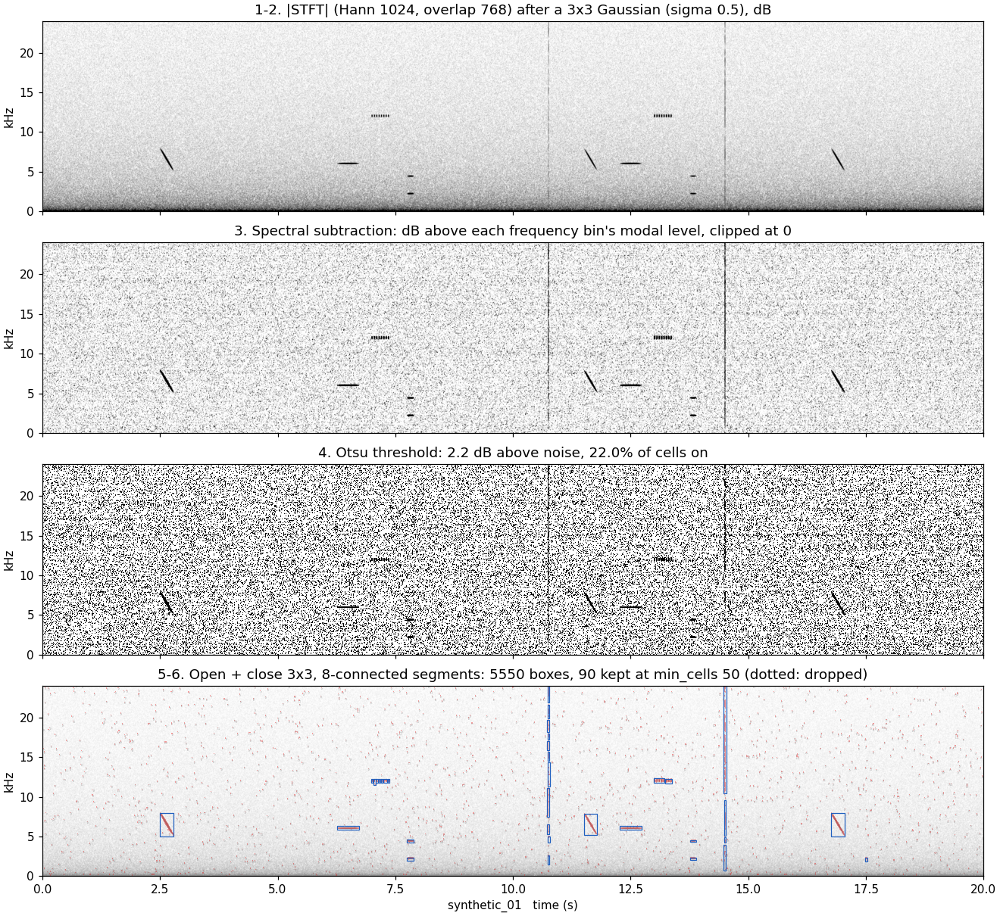
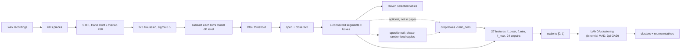
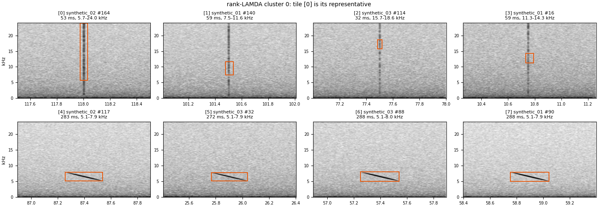

# biodetect: Guerrero et al. (2023) segmentation and LAMDA clustering

*Part of [Natgeo Biodiversity Detection](README.md). This page documents the `biodetect` package under `src/`.*

[](https://github.com/jeeven0099/Natgeo-Biodiversity-Detection/actions/workflows/ci.yml)

`biodetect` is a Python implementation of the unsupervised sound-detection pipeline of
**Guerrero et al. (2023)**, *Acoustic animal identification using unsupervised learning*
(Methods in Ecology and Evolution 14:1500–1514). It takes long passive-acoustic recordings and
returns:

1. **Bounding boxes** (time × frequency) around every acoustic event, found by spectral noise
   subtraction, an Otsu threshold and morphological cleaning. No labels or training are needed.
2. **Clusters** of those boxes from 27 spectral features and the LAMDA fuzzy clustering
   algorithm, so a person can label a few representatives instead of thousands of boxes.

The package also has a label-free way to choose a minimum box size (a *speckle cutoff*) and two
Jupyter viewers, one for browsing boxes and one for listening to clusters. It was built in a
National Geographic × NUS capstone project to survey animal sounds in field recordings.



*The pipeline on 20 s of a synthetic recording (`examples/synthetic_demo.py`). Every box that
survives the size cutoff is drawn solid blue. The thin full-height boxes at 10.8 s and 14.5 s are
synthetic broadband clicks.*

---

## Contents

- [Pipeline](#pipeline)
- [Install](#install)
- [Quick start](#quick-start-synthetic-data-no-downloads)
- [Use on your own recordings](#use-on-your-own-recordings)
- [Outputs](#outputs)
- [Paper settings and our assumptions](#paper-settings-and-our-assumptions)
- [Choosing the speckle cutoff without labels](#choosing-the-speckle-cutoff-without-labels)
- [Results](#results)
- [Limitations](#limitations)
- [Tests and CI](#tests-and-ci)
- [Repository layout](#repository-layout)
- [References](#references)

## Pipeline



| Stage | Module | CLI |
|---|---|---|
| Noise reduction, Otsu, morphology, boxes | [`segmentation.py`](src/biodetect/segmentation.py) | `biodetect segment` |
| Label-free size cutoff | [`speckle_null.py`](src/biodetect/speckle_null.py) | `biodetect speckle-null` |
| 27 features per box | [`features.py`](src/biodetect/features.py) | `biodetect cluster` |
| LAMDA (numba port of `LAMDA_General.m`) | [`lamda.py`](src/biodetect/lamda.py) | `biodetect cluster` |
| Features + LAMDA over a run, diagnostics | [`clustering.py`](src/biodetect/clustering.py) | `biodetect cluster` |
| Four-panel figure of one piece | [`figure.py`](src/biodetect/figure.py) | `biodetect figure` |
| Synthetic soundscapes with known events | [`synthetic.py`](src/biodetect/synthetic.py) | `biodetect demo-data` |
| Box browser and cluster gallery (Jupyter) | [`viewer/`](src/biodetect/viewer) | `notebooks/` |

## Install

You need Python 3.10 or newer. `soundfile` needs the system library `libsndfile`, which the
pip wheels already include on Windows and macOS.

```bash
git clone https://github.com/jeeven0099/Natgeo-Biodiversity-Detection.git
cd Natgeo-Biodiversity-Detection
python -m venv .venv && source .venv/bin/activate     # Windows: .venv\Scripts\activate
pip install -e ".[viewer,dev]"                          # viewer = Jupyter widgets, dev = pytest + ruff
```

The core install needs only `numpy`, `scipy`, `pandas`, `soundfile`, `numba`, `scikit-learn`
and `matplotlib`. No GPU and no model weights are needed.

## Quick start (synthetic data, no downloads)

```bash
python examples/synthetic_demo.py
```

The script takes a few minutes on a laptop. It does the following:

1. Writes three 120 s synthetic recordings. They hold 180 events of five kinds (whistle, chirp,
   downslur, pulse train, click) over pink noise and wind.
2. Segments them, runs the speckle null, and segments again with `min_cells = 50`.
3. Clusters the boxes with both scalings.
4. Prints how many synthetic events overlap a box, and redraws the two figures in
   `docs/figures/`.

All of its output goes to `results/demo/`, which git ignores.

You can then open the viewers on the demo output:

```bash
jupyter lab notebooks/01_box_viewer.ipynb        # browse windows, play boxes
jupyter lab notebooks/02_cluster_gallery.ipynb   # tiles + audio per cluster, name clusters
```

## Use on your own recordings

```bash
# 1. boxes exactly as in the paper (every segment kept)
biodetect segment path/to/recordings --out results/boxes --workers 8

# 2. optional: how many of the small boxes would pure noise produce?
biodetect speckle-null results/boxes --pieces 60 --workers 8

# 3. boxes again, dropping segments smaller than the chosen cutoff (NOT in the paper)
biodetect segment path/to/recordings --min-cells 50 --out results/boxes_min50 --workers 8

# 4. features + LAMDA; the paper's min-max scaling, then the rank variant
biodetect cluster results/boxes_min50 --workers 8
biodetect cluster results/boxes_min50 --scaling rank --skip-features

# 5. a four-panel figure of any piece
biodetect figure path/to/recordings/site_A.wav --start 120 --min-cells 50 --view 130 150
```

`biodetect <command> --help` lists every option. `python -m biodetect` works as well.
Inputs are `.wav` files or folders, and folders are searched recursively. Recording names must
be unique, because a box is identified by its file stem. Long files are processed as 60 s
pieces (`--chunk-s`), which matches the 1-minute recordings of the paper. Each piece gets its
own noise profile and threshold.

## Outputs

**`biodetect segment`** writes these files to the run folder:

| File | Content |
|---|---|
| `boxes.csv.gz` | one row per box: `file, selection, begin_s, end_s, low_hz, high_hz, n_cells, mean_db` (dB above the bin's modal noise) |
| `raven_tables/<file>.Guerrero.Table.1.selections.txt` | the same boxes as a Raven Pro selection table, one per recording |
| `per_piece.csv` | Otsu level (dB above noise), share of cells on, segments found and kept per 60 s piece |
| `files.csv`, `run_info.json` | input paths and every setting used |

**`biodetect speckle-null`** writes `speckle_null/cutoff_table.csv`: the real and noise box
counts per piece at each cutoff, and the estimated noise share. See
[below](#choosing-the-speckle-cutoff-without-labels).

**`biodetect cluster`** writes to `<run>/lamda/`, or to `lamda/rank/` for the rank scaling:

| File | Content |
|---|---|
| `features.csv.gz` | the 27 features of every box (shared by all scalings) |
| `boxes_clustered.csv.gz` | every box with its `cluster`, its `gad` (membership) and its band and duration bins |
| `representatives.csv` | the highest-GAD box of each cluster: the element the paper's expert labels |
| `prototypes.csv` | the LAMDA prototype of each cluster |
| `run_info.json` | cluster counts, plus AMI/ARI of the clusters against recording, frequency band and duration |

## Paper settings and our assumptions

The paper was implemented in MATLAB R2022a and leaves several numbers unstated. Each gap is
filled with the MATLAB default that its wording implies, or with co-author Bedoya's published
MATLAB code. Every gap is listed here and in the docstring of the module concerned.

| Step | Paper | Here |
|---|---|---|
| Spectrogram | magnitude STFT | `hann(1024)`, overlap 768, nfft 1024, from Bedoya's `Noise_Reduction_Example_GH.m` |
| Smoothing | 3×3 Gaussian | σ = 0.5, `imgaussfilt`'s default and the only σ that gives a 3×3 kernel; replicate padding |
| Noise reduction | spectral subtraction (Xie et al. 2017) | each frequency bin's modal dB level (100-bin histogram, 3-bin smoothing) subtracted, negatives set to 0 |
| Threshold | Otsu | `graythresh(mat2gray(S'))`, 256 levels; checked against brute force in the tests |
| Morphology | opening and closing | 3×3 square for both (size not stated) |
| Segments | connected segments, all bands | 8-connected (`bwconncomp` default), bounding box per segment |
| Unit | 1-min recordings | 60 s pieces, each with its own noise profile and threshold |
| Features | f_peak, f_min, f_max + 24 cepstral coefficients (eqs. 1–2) | eq. 2 as printed; one frame per box (w not stated); \|H\|² from 10^(S'/20) |
| Scaling | to [0, 1] | min-max over the run (**paper**), or rank/percentile (**variant**, `--scaling rank`) |
| Clustering | LAMDA, binomial MAD, 3π connective | line-by-line port of `LAMDA_General.m`, NIC 0.5, 10 passes |
| Size cutoff | none | `--min-cells` (**variant**, default 0 = paper) |

## Choosing the speckle cutoff without labels

The paper keeps every connected segment, and on field recordings most of them are *speckle*:
a few noise cells just above the Otsu level that survive the 3×3 opening. On our validation
recordings, the paper's settings gave 2,254,716 raw boxes.

`speckle-null` chooses a cutoff without labels:

1. Take a random sample of 60 s pieces and **phase-randomise** each one. Each copy keeps the
   piece's long-term power spectrum but has no calls and no temporal structure.
2. Segment every copy, once with its own Otsu threshold (`paper`) and once with the real
   piece's threshold (`same_thr`).
3. At each cutoff N, the ratio (noise boxes ≥ N per piece) / (real boxes ≥ N per piece)
   estimates what share of the surviving real boxes noise alone would produce.

Pick the smallest N where that share is small enough for your use.

## Results

### Field recordings (validation split, not distributed)

These numbers come from the capstone's validation recordings. The audio cannot be shared, so
only aggregate numbers are given.

| | |
|---|---|
| Raw boxes (paper settings) | 2,254,716 |
| Noise boxes with ≤ 48 cells | 99.9% |
| Estimated noise share at `min_cells = 50` | 1.3% (`paper`) / 0.4% (`same_thr`) |
| Boxes kept at `min_cells = 50` | 179,380 (8.0%); median box 91 ms × 656 Hz |
| LAMDA, min-max (paper) | 6 clusters; AMI with frequency band 0.61, with recording 0.06, with duration 0.06 |
| LAMDA, min-max, shuffled input order | 7 clusters; AMI with the original-order partition 0.56–0.60 |
| LAMDA, rank scaling (variant) | 211 clusters; AMI with frequency band 0.17 |

What these numbers mean:

- **The cutoff works as intended.** Almost all pure-noise boxes are smaller than 50 cells. The
  boxes that survive look like calls in the viewer, apart from rain-drop clicks, which are real
  broadband transients.
- **Min-max LAMDA groups by frequency band.** After min-max scaling, the 24 cepstral features
  vary little from box to box, so the three frequency features decide the memberships and
  LAMDA opens only 6 clusters. Those clusters follow the frequency band of the box (AMI 0.61).
  Rank scaling spreads every feature over [0, 1] and gives 211 finer clusters. Both are useful for organising boxes, but
  neither is a species label.

### Synthetic demo (`examples/synthetic_demo.py`)

There are 180 events in 3 × 120 s with known times and bands. This checks the implementation;
it does not measure performance on real soundscapes.

| | |
|---|---|
| Boxes (paper settings) | 32,251 |
| Boxes at `min_cells = 50` | 506 |
| Events overlapping a box, all five kinds | 100% with all boxes and 100% at `min_cells = 50` |
| LAMDA min-max | 3 clusters (AMI with band 0.32, with recording ≈ 0) |
| LAMDA rank | 16 clusters (AMI with band 0.26, with duration 0.17, with recording ≈ 0) |



*The cluster gallery for one rank-LAMDA cluster in the demo. Tile [0] is the representative
(the highest-GAD box). The cluster mixes broadband clicks with downslurs, which is the kind of
coarse grouping described under [Limitations](#limitations).*

## Limitations

- **Steady sounds are subtracted as background.** The noise level of each frequency bin is its
  *modal* level over the 60 s piece. A sound that holds a steady level for most of the piece,
  such as a constant insect chorus or a hum, becomes the mode and is removed. Only sounds that
  change level in time are boxed. The test suite uses an enveloped tone for this reason.
- **The speckle null is conservative on dense, loud scenes.** Phase randomisation keeps each
  piece's long-term spectrum, so loud events become band-limited noise in the copies. In the
  synthetic demo there is an event every 2 s on average, 12–24 dB above the background. There
  the null produces more large boxes than the real pieces do: the noise share is 1.23 at 50
  cells and only falls to 0.05 at 300 cells. With half as many events, the share at 50 cells
  was 2.07 at 12–24 dB, 1.04 at 0–12 dB and 0.27 at −12–0 dB, so it tracks how loud the events
  are. On the field recordings, where calls are sparser, it was 1.3% at 50 cells. Read the table as an upper bound, and check it in the box
  viewer.
- **LAMDA depends on input order.** Clusters open one datum at a time, and the paper does not
  give an order. `--shuffle-seed` reruns with a random order so you can measure the effect
  (AMI 0.56–0.60 between orders on the field data).
- **Clusters are not species.** The clusters follow frequency band more than anything else, so
  a cluster can mix several call types, and one call type can span several clusters. The
  paper's workflow assumes an expert labels each cluster's representative. The gallery shows
  random members beside the representative so that this assumption can be checked.
- **Classifying the clusters is out of scope.** The capstone also labelled clusters with a
  pretrained bird classifier (Perch 2.0, through `bacpipe`). That step needs large
  model weights and a GPU setup, and it is not part of this package.
- **No evaluation against human annotations is included.** The demo checks the implementation
  on synthetic events. Results on field data are reported as label-free diagnostics only.

## Tests and CI

```bash
pytest -q          # 32 tests, about a minute
ruff check .
```

The tests run on synthetic audio and need no data. They check:

- the 3×3 Gaussian against MATLAB's `fspecial('gaussian', 3, 0.5)`;
- the Otsu threshold against a brute-force search;
- that every synthetic event is boxed, and that box edges stay inside the spectrogram;
- that white noise gives almost only boxes under 50 cells;
- that the feature extractor recovers each segment's exact cell range from its box;
- the cepstra against an explicit loop of eq. 2;
- LAMDA on a single datum, on three separated blobs, and for determinism;
- phase randomisation and the cutoff table;
- the CLI end to end, and the viewer functions without widgets.

GitHub Actions ([`ci.yml`](.github/workflows/ci.yml)) runs ruff and pytest on Python 3.10,
3.11 and 3.12.

## Repository layout

```
src/biodetect/
    segmentation.py   steps 1-6 of the paper, Raven tables, parallel runner
    speckle_null.py   phase-randomised noise null for --min-cells
    features.py       27 features per box (eqs. 1-2)
    lamda.py          LAMDA (numba) and the two scalings
    clustering.py     features + LAMDA over a run, AMI/ARI diagnostics
    figure.py         four-panel segmentation figure
    synthetic.py      synthetic soundscapes with ground-truth events
    cli.py            `biodetect` command line
    viewer/           BoxViewer and ClusterGallery (ipywidgets)
examples/synthetic_demo.py
notebooks/            01_box_viewer, 02_cluster_gallery
tests/
docs/figures/
```

## References

- Guerrero, M. J., Bedoya, C. L., López, J. D., Daza, J. M., & Isaza, C. (2023). Acoustic
  animal identification using unsupervised learning. *Methods in Ecology and Evolution*, 14,
  1500–1514.
- Bedoya, C. L. `LAMDA_General.m` and `Noise_Reduction_Example_GH.m`, the MATLAB code that the
  LAMDA port and the STFT settings follow.
- Xie et al. (2017), the spectral-subtraction method that Guerrero et al. cite, built on the
  QUT/Towsey noise removal.
- Otsu, N. (1979). A threshold selection method from gray-level histograms. *IEEE Transactions
  on Systems, Man, and Cybernetics*, 9(1), 62–66.

## License

No license has been chosen yet, so all rights are reserved by the author. Please ask before
reusing the code.
