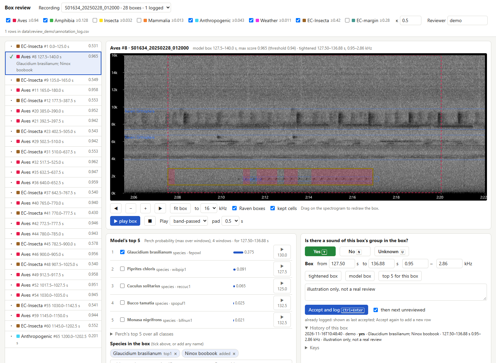
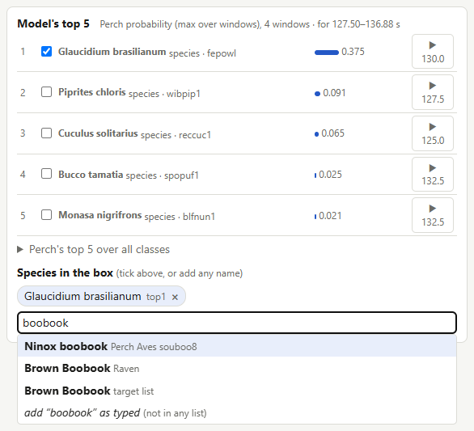

# Natgeo Biodiversity Detection

[](https://github.com/jeeven0099/Natgeo-Biodiversity-Detection/actions/workflows/ci.yml)

Detecting animal species by sound in a single Singapore study area, to assess the biodiversity
there. It was built in a National Geographic × NUS capstone project. The corpus is one recorder
(S01634) over 7 days: 134 long-form recordings, plus 4,684 labelled clips filed one folder per
class.

The repository has two parts:

| Part | Where | What it does |
|---|---|---|
| **Perch 2.0 zero-shot survey** (this page) | `scripts/`, `config/`, `notebooks/perch_zeroshot_viewer.ipynb` | Scores every 5 s window of the long recordings for birds, frogs, insects, mammals and human sounds with Perch 2.0 and EarthChirp. Turns the scores into time-frequency boxes. Lets a person review each box in a local web app. |
| **`biodetect` package** ([BIODETECT.md](BIODETECT.md)) | `src/biodetect/`, `tests/`, `examples/`, `notebooks/0*_*.ipynb` | A label-free implementation of Guerrero et al. (2023): Otsu boxes and LAMDA clustering. It is pip-installable and tested in CI. |

The pipeline caches Perch 2.0 embeddings and logits once, then scores against our own labels.
Everything after extraction needs only numpy and scikit-learn, so the expensive stage runs once and
analysis iterates cheaply.

### The review platform at a glance



*`scripts/review_app.py` on one Aves box. Left: every zero-shot box in the recording; ✓ marks a
logged box. Centre: the spectrogram, with Raven boxes (blue dashed), the cells Perch used (shaded)
and the accepted box (yellow). Below it: Perch's top 5 inside the box's group, the species
chosen, and the Yes / No / Unknown decision with the box's history. The entries shown are an
illustration, not a review: Perch's top 5 here are Neotropical species, which is the reason a
reviewer can add any species by hand. See [Review platform](#review-platform-yes--no--unknown-with-a-top-5-species-list).*

## Contents

- [Stages](#stages)
- [Window-level zero-shot on the long-form recordings](#window-level-zero-shot-on-the-long-form-recordings)
- [Viewer: where Perch hears each group](#viewer-where-perch-hears-each-group)
- [Insecta: EarthChirp vs Perch zero-shot](#insecta-earthchirp-vs-perch-zero-shot)
- [Hybrid on the long-form recordings](#hybrid-on-the-long-form-recordings-earthchirp-for-insects-perch-for-the-rest)
- [Tightened boxes](#tightened-boxes-where-in-time-and-frequency-each-zero-shot-box-is)
- [Review platform](#review-platform-yes--no--unknown-with-a-top-5-species-list)
- [Why the class index exists](#why-the-class-index-exists)
- [GPU setup (Windows)](#gpu-setup-windows)
- [Known caveats](#known-caveats)
- [Repository layout](#repository-layout)

## Stages

| # | Command | Output | Cost |
|---|---------|--------|------|
| 1 | `python scripts/build_manifest.py` | `data/manifest.csv` — one row per clip, audio referenced in place | seconds |
| 2 | `python scripts/make_splits.py` | `data/splits.csv` — session-level train/val/test | seconds |
| 3 | `python scripts/build_taxonomy_map.py --assets <model assets>` | `config/perch_class_index.csv`, `config/perch_genus_taxonomy.csv` | ~5 min, **needs network**, already committed |
| 4 | `python scripts/extract_perch.py --model-name perch_v2_onnx --device cuda` | `data/perch/` — embeddings, target logits, top-K | ~22 min on GPU, 3.4 h on CPU |
| 5 | `python scripts/score_zeroshot.py` | per-class AP / AUC / F1 | seconds |

Stage 3's outputs are committed, so a fresh clone starts at stage 4 offline.

## Window-level zero-shot on the long-form recordings

`scripts/zeroshot_windows.py` is separate from stages 1-5: it runs Perch over the
134 annotated 20-min recordings in `dataset/` as 5 s windows starting every 2.5 s
(~64k windows, ~20-25 min on the GPU), and scores which groups Perch hears against
the Raven boxes in `dataset/annotaions/`.

The scoring unit is the 2.5 s **segment**. Each segment lies inside two
half-overlapping windows, and its score is the max of the two, so a call cut by
one window's edge is still credited by the other, and every stretch of audio is
scored once. `--hop 5` gives plain back-to-back 5 s windows instead.

```
.venv-perch/Scripts/python -X utf8 scripts/zeroshot_windows.py                 # extract + score
.venv-perch/Scripts/python -X utf8 scripts/zeroshot_windows.py --score-only    # rescore the cache
.venv-perch/Scripts/python -X utf8 scripts/zeroshot_windows.py --score-only --score maxlogit
```

- **Groups.** Aves, Amphibia, Insecta, Mammalia, Anthropogenic are the targets;
  Weather is scored and reported apart; Unknown is never scored. Labels ending in
  `?` count for their group. The script stops if any label is unmapped or if the
  box counts differ from 2907 / 39 / 1900 / 6 / 342 / 14 / 47.
- **Truth.** A group is present in a segment if one of its boxes covers >= 0.5 s
  of it (or all of a shorter box). A box that only grazes the segment, or an
  Unknown box, makes the cell *ignored*, not negative. Truth is built at scoring
  time from `window_scores.csv` (the Perch cache), so `--score-only` can change it
  without rerunning Perch.
- **Perch score.** Perch 2.0 is trained with softmax cross-entropy, so a group's
  score is the summed softmax probability of its classes (every species of the
  taxonomic class plus the matching FSD50K events). Max logit is kept as an
  alternative (`--score maxlogit`).
- **Operating points.** *fixed*: summed probability >= 0.5, no labels used.
  *lodo*: the F1-best threshold on the other recording days, applied to the
  held-out day, so no segment is scored by a threshold fitted on it. AP and
  ROC-AUC are threshold-free. F1 and the other rates carry 95% bootstrap CIs over
  recordings. `Acc0` is the accuracy of always saying "absent".
- **Recall view** (`metrics_recall.csv`, printed last). Precision is unreliable
  because unannotated audio is not proven empty, so recall is also measured with
  thresholds that never look at labels: the fixed rule, and "flag the top 5 / 10 /
  20 / 50 % of all segments by the group score". *Segment recall* = positive
  segments flagged; *box recall* = Raven boxes with at least one flagged segment
  they overlap. Recall grows with how much is flagged, so each value is read
  against two nulls that keep the number and clustering of flags and move only
  their position: *null any* (flags of a random recording, rotated) and *null
  within* (the recording's own flags, rotated; tests timing inside a recording).
  `p` = share of 200 null draws with recall >= observed.
- **Model.** The local `perch_v2_no_dft.onnx` on CUDA **with TF32 off**. With
  onnxruntime's default TF32, logits drift up to 3.09 from the TF SavedModel
  (top-1 still agrees); with it off, 0.0003.

Checks run:

| check | result |
|---|---|
| ONNX (CUDA, TF32 off) vs TF SavedModel `perch_v2_cpu`, 16 real windows | logit max\|diff\| 0.00028; with TF32 on 3.09, on CPU 0.00028 |
| ONNX label order vs `config/perch_class_index.csv` and the SavedModel's `labels.csv` | identical, 14,795 |
| annotation labels -> groups | 0 unmapped; counts equal the grouping table |
| CUDA vs CPU at batch sizes 1, 2, 3, 5, 8, 15, 16 | logit max\|diff\| <= 0.00012; the `cudnn_frontend ... No execution plans` errors at batch 1-2 are a harmless fallback |
| `--hop 5` segments vs the first per-window code (smoke cache, 481 windows) | truth and scores identical |
| 2.5 s windows vs the resampled audio | window k = samples [80000k, 80000k+160000); 1199.9 s -> 480 windows; last window = tail + zeros |
| segment score = max of its covering windows (hand-made scores) | [.1,.9,.2,.3,.8,.05] -> [.1,.9,.9,.3,.8,.8] |
| segment truth vs hand computation, isolated Frog / Aircraft / Helicopter boxes | 5 boxes identical, grazing segments -1 |
| smoke run, 2 recordings at 2.5 s | 961 windows -> 961 segments, metrics written; lodo falls back to the fixed rule when only one day is present |
| recall view: box -> overlapped segment range vs brute force, all 5,208 non-Unknown boxes | 0 differ (after clipping 8 Insecta boxes that start at about -510 s; 5 zero-length boxes take the segment they sit in) |
| recall view: null draws | *within* = a rotation of each recording's own rows; *any* = one whole source recording per recording, each used once (20 draws) |
| recall view: hand cases | flags = truth -> segment recall 1; all flagged -> (1, 1); none -> (0, 0); one flag hits exactly the boxes spanning it |
| recall view: nulls on iid random 10% flags (Aves) | segment recall 0.101 vs null 0.099 / 0.098; box recall 0.278 vs 0.283 / 0.281 (random flags already "find" 28% of boxes) |
| recall view: budgets | top 5/10/20/50% flag that share of segments, +-0.2 pt |

Caveat: the Raven tables are correct but not complete, so an unannotated window is
not proven empty. Every FP count includes some unlabelled real calls; precision
and accuracy are lower bounds.

Add `--dry-run` to stage 4 to resolve targets and stop before inference.

## Viewer: where Perch hears each group

`scripts/perch_viewer.py` + `notebooks/perch_zeroshot_viewer.ipynb`. The viewer is
read-only. It uses `data/perch_windows/segment_scores.csv`, the Raven tables and the wavs.

- **One page = one minute** of one recording: a 0–24 kHz spectrogram plus a score track.
- **Perch boxes** are runs of consecutive 2.5 s segments whose summed probability
  passes the group threshold. Perch outputs no frequency, so each box spans the band
  Perch hears (60 Hz–16 kHz).
- **Raven boxes** are drawn at their real time and frequency. A radio button shows
  or hides them, and another does the same for the Perch boxes.
- **Thresholds**: all of them are editable in the GUI.
  - Confirmed by listening in this viewer on 2026-11-14: Aves 0.94 (flags 14% of
    the audio), Anthropogenic 0.043 (10%) and Insecta 0.032 (79%). The recall
    analysis had given Aves 0.916 and Insecta 0.040.
  - Confirmed by listening on 2026-11-15, with the hybrid lanes on: Amphibia 0.128 (8%)
    and EC-Insecta 0.42 (74%), with Aves 0.94 and Anthropogenic 0.043 again.
  - From the recall analysis only: Weather 0.011, Mammalia 0.013.
  - Only Mammalia is off by default, because it can't be tested (only 1 recording
    has mammals).
  - With `earthchirp_segments.csv` present, the EarthChirp insect lanes are added
    and the defaults become the hybrid. See "Hybrid on the long-form recordings" below.
- **Navigation:**
  - An **audio file dropdown** lists all 155 wavs, each with its start date and time,
    length and Raven box count.
  - The 21 wavs without a Raven table were never scored by `zeroshot_windows.py`. They
    show the spectrogram only, labelled "no Perch scores".
  - Minute steppers, and "find next/previous Perch box of <group>" across files.
  - A play button loads the minute's audio.
- **Listening to Perch boxes:** a list under the plot has one row per Perch box on
  the minute, numbered like the `#n` labels on the spectrogram. Clicking a row plays
  that box plus `pad` seconds (0.5 s by default) on each side. A box that runs past
  the minute is still played in full, up to 30 s (`MAX_CLIP_S`). Clips are
  peak-normalised for listening.
- **Tightened boxes:** once `data/perch_windows/cell_maps.npy` exists, each box can also
  be drawn shrunk to the 16 × 4 cells that carry its score. The rows give 4 frequency
  bands. You choose the box extent (both / tightened / full band) and set κ. The
  player can also play a box filtered to its tightened rows or its kept cells. See
  "Tightened boxes" below.

The notebook is saved already executed, with widget state. Its kernel is
`perch-venv`, which `.venv-perch` registers once:

```
.\.venv-perch\Scripts\python.exe -m ipykernel install --user --name perch-venv --display-name "Python (.venv-perch)"
.\.venv-perch\Scripts\python.exe -m jupyter lab notebooks\perch_zeroshot_viewer.ipynb
```

In VS Code, open the notebook, pick the kernel "Python (.venv-perch)" and choose Run All.

| Check | Result |
|---|---|
| Raven reading vs `zeroshot_windows.read_boxes` | 5,255 boxes; groups and times identical; frequencies 0.00–23.93 kHz |
| box merging, hand case `[.95,.95,.1,.92,.1,.1,.97,.99]` at 0.916 | `(0,5)`, `(7.5,10)`, `(15,20)` with max prob and segment counts as expected |
| real scores, every recording and group | box time = flagged segments × 2.5 s; boxes never touch. Boxes: Aves 3,370, Amphibia 531, Insecta 4,295, Mammalia 3,707, Anthropogenic 985, Weather 703 |
| spectrogram of a 3 kHz tone, 60 s at 48 kHz | peak at 3.000 kHz; 513 × 5,624 bins; axis to 24 kHz |
| pages | minute 1 = 60.0 s. A 1,200.04 s file gives 20 pages (a tail < 3 s gets no page). Across 155 recordings: 153 × 20 pages, `S01634_20250312_105744` (135 s) → 3, `S01634_20250228_150000` (0.08 s) → 1 |
| rendered pages, viewed by eye | `S01634_20250314_172000` min 1 (5 Perch / 4 Raven boxes); `S01634_20250301_132000` min 1 (7 / 1) |
| audio file dropdown | 155 entries = every wav (21 marked unscored). An unscored 20-min file gives 20 pages and 0 Perch boxes; the 135 s file gives 3 pages; its tail page renders. Next rec, then find Aves, lands on `S01634_20250312_120000` min 7 at Aves 0.916 and min 8 at 0.94. Each step redraws in about 3 s |
| Perch-box player, `S01634_20250314_172000` min 1 | 5 rows = 5 page boxes, in time order and numbered like the plot labels. Refilling the list plays nothing. Each clip equals the wav samples of [begin − pad, end + pad], clipped at 0 s and capped at 30 s. Example: #5 Anthropogenic 57.5–87.5 s plays 57.0–87.0 s |
| Perch-box player, long box and empty cases | a 72 s Aves box (`S01634_20250228_064000`, 97.5–170 s) plays 95.5–125.5 s. With no group ticked, and on an unscored file, the list is empty |
| built in place (nbclient, kernel `perch-venv`, widget state stored) | all cells run with no error |
| notebook executed headless (nbclient, `.venv-perch`) | all cells run in 72 s; one redraw 1.4 s. Find next/prev (and the auto-tick of the found group), recording/minute steps, clamp at the last page, radio toggles, threshold edit/reset and play all run without error (the audio widget stays empty headless; it fills in a live frontend) |

## Insecta: EarthChirp vs Perch zero-shot

`scripts/insecta_compare.py` asks one question: on the labelled clips, does
[EarthChirp](https://github.com/foundfold/earthchirp) (Melnick 2026) tell insect windows from
non-insect windows better than Perch's own Insecta score? Both methods read **the same**
Perch 2.0 forward pass of the same 5 s windows (the 35,424 windows of `data/perch/windows.csv`).

- **Perch.** The summed softmax probability of the 2,045 Insecta classes (every Insecta species,
  plus FSD50K `Insect` and `Cricket`). This is the `zeroshot_windows.py` group score, and 0.032 is
  the listening-confirmed threshold.
- **EarthChirp.** The max cosine between the 1536-d embedding and the library's insect
  prototypes: 2,012 species, 619 genera, and the Orthoptera and Cicadidae groups (Zenodo
  [10.5281/zenodo.20697426](https://doi.org/10.5281/zenodo.20697426) → `external/earthchirp_lib/`).
  This is how `recognise.py` computes it.
  - Its two label-free operating points come from the paper, and both are built on
    [ESC-50](https://github.com/karoldvl/ESC-50) (`external/esc50/`), never on our labels.
  - *tau*: the 95th percentile of the cosine on ESC-50's mechanical clips.
  - *outgroup*: the window counts as insect only if its nearest prototype is an insect, not the
    ESC-50 "urban" or "geophony" prototype. Each of those is the mean of a random half of that
    tier.
  - `ec_margin` (insect cosine minus outgroup cosine) is the paper's continuous score with the
    outgroup.
- **Truth.** A window is positive when its clip's coarse label is insect. Negatives are split
  into bird, anthropogenic and amphibian. Geophony (19 windows) and mammal (10 windows) count
  only in "all".
  - A bird or aircraft clip from this forest often has insects behind it, so an insect flag on a
    negative is not surely wrong.
  - Both methods face the same noisy negatives, so the comparison is relative.
- **Metrics.**
  - AUROC and AP per window and per clip (a clip scores the max over its windows), with 95% CIs
    from resampling the 108 sessions.
  - The paired EarthChirp − Perch AUROC difference on the same draws.
  - The share flagged per label at each operating point, plus EarthChirp cut at the share of
    windows that Perch flags at 0.032.

```
.venv-perch\Scripts\python.exe -X utf8 scripts\insecta_compare.py                         # all stages (GPU)
.venv-perch\Scripts\python.exe -X utf8 scripts\insecta_compare.py --stage esc50 --device cpu
.venv-perch\Scripts\python.exe -X utf8 scripts\insecta_compare.py --stage score
```

The stages are cached in `data/insecta_compare/`: `esc50` (2,000 clips, about 9 min on CPU),
`clips` (35,424 windows, about 20 min on GPU, 2.6 h on CPU) and `score` (seconds). The clips stage
reads each clip straight from its `Labelled Data-*.zip`, because the clips are not unpacked.

| Check | Result |
|---|---|
| zip reader vs `extract_perch.load_audio_windows` on the same clip extracted to disk | identical windows and start times on 9 clips (one per zip, plus the longest at 241 windows and the shortest) |
| rebuilt windows vs `data/perch/windows.csv` | every clip's window count must be equal, and its starts within 0.0051 s (asserted per clip). The csv rounds to 0.01 s with Python `round`. An exact `np.round` comparison stopped the first GPU run at `Brown Boobook/S01634_20250315_052000_sel11`, whose true start 6.985 s is stored as 6.99 |
| smoke run, first 20 clips on CPU (420 windows) | embeddings vs `data/perch/embeddings.npy`: max\|diff\| 0.0005, min cosine 1.00000. Group probabilities sum to 1 (6e-15). The Insecta max logit equals the cached `unspecified_insect` to 0.005 |
| exact Perch Insecta probability vs the top-20 approximation (same 420 windows) | Spearman 0.92 (medians 0.054 vs 0.042). The top-20 approximation is a rough preview only |
| our insect cosine and outgroup rule vs EarthChirp's own `recognise_batch` (cloned repo, same outgroup), 3,000 clip windows + 2,000 ESC-50 clips | non-insect decisions identical (1,571 rejected); insect cosine max\|diff\| 1.5e-07 |
| ESC-50 outgroup and tau | urban = mean of 660 of 1,320 mechanical clips, geophony = mean of 100 of 200. tau 0.524 leaves exactly 5.0% of mechanical clips above it |
| `boot_auc`, hand case | a perfect score vs a reversed one gives AUROC 1 / 0 and a paired difference of −1 on every draw |
| full clip stage (GPU), 35,424 windows | embeddings vs `data/perch/embeddings.npy`: max\|diff\| 0.0010, min cosine 1.00000 |
| ESC-50 reproduction (our ONNX Perch + scorer) vs the paper | insect vs vertebrate AUROC 0.952 (paper 0.95). Insect vs mechanical: 0.748 without the outgroup (paper 0.74), 0.927 with the margin on held-out clips (paper 0.93). Positive controls above tau: 41%; kept by the outgroup rule: 84% |

Results (2026-11-15, `metrics_auc.csv`, `metrics_operating.csv`). AUROC is given with its 95%
session-bootstrap CI; *d* is the paired difference from Perch's probability.

| Window vs | Perch prob | Perch max logit | EarthChirp cos | EarthChirp margin |
|---|---|---|---|---|
| all (11,855 neg) | 0.612 [0.568, 0.656] | 0.491 | **0.754** (d +0.14 [+0.09, +0.20]) | **0.800** (d +0.19 [+0.14, +0.25]) |
| bird (7,730) | 0.658 | 0.509 | **0.852** (d +0.19 [+0.13, +0.26]) | 0.790 (d +0.13) |
| anthropogenic (3,630) | 0.534 | 0.490 | 0.603 (d +0.07 [+0.03, +0.11]) | **0.864** (d +0.33 [+0.29, +0.37]) |
| amphibian (466, 12 sessions) | 0.457 | 0.190 | 0.311 (d −0.15 [−0.22, +0.13]) | 0.464 (d +0.01 [−0.04, +0.13]) |

- **EarthChirp beats Perch on insect vs non-insect.** The CIs exclude 0 against all negatives,
  against birds and against anthropogenic sound.
  - EarthChirp's cosine separates insects from birds best.
  - The outgroup margin separates insects from engines and aircraft best.
- **Frogs are no better** with either method, and the CIs are wide (12 sessions).
- **At Perch's flag rate** (68% of windows), EarthChirp finds more insect windows (83% vs 76%)
  and flags fewer bird windows (26% vs 45%) and anthropogenic windows (60% vs 68%). It flags
  slightly more frog windows (88% vs 83%).
- **Perch's summed probability beats its max logit** (+0.12, CI excludes 0), so the summed
  probability is the right Perch score.
- **Per clip** (max over windows): EarthChirp cos 0.855 vs Perch 0.658 against all negatives.
  Against anthropogenic clips only the margin helps (0.656 vs 0.475, d +0.18 [+0.07, +0.29]).
  The cosine alone ties Perch there (0.455).
- **EarthChirp's own label-free rules don't fit this site.**
  - *tau* (0.524) catches only 26% of insect windows.
  - The *outgroup* rule flags 99% of everything, because forest audio is always nearer an insect
    prototype than ESC-50 urban or geophony.
  - An operating point would have to be set by listening, as for Perch.
- The "matched" clip row applies the window-level cut (0.402) to the clip maxima. So it flags 50%
  of clips, not Perch's 86%, and is not a matched comparison per clip.

## Hybrid on the long-form recordings: EarthChirp for insects, Perch for the rest

`scripts/earthchirp_windows.py` brings EarthChirp onto the long-form recordings, and the viewer
shows the result as a **hybrid**:
- Perch's zero-shot lanes for Aves, Amphibia, Anthropogenic and Weather;
- EarthChirp in place of Perch's Insecta lane.

Each group is decided on its own, so a segment can carry several groups. Nothing is trained.

- **Why a rerun is needed.** `zeroshot_windows.py` kept only group scores, but EarthChirp needs
  the 1536-d embedding. The `extract` stage therefore runs Perch again on exactly the same 64,368
  windows (5 s, every 2.5 s, same ONNX model, TF32 off) and keeps the embeddings (float16).
- **Rebuild check.** The 6 group probabilities of every window must match `window_scores.csv`
  (the run the listening-confirmed thresholds were set on) to within 0.01. If they don't,
  nothing is written.
- **Scores.**
  - `ec_cos` and `ec_margin` per window, defined as in `insecta_compare.py` (same prototypes,
    same ESC-50 outgroup).
  - Per 2.5 s segment, the max of the two covering windows, the same rule as the Perch segments.
- **Metrics** (no labels are used anywhere else).
  - Segment AUROC of Perch Insecta / EC cos / EC margin against the Raven insect boxes. Ignored
    segments are left out, and the CIs resample the recordings.
  - Operating points:
    - Perch ≥ 0.032;
    - the two clip-matched EarthChirp cuts (cos 0.402, margin 0.280);
    - EarthChirp cut at the share of segments that Perch flags on the long-form audio.

    For each one: the flag share, segment and box recall (with CIs), the share flagged of
    segments that hold only another group's box, and the share flagged of unlabelled segments.
  - Raven labels are incomplete, so the off-label and unlabelled shares are upper bounds on false
    alarms, not error rates.
- **Viewer.** When `data/perch_windows/earthchirp_segments.csv` exists, the viewer adds two lanes:
  - **EC-Insecta** (cosine, starting at 0.402);
  - **EC-margin** (margin, starting at 0.280).

  The default lanes become the hybrid (Aves, Amphibia, EC-Insecta, Anthropogenic, Weather). Perch
  Insecta stays available, unticked. EC lanes are drawn and counted against the Raven insect
  boxes. Both EC thresholds come from the clip windows and **still have to be set by listening**.
  Without the file the viewer is unchanged, and the `_limit` smoke files are ignored.

```
.venv-perch\Scripts\python.exe -X utf8 scripts\earthchirp_windows.py                          # extract (GPU, ~20 min) + score
.venv-perch\Scripts\python.exe -X utf8 scripts\earthchirp_windows.py --stage score            # rescore only (~1 min)
.venv-perch\Scripts\python.exe -X utf8 scripts\earthchirp_windows.py --limit 2 --device cpu   # smoke run -> *_limit files
```

Outputs, all in `data/perch_windows/` (the Perch files there are never rewritten):
- `earthchirp_embeddings.npy`
- `earthchirp_rebuild_check.csv`
- `earthchirp_windows.csv`
- `earthchirp_segments.csv`
- `hybrid_insecta_auc.csv`
- `hybrid_insecta_operating.csv`

| Check | Result |
|---|---|
| smoke run, first 2 recordings on CPU (961 windows) | rebuilt windows equal the cache in count and start; group probabilities vs `window_scores.csv` max\|diff\| 5.3e-06 (limit 0.01); embeddings written as `_limit` |
| float16 storage, 2,000 float32 ESC-50 embeddings vs their float16 cast | max\|d cos\| 2.3e-05, max\|d margin\| 3.1e-05 |
| `earthchirp_windows_limit.csv` vs rescoring the stored embeddings | max\|d cos\| 3.0e-08; `ec_margin` = `ec_cos` − `ec_og` to 7.5e-08 |
| `segment_max` vs brute force (segment k = max of windows k−1, k) | equal on both recordings (to the csv round trip, 3e-08); 961 segments line up with `segment_scores.csv` |
| metrics path, the 2 smoke recordings run as a full set in a temp folder | 5 rules, 3 AUROC rows written. EC cos segment recall 0.9823 = hand count. The share-matched cut flags 0.959 vs Perch 0.961. The numbers themselves mean nothing: 960 of 961 segments hold a Raven insect box, and neither recording has an off-label-only segment, so those columns are NaN |
| viewer merge | EC lanes equal `earthchirp_segments.csv`. EC-Insecta boxes cover exactly the flagged segments (474 on `S01634_20250228_000000`). A lane without scores is skipped. A file one row short is refused. With no file there are only Perch lanes |
| notebook, executed headless on a copy without the EC file | all cells run (16 s); the per-recording table has the Perch lanes only |
| full extract (GPU), 134 recordings, 64,368 windows | group probabilities vs `window_scores.csv` max\|diff\| 1.1e-16 |

Results (2026-11-15, `hybrid_insecta_auc.csv`, `hybrid_insecta_operating.csv`):
- 63,946 scored segments: 40,204 with a Raven insect box, 23,742 without, 1,900 insect boxes.
- AUROC is per segment, with 95% recording-bootstrap CIs; *d* is the paired difference from Perch.
- In the off-label columns, the count under each heading is the number of segments with that
  group's box and no insect box.

| Insecta score | AUROC | AP | d vs Perch |
|---|---|---|---|
| Perch prob | 0.585 [0.543, 0.625] | 0.663 | |
| EC cos | 0.635 [0.586, 0.678] | 0.676 | +0.050 [+0.010, +0.089] |
| EC margin | **0.815** [0.771, 0.855] | **0.870** | **+0.230** [+0.187, +0.274] |

| Rule | Flagged | Seg recall | Box recall | Aves-only (4,767) | Amphibia-only (435) | Anthro-only (7,413) | Weather-only (1,106) | Unlabelled |
|---|---|---|---|---|---|---|---|---|
| Perch ≥ 0.032 | 0.786 | 0.837 [0.80, 0.87] | 0.937 [0.91, 0.96] | 0.334 | 0.924 | 0.672 | 0.579 | 0.852 |
| EC cos > 0.402 (clip-matched) | 0.780 | 0.883 [0.85, 0.91] | 0.919 | **0.182** | 0.943 | 0.542 | 0.306 | 0.802 |
| EC margin > 0.280 (clip-matched) | 0.716 | 0.874 [0.84, 0.91] | 0.879 | 0.315 | 0.929 | **0.208** | **0.014** | 0.662 |
| EC cos > 0.399 (Perch's share) | 0.786 | 0.888 [0.85, 0.92] | 0.923 | 0.191 | 0.943 | 0.552 | 0.315 | 0.809 |
| EC margin > 0.247 (Perch's share) | 0.786 | **0.920** [0.89, 0.94] | 0.924 | 0.472 | 0.963 | 0.292 | 0.023 | 0.776 |

- **The margin is the best insect score on the long-form audio.** Its AUROC is +0.23 over Perch
  (CI excludes 0). The cosine alone is only +0.05.
- **At Perch's flag share (78.6%)**, both EarthChirp scores find more insect segments than Perch:
  0.888 (cos) and 0.920 (margin) vs 0.837. Box recall ties (0.92 vs 0.94, CIs overlap).
- **The two EarthChirp scores reject different things**, as on the clips.
  - **The margin rejects rain and engines.** It flags only 2% of weather-only segments
    (Perch 58%) and 29% of anthropogenic-only ones (Perch 67%), because its outgroup is ESC-50's
    urban and geophony sound.
  - **The margin is worse than Perch on bird-only segments** (47% vs 33%).
  - **The cosine rejects birds:** 19% of bird-only segments, against Perch's 33%.
- **Frog-only segments are flagged 92–96% by every rule.** Frogs are read as insects, or insects
  sit behind the frogs. Nothing here separates the two.
- The clip-matched cuts land close to Perch's long-form share for the cosine (0.402 vs 0.399).
  The margin cut moves more (0.280 vs 0.247).
- Raven labels are incomplete, so the off-label and unlabelled shares are upper bounds on false
  alarms. A bird-only segment can still hold unlabelled insects.

**Listening-confirmed hybrid (2026-11-15):**

| Lane | Model | Threshold | Flags |
|---|---|---|---|
| Aves | Perch | 0.94 | 13.6% of segments |
| Amphibia | Perch | 0.128 | 8.4% |
| Anthropogenic | Perch | 0.043 | 10.0% |
| Insects (EC-Insecta) | EarthChirp cosine | 0.42 | 73.8% |

Weather (0.011, 9.4%) stays on but has not been listened to. EC-margin has not been listened to and
is off by default.

The same metrics at EC cos ≥ 0.42, measured once after the choice (not used to make it), are set
beside the clip-matched start and Perch below.

| Rule | Flagged | Seg recall | Box recall | Aves-only | Amphibia-only | Anthro-only | Weather-only | Unlabelled |
|---|---|---|---|---|---|---|---|---|
| Perch ≥ 0.032 | 0.786 | 0.837 [0.80, 0.87] | 0.937 [0.91, 0.96] | 0.334 | 0.924 | 0.672 | 0.579 | 0.852 |
| EC cos > 0.402 | 0.780 | 0.883 [0.85, 0.91] | 0.919 [0.88, 0.95] | 0.182 | 0.943 | 0.542 | 0.306 | 0.802 |
| **EC cos ≥ 0.42 (listened)** | 0.738 | 0.844 [0.80, 0.88] | 0.890 [0.85, 0.92] | 0.138 | 0.938 | 0.490 | 0.233 | 0.757 |

- At 0.42, EarthChirp flags 5 points less audio than Perch and keeps about the same segment recall
  (0.844 vs 0.837). Its box recall is lower (0.890 vs 0.937; the CIs just overlap).
- It flags far fewer bird-only (14% vs 33%), weather-only (23% vs 58%) and anthropogenic-only
  (49% vs 67%) segments.
- Frog-only segments are still flagged about 94% of the time.

## Tightened boxes: where in time and frequency each zero-shot box is

A zero-shot box is a run of 2.5 s segments drawn across Perch's whole band (60 Hz–16 kHz).
`scripts/cell_maps.py` scores the inside of every window, and the viewer uses that to shrink each box
to the cells that carry the score. Nothing is trained and no labels are used.

**Where the cells come from.**
- Perch 2.0 computes every window from a 16 × 4 grid of 1536-d cells (`spatial_embedding`):
  16 time cells of 312.5 ms × 4 frequency rows of 32 mel bins (0.06–0.95, 0.95–2.9, 2.9–7.0,
  7.0–16 kHz).
- The pooled `embedding` is exactly the mean of the 64 cells.
- `label` is a ProtoPNet head: each class has 4 unit prototypes, and
  `logit = Σ_proto w · max_cells cos(cell, prototype) + b`.

**What each cell is scored with.**
- **Perch lanes:** the same head on one cell, without the max over cells
  (`Σ_proto w · cos(cell, prototype) + b`). Then softmax over the 14,795 classes and a sum per
  group, as in `zeroshot_windows.py`.
  - The `build-head` stage reads the head weights out of the Perch ONNX.
  - It writes them as a small ONNX model (`data/perch_windows/perch_cell_head.onnx`, 347 MB), so the
    head runs on the GPU like Perch.
- **EarthChirp lanes:** the window cosine `cos(e, p*)`, with `e` the mean of the cells and `p*` the
  best prototype, splits exactly into cells: each cell scores `cell · p* / |e|`, and their mean is
  `ec_cos`. The outgroup is split the same way, and the margin is insect minus outgroup.
- **Stored output:** `cell_maps.npy`, (windows, 16, 4, 8) float16, with lanes Aves, Amphibia, Insecta,
  Mammalia, Anthropogenic, Weather, EC-Insecta and EC-margin.

**Tightening a box** (`perch_viewer.tighten`, run per box at view time):
1. Each 0.3125 s slot takes the max of the two windows covering it, the same rule a segment uses.
2. Inside the box, keep the cells at least **κ** of the way from the box's *median* cell to its
   highest cell (default κ = 0.5; set it by eye in the viewer).
3. Drop rows that hold fewer than ¼ of the kept cells of the strongest row.
4. The tightened box is the bounding box of what is left. There is one tightened box per original
   box; nothing is split.

Two choices in this rule were fixed by looking at the smoke recordings, not by labels:
- **Median floor.** With the box *minimum* as the floor, scattered background cells pass. Then 74% of
  Aves boxes stayed full band.
- **¼ row rule.** Kept cells formed one dominant row plus 1–3 stray cells in other rows, which
  stretched the box back to full band.

```
python -X utf8 scripts\cell_maps.py --stage build-head                                 # once; needs `pip install onnx`
.venv-perch\Scripts\python.exe -X utf8 scripts\cell_maps.py                           # extract (GPU, ~25 min)
.venv-perch\Scripts\python.exe -X utf8 scripts\cell_maps.py --limit 2 --device cpu    # smoke -> *_limit files
```

- **Requirements.** Extract needs `window_scores.csv` and `earthchirp_windows.csv`.
- **Checks.** These run per recording; if any fails, nothing is written and the `.partial.npy`
  is kept:
  - the group probabilities match `window_scores.csv`;
  - the head's rebuilt window logits match the ONNX `label`;
  - the mean of the EC cells matches `ec_cos` / `ec_margin`.
- **Viewer behaviour.** With `cell_maps.npy` present, the viewer adds:
  - **Box extent** (both / tightened / full band);
  - **keep cells ≥** (κ);
  - a tightened-area column;
  - the tightened span in the box list. The player plays that span.
  - **Play** (original / band-passed / cell mask), see below.

  Without the file, nothing changes. The `_limit` file is never loaded by the viewer.

**Filtered playback** (`perch_viewer.filter_clip`). This only changes what you hear; no box or score
changes.
- **band-passed:** keeps the tightened box's frequency rows over the whole clip.
- **cell mask:** keeps only the kept cells (0.3125 s × one row). Everything else is muted, padding
  included.
- **How:** both multiply an STFT (2048 points, hop 512) by a 0/1 gain. The gain is smoothed over 5 bins ×
  5 frames (~120 Hz × ~50 ms) so its edges do not click, and the result is inverted back to audio.
- **Same-row sounds stay.** It cuts time and frequency; it does not separate sources. A second bird or
  rain in the same rows is still heard.
- **Volume.** Clips are peak-normalised as before, so a filtered clip plays as loud as the original.
- **Box extent "full band".** The clicked box is tightened for playback only (at the current κ).

| Test (smoke: first 2 recordings, 961 windows, CPU) | Result |
|---|---|
| Head walk-back from `label` finds Add ← ReduceSum ← Mul(w) ← ReduceMax ← Reshape ← MatMul(P) ← Div(`spatial_embedding`), eps 1e-5 | found; P (1536, 59180), w (1, 14795, 4), b (1, 14795) |
| Group membership of the head's class → group matrix | Insecta 2,045 classes (same as `zeroshot_windows.py`), each class in exactly one group |
| Head's rebuilt window logits vs Perch ONNX `label` | max \|diff\| **0.0** |
| Group probabilities vs `window_scores.csv` | max 5.3e-06 (limit 0.01) |
| Mean of the EC cells vs `earthchirp_windows.csv` (whose embeddings are float16) | max 2.3e-05 (limit 1e-3); after float16 storage of the maps 8.3e-05 |
| Pooled `embedding` vs mean of the 64 cells | 0.0 |
| Slot grid vs brute-force max over covering windows (synthetic and real) | 0.0 |
| Tighten rule on synthetic boxes: κ 0; one hot cell; flat box; a call in row 1 plus one stray cell in row 3; a call over rows 1–2 | the whole box; that cell; the whole box; the call only (stray dropped); rows 1–2 |
| Time axis: silence the second half of 4 real windows | cells 10–15 look more like silence than cells 0–5 (cosine to a silent window 0.51 vs 0.32) |
| Frequency rows: tones 500 / 1800 / 4500 / 11000 Hz; 900 Hz low-pass; 1–2.8 kHz band-pass | 1.8 kHz → row 1; 4.5 kHz → row 2; the low-pass silences rows 2–3 most; the 1–2.8 kHz band-pass changes row 1 most. **But** 500 Hz and 11 kHz also move row 1 most: rows leak into neighbours, so frequency is soft |
| `plot_page` in every mode; κ 0 gives the original box back | renders; identical for all boxes |
| Viewer GUI with the smoke maps swapped in: box list, κ 0 / 0.8, player span, recording without maps | tightened rows listed; κ 0 = full box; the player plays the tightened span; no map → full band |

Full GPU run (2026-11-15): 134 recordings, 64,368 windows, every per-recording check passed:

| Check, max over all recordings | Result |
|---|---|
| Group probabilities vs `window_scores.csv` | 5.0e-07 |
| Head window logits vs ONNX `label` | 0.0 |
| EC cell mean vs `ec_cos` / `ec_margin` | 3.3e-05 |
| Pooled `embedding` vs mean of cells | 4.8e-07 |

Filtered playback tests (`perch_viewer.cell_gain` / `filter_clip`, then the GUI on the full maps):

| Test | Result |
|---|---|
| Cell gain by hand: 9 frequencies (30 Hz–20 kHz) × 6 times around a 3-slot box (row 1 kept in slots 0–1, row 3 in slot 2) | equals the hand mask: nothing below 60 Hz, from 16 kHz, before the box or past it |
| band-passed 0.955–2.864 kHz on tones at 0.5 / 1.8 / 5 / 12 / 20 kHz plus noise (4 s) | 1.8 kHz kept at 0.0 dB; the others −90 to −110 dB; output length = input |
| cell mask: row 1 kept for the first 1.25 s of a 4 s clip | 0–1.15 s: RMS 0.0708 = the 1.8 kHz tone alone (0.0707), 5 kHz −84.5 dB; 1.4–4 s: RMS 0.00000 (original 0.158) |
| original mode; mask with every cell kept | original returned untouched; all cells kept passes 0.5–12 kHz at 0.00 dB and removes 20 kHz (−99 dB) |
| GUI, `S01634_20250228_012000` min 3, Aves box #2, box extent both / full band × the 3 play modes | plays 127.0–137.4 s (tightened) or 127.0–140.5 s (full). Power share in Perch's 4 rows: original 0.10 / 0.01 / 0.03 / 0.09 (rest below 60 Hz or above 16 kHz); band-passed and cell mask ≈ 0.99 in row 1 (0.95–2.9 kHz), 16 cells kept. 0.1–0.25 s per click |
| GUI, a box on a recording outside the maps | plays unfiltered and says so ("no cell map for this box") |
| notebook re-executed in place (nbclient, `perch-venv`) with the full maps | 0 errors |

What the smoke recordings show (κ 0.5, listening thresholds; descriptive only, 2 recordings):

| Lane | Boxes | Mean box | Mean tightened time | Mean area kept | Most common band |
|---|---|---|---|---|---|
| Aves | 19 | 7.5 s | 4.9 s | 25% | 0.95–2.9 kHz |
| EC-Insecta | 23 | 99 s | 79 s | 19% | 7.0–16 kHz |
| Perch Insecta | 19 | 121 s | 74 s | 28% | 2.9–16 kHz |
| Mammalia | 25 | 7.8 s | 4.6 s | 21% | 0.06–0.95 kHz |

- **Aves.** On minute 3 of `S01634_20250228_012000`, both Aves boxes (12.5 s and 15 s, full band)
  shrink onto the bird calls at 0.95–2.9 kHz. At κ 0.8 the first one is 130.9–136.6 s.
- **Long insect boxes** (minutes long) barely shrink in time, because insects sing throughout.
  For them the gain is the frequency row.
- **Limits:**
  - only 4 frequency rows, and they leak;
  - one box per box: a box holding two calls in different rows is drawn spanning both;
  - Perch hears nothing above 16 kHz.

## Review platform: yes / no / unknown with a top-5 species list

`scripts/review_app.py` + `scripts/review_app.html`. A local web page for reviewing every zero-shot box,
one at a time. Each accepted review becomes one row in a CSV. No active learning yet: the log is the
only output, and nothing in it is fed back to a model.

```
.venv-perch\Scripts\python.exe -X utf8 scripts\review_app.py
```

- Opens http://127.0.0.1:8765.
- Options: `--device cpu` (Perch on CPU), `--port N`, `--no-browser`, `--review-dir DIR`.
- Writes `data\review\annotation_log.csv` (the log) and `data\review\prediction_cache.jsonl` (top-5 cache).
- Needs only `.venv-perch`: stdlib `http.server`, numpy, scipy and PIL. There is no Flask and no CDN.


*An EC-Insecta box (135–165 s). EarthChirp scores it. The tightened box keeps 6.97–16 kHz, and the
shaded columns are the cells kept at κ 0.5. "cell mask" playback plays only those cells (16 runs
here, capped at 30 s). The top 5 are EarthChirp prototypes with their level (species / genus).*

**What a box is.** The viewer's boxes: `perch_viewer.perch_boxes` at the listening thresholds
(Aves 0.94, Amphibia 0.128, EC-Insecta 0.42, Anthropogenic 0.043, …). Each box is tightened with the cell
maps at the chosen κ (`CellMaps.tighten_boxes`). A box id is `recording|lane|begin|end`, so it does not
depend on κ.

**The page**
- **Spectrogram:** the model box ± 2 s (10–120 s view), with:
  - Raven boxes (blue dashed, labelled);
  - kept cells (shaded);
  - the model box (dashed);
  - the tightened box (thin line);
  - the accepted box (black and yellow).
  Dragging redraws the accepted box. The four number fields edit it exactly.
- **Playback:**
  - three modes: original, band-passed (the accepted box's rows) and cell mask (kept cells only);
  - 0–2 s pad;
  - ▶ on a top-5 row plays the 5 s window where that name scored highest.
- **Model's top 5**, computed on demand for the accepted span and cached:
  - **Perch lanes:** Perch's softmax over 14,795 classes, max over the windows covering the span, then
    the top 5 *within the lane's group* (an Aves box shows birds). Perch's top 5 over all classes is
    shown underneath, collapsed.
  - **EC lanes:** EarthChirp cosine to its 2,633 prototypes (max over windows), top 5 with their level
    (species / genus / group).
  - **Window choice:** windows overlapping the span by ≥ min(2.5 s, span); else the best overlap; at most
    64, evenly spaced.
- **Species:**
  - tick any of the top 5, or add any name with autocomplete;
  - the vocabulary (17,553 names) is Perch labels, EarthChirp names, Raven labels, `taxonomy.csv`,
    `perch_targets.csv` queries, and names added earlier;
  - Enter on free text adds it as typed.

  

  *Typing "boobook" lists the matches with their sources (Perch class, Raven label, target list).
  The last line adds the text as typed.*

- **Decision:** Yes / No / Unknown. Optional comment. "Accept and log" (Ctrl+Enter), then on to the
  next unreviewed box.
- **Revisiting a box:** a box already logged opens with its last accepted row filled in, and shows its
  history.
- **Keys:** Y / N / U, 1–5 (tick a top-5 row), Space (play / stop), ← / → (box), J (next unreviewed),
  Ctrl+Enter. Keys are ignored while typing.

**Log semantics** (`annotation_log.csv`)

Append-only. Every Accept writes a new row and nothing is ever rewritten.
- **Latest row wins:** the current state of a box is its latest row by `log_id`.
- **`decision`** answers "is there a sound of this box's group in the box?".
  - `unknown` is **withheld**, not negative.
  - `no` says nothing about other groups.
- **`species`** may be of any group: a bird inside an EC-Insecta box is allowed. It is `; `-joined, with
  a matching `species_source` per name: `top1`–`top5` (ticked from the list) or `added`.
- **Box columns:**
  - `box_*`: the model box;
  - `tight_*`: the tightened box at the logged `kappa`;
  - `accepted_*`: what the reviewer confirmed;
  - `box_edited` = 1 when `accepted_*` differs from `tight_*`.
- **`top5`** = `name=score | …` as shown. `prediction_span` = the span that top 5 was computed on.

| Column | Meaning |
|---|---|
| `log_id`, `logged_at`, `reviewer`, `app_version` | row id (increasing), local time, name typed in the header, app version |
| `recording`, `lane`, `model`, `threshold` | the box's source |
| `box_begin_s`, `box_end_s`, `box_max_score` | model box and its peak group score |
| `kappa`, `tight_begin_s`, `tight_end_s`, `tight_lo_khz`, `tight_hi_khz` | tightened box |
| `accepted_begin_s`, `accepted_end_s`, `accepted_lo_khz`, `accepted_hi_khz`, `box_edited` | reviewer's box |
| `decision`, `species`, `species_source`, `comment` | the review |
| `top5`, `prediction_span` | what the model showed |

One logged row (the screenshot above; illustration only):

```csv
log_id,logged_at,reviewer,recording,lane,model,threshold,box_begin_s,box_end_s,box_max_score,kappa,tight_begin_s,tight_end_s,tight_lo_khz,tight_hi_khz,accepted_begin_s,accepted_end_s,accepted_lo_khz,accepted_hi_khz,box_edited,decision,species,species_source,top5,prediction_span,comment,app_version
ddf7ec42a062,2026-11-16T10:48:40,demo,S01634_20250228_012000,Aves,Perch,0.94,127.5,140.0,0.964742,0.5,127.5,136.875,0.955,2.864,127.5,136.875,0.955,2.864,0,yes,Glaucidium brasilianum; Ninox boobook,top1; added,Glaucidium brasilianum=0.3746 | Piprites chloris=0.0912 | Cuculus solitarius=0.0653 | Bucco tamatia=0.0255 | Monasa nigrifrons=0.0212,127.50-136.88,"illustration only, not a real review",1
```

The screenshots were taken in headless Chrome over CDP. The server ran on a separate port with a
throwaway `--review-dir`, which was deleted afterwards.

**Laptop loopback fix.** On this laptop, responses over ~70 KB lost their last 25–40 KB and the browser
hung or got WinError 10054.
- **Cause:** `socket.shutdown(SHUT_WR)`, which `socketserver` calls when it closes a request.
- **Ruled out:** the sandbox, proxies, matplotlib and HTTP itself.
- **Fix:** `review_app.Server` overrides `shutdown_request`: it drains the client until EOF (5 s
  timeout), then closes, without calling `shutdown`.
- **Measured:** 1.2–20 MB responses complete in under 0.2 s.

Any other stdlib HTTP server on this machine needs the same override.

Headless tests (`test_review_app.py` in the session scratchpad; log and cache redirected to a scratch
folder; GPU):

| Test | Result |
|---|---|
| `windows_for_span`: span inside one window; long span; span shorter than any overlap; > 64 windows | covering windows; overlap ≥ min(2.5 s, span); best-overlap fallback; 64 evenly spaced |
| Store load | 2.9 s; 134 recordings; vocabulary 17,553 names |
| `resampled_slice` vs resampling the whole file, at 0 / 127.5 / 1195 s | max diff 0 |
| Boxes on `S01634_20250228_012000` | 65 = `perch_boxes`; every tightened box inside its model box; kept rects = kept cells; ids unique and the same at every κ |
| Perch top 5 on 4 lanes | group sums vs `window_scores.csv` ≤ 1.7e-6; top 5 all within the lane, sorted; top-1 ≤ group probability. E.g. Aves 127.5–140 s → *Glaucidium brasilianum* 0.375; Anthropogenic → Musical_instrument 0.060 |
| Perch time | 5.4 s for 4 boxes on first call; 0.000 s from cache |
| EC top-1 vs max `ec_cos` over the box's windows | equal (0.5315, 0.5782, 0.5494) |
| Species search | finds *Otus lempiji*, Brown Boobook (a Raven label), *conocephalus* |
| Spectrogram PNG | 3000 × 513, 1.24 MB, complete over HTTP |
| Audio power share in 0.955–2.864 kHz (Aves box) | original 0.018, band-passed 0.993, cell mask 0.994; length 10.38 s as requested |
| Errors | unknown path 404; bad box id 500 JSON; bad decision / inverted box 400, nothing logged |
| Log | 2 rows; header = `LOG_COLS`; `top5` written; latest row wins; logged status survives a κ change |
| Restart | added species searchable; prediction cache reloaded |

Browser test (`ui_test.mjs` in the scratchpad: headless Chrome over CDP, server on port 8766 with a scratch
`--review-dir`):

| Test | Result |
|---|---|
| Page load | 15 boxes listed, top 5 shown, 3000 × 513 spectrogram, 6 Raven boxes drawn |
| Play box / Space / cell-mask play | plays ("box: 4.81–30.50 s, original"); Space stops; cell mask plays 9 cell runs |
| Y, 1, 2, 2 | decision yes, top1 ticked, 2 ticked then unticked |
| Autocomplete "lempiji" + ↓ Enter; free text "Unlisted testus" + Enter | *Otus lempiji* and "Unlisted testus" added, source `added` |
| Drag on the spectrogram | new box, begin < end and low < high, marked edited |
| Ctrl+Enter | row logged, list marks ✓ with species, moves to the next unreviewed box |
| Revisit the logged box | decision, 3 species and comment restored |
| → / change recording / EC box | next box; new recording loads; EC box shows EarthChirp top 5 with levels |
| JS exceptions | none |

## Why the class index exists

Perch v2 has a **single flat head of 14,795 classes** (14,597 scientific
binomials plus 198 FSD50K sound events). There are no genus, family or order
outputs, so an aggregate target like "any Orthoptera" has to be expanded into
its member species. Stage 3 does that once: birds come free from the model's
own `perch_v2_ebird_classes.csv` (a parallel array; `no_ebird_code` marks the
non-birds), and the remaining 1,730 non-bird genera are resolved against GBIF.

`config/perch_targets.csv` then expresses each of our 31 labels as a query:

```
Mixornis gularis     a literal class name
genus:Purana         every species in that genus
family=Cicadidae     every species in that family  (also order=, class=)
ebird:any            every class carrying an eBird code, i.e. every bird
```

Alternatives are `;`-separated and unioned; a target matching several classes
takes the max. Stage 4 verifies the committed index still aligns with the
model's class list and refuses to run if a model version bump shifted indices.

## GPU setup (Windows)

TensorFlow dropped native Windows GPU support after 2.10 and Perch's SavedModel
needs 2.20, so the GPU path goes through ONNX Runtime instead. Measured on this
laptop (6 GB card), batch 16:

| backend | windows/s | full corpus |
|---------|-----------|-------------|
| TensorFlow, CPU | 3.7 | 3.4 h |
| ONNX Runtime, CPU | 7.7 | 1.3 h |
| ONNX Runtime, CUDA | 26.7 | ~22 min |

```
pip install "onnxruntime-gpu==1.22.0"
pip install nvidia-cuda-runtime-cu12 nvidia-cudnn-cu12 nvidia-cublas-cu12 \
            nvidia-cufft-cu12 nvidia-curand-cu12
```

Pin 1.22 deliberately: **onnxruntime-gpu 1.30 requires CUDA 13**, and driver
576.28 tops out at 12.9. Install the wrong one and it loads without error, then
silently runs on CPU. `extract_perch.py --device cuda` fails loudly instead of
falling back; `--device auto` falls back but says so.

Keep the batch at 16 on a 6 GB card. Larger batches are both slower (24→25.3,
32→24.1, 48→19.3 win/s) and eventually OOM in the ProtoPNet reduce-max.

Two things the setup gets wrong if you skip them:

- **cuDNN sublibraries.** cuDNN 9 pulls its own DLLs in by bare name through
  `LoadLibrary`, which searches `PATH` only, so `os.add_dll_directory` alone is
  not enough. CUDA initialises, then dies at the first convolution with
  `CUDNN_STATUS_SUBLIBRARY_LOADING_FAILED`. `add_nvidia_dll_dirs()` sets both.
- **Peak normalisation.** perch_hoplite normalises every window to a peak of
  0.25 inside its wrapper. The fast path calls the ONNX session directly, so it
  replicates that arithmetic in `normalize_windows()`. Skipping it does not
  fail — it just quietly shifts every logit.

The GPU path is verified against the TensorFlow path on the same 258 windows:
identical top-1 and top-5 predictions, target-logit max|diff| 0.0054.

## TLS interception

This network intercepts TLS, and a fresh venv's bundled pip verifies against
certifi only, so installs fail with `CERTIFICATE_VERIFY_FAILED`. Bootstrap once:

```
python -m pip install --upgrade --trusted-host pypi.org \
    --trusted-host files.pythonhosted.org pip
```

Stages 3 and 4's first run also download over `requests`, which needs the
Windows roots exported to a bundle and `REQUESTS_CA_BUNDLE` / `SSL_CERT_FILE` /
`CURL_CA_BUNDLE` pointed at it.

## Known caveats

These belong in the write-up, not just here:

- **Single-label corpus.** One folder per clip, so a clip filed under Bird may
  also contain cicadas. Some counted false positives are annotation gaps, and
  reported precision is a lower bound.
- **Clip-level max aggregation favours long clips** — the max of n noisy window
  scores grows with n, and class correlates with duration. `score_zeroshot.py`
  reports an `auc_dur` control column: a class whose AUC is no better than
  duration alone has not been detected.
- **Scops owl ambiguity.** Perch carries *Otus lettia* (Collared) but Singapore's
  resident is *O. lempiji* (Sunda). Both are queried; 515 clips are affected.
- **`unspecified_bird` is a max over 10,222 classes** and is noisy by
  construction. This is the clearest case for a linear probe on the cached
  embeddings rather than zero-shot logits.
- **`helicopter` has no class in FSD50K**, so it falls back to `Aircraft` and is
  a near-duplicate of the `aircraft` target.
- **`Purana ubina` is absent** from Perch; three congeners stand in. Treat a hit
  as *Purana* sp., not a species ID.
- **Weather data is misaligned** — station S07, daily, full-year 2025, against
  7 days of audio. Not usable as a covariate as it stands.

## Repository layout

```
scripts/              Perch / EarthChirp zero-shot pipeline (this page)
    build_manifest.py, make_splits.py, build_taxonomy_map.py, extract_perch.py, score_zeroshot.py
    zeroshot_windows.py      Perch group scores per 5 s window, long-form recordings
    earthchirp_windows.py    EarthChirp cosine / margin per window
    insecta_compare.py       EarthChirp vs Perch on Insecta
    cell_maps.py             Perch 16 x 4 cells -> tightened boxes
    perch_viewer.py          viewer helpers, filtered playback
    review_app.py/.html      local review platform
config/               Perch class index, taxonomy, target list
jobs/                 SLURM job for GPU extraction
notebooks/            perch_zeroshot_viewer.ipynb (this page); 01_box_viewer, 02_cluster_gallery (biodetect)
src/biodetect/        Guerrero et al. (2023) package, see BIODETECT.md
tests/, examples/     biodetect tests and synthetic demo
docs/figures/         README figures
data/                 manifest.csv, splits.csv, zeroshot_report.csv (caches are git-ignored)
```

## License

No license has been chosen yet, so all rights are reserved by the author. Please ask before reusing
the code.
