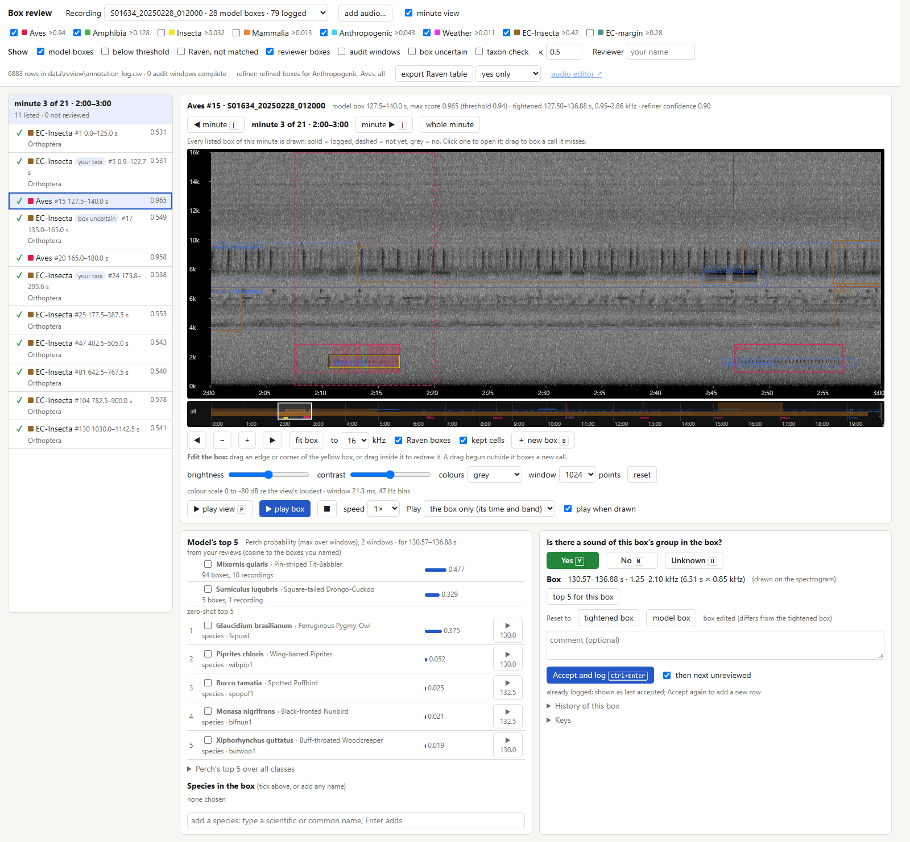
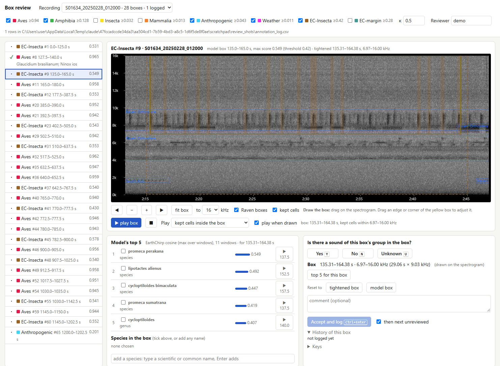

# Natgeo Biodiversity Detection

Detecting animal species by sound in a single Singapore study area, to assess the biodiversity
there. It was built in a National Geographic × NUS capstone project. The corpus is one recorder
(S01634) over 7 days: 134 long-form recordings, plus 4,684 labelled clips filed one folder per
class.

The pipeline (`scripts/`, `config/`, `notebooks/perch_zeroshot_viewer.ipynb`) scores every 5 s
window of the long recordings for birds, frogs, insects, mammals and human sounds with Perch 2.0 and
EarthChirp. It turns the scores into time-frequency boxes and lets a person review each box in a
local web app. Small learners fitted to those reviews then refine the thresholds, the boxes, the
group calls and the species names.

The pipeline caches Perch 2.0 embeddings and logits once, then scores against our own labels.
Everything after extraction needs only numpy and scikit-learn, so the expensive stage runs once and
analysis iterates cheaply.

### The review platform at a glance



*`scripts/review_app.py` as it runs now (2026-11-18), with the refitted learners loaded. Minute
view of one minute of S01634_20250228_012000: the list on the left holds only the boxes of that
minute, from every lane and source. The open box is Aves #15 (127.5–140.0 s). The taxon head gives
it p = 0.989 and the box refiner's edges have confidence 0.90. Above Perch's zero-shot top 5, the
learned names from the reviewed prototypes come first (*Mixornis gularis* 0.477, *Surniculus
lugubris* 0.329). Below sit the Yes / No / Unknown panel, the recording overview strip and the
display controls (colour map, STFT size, tape speed). The species shown are the models'
suggestions, not a review. See [Review platform](#review-platform-yes--no--unknown-with-a-top-5-species-list)
and [Current results](#current-results-2026-11-18).*


*The earlier single-box view of one logged Aves box. Left: every zero-shot box in the recording;
✓ marks a logged box. Centre: the spectrogram, with Raven boxes (blue dashed), the cells Perch used
(shaded) and the accepted box (yellow), which the reviewer draws or adjusts by dragging; ▶ plays
only that box. Below it: Perch's top 5 inside the box's group, each as scientific name · English
common name, the species chosen, and the decision with the box's history. The entries are an
illustration, not a review: Perch's top 5 here are Neotropical species, which is why a reviewer can
add any species by hand.*

## Current results (2026-11-18)

These numbers come from the refit after the latest round of active learning: 6,883 log rows,
including the Raven labels logged as reviews. Perch 2.0 and EarthChirp stay frozen. Each learner is
a small model on their outputs, scored on held-out recordings, with a 95% bootstrap CI over
recordings. A learner is adopted only if the low end of its CI is above 0. The 70 log rows on added
audio (`data/uploads`) are left out, because added audio has no split.

**Zero-shot baseline vs the Raven boxes** (window ROC AUC, leave-one-day-out): Aves 0.767,
Amphibia 0.878, Insecta 0.585 (EarthChirp margin 0.815 [0.771, 0.855]), Mammalia 0.770,
Anthropogenic 0.862, Weather 0.962.

**Taxon head** (is this group present in the segment; held-out AUROC, positives vs unlabelled):

| Group | Zero-shot → head [CI of the gain] | Decision |
|---|---|---|
| Aves | 0.758 → 0.921 [+0.112, +0.227] | adopt |
| Amphibia | 0.864 → 0.985 [+0.036, +0.655] | adopt (13 recordings, wide CI) |
| Insecta | 0.612 → 0.903 [+0.230, +0.354] | adopt |
| Anthropogenic | 0.813 → 0.927 [+0.082, +0.147] | adopt |
| Weather | 0.958 → 0.971 [−0.033, +0.076] | keep zero-shot |
| Mammalia | 22 positives, 1 recording | keep zero-shot |

A fit with the 22 `no` answers as negatives (2026-11-19) gives the same decisions, and moves AUROC by
at most 0.001. See [Taxon head](#taxon-head-review_taxonpy).

**Learned species names** (19 prototypes): held-out MRR@5 0.289 → 0.859 [+0.506, +0.636];
hit@1 0.22 → 0.80, hit@5 0.41 → 0.94. Adopted.

**Boxes** (held-out IoU with the reviewer's box):

| Learner | Group | Before → after [CI of the gain] | Decision |
|---|---|---|---|
| Box settings (κ, row support) | Aves | 0.166 → 0.248 [+0.057, +0.110] | adopt (0.6, 0.75) |
| | Anthropogenic | 0.122 → 0.244 [+0.081, +0.192] | adopt (0.1, 0) |
| | EC-Insecta | 0.162 → 0.175 [+0.002, +0.027] | adopt (0.2, 0.375) |
| | all | 0.162 → 0.200 [+0.023, +0.054] | adopt (0.5, 0.75) |
| Box refiner | Aves | 0.166 → 0.237 [+0.050, +0.095] | adopt |
| | Anthropogenic | 0.122 → 0.221 [+0.038, +0.130] | adopt |
| | all | 0.162 → 0.181 [+0.011, +0.028] | adopt |

**Thresholds** (held-out gain = recall − share flagged): adopted for Aves (0.94 → 0.9163; gain
0.240 → 0.333 [+0.062, +0.126]), Anthropogenic (0.043 → 0.01279; 0.226 → 0.286 [+0.023, +0.097]),
Insecta (0.032 → 0.04009; 0.040 → 0.046 [+0.001, +0.011]) and EC-margin (0.28 → 0.3533; 0.096 →
0.126 [+0.017, +0.043]). Kept for Amphibia, Weather, EC-Insecta and Mammalia.

The app loads the refiner, the taxon head and the species prototypes at start. The fitted
thresholds and box settings are recommendations: the app still uses `perch_viewer.THRESHOLDS`,
`KAPPA` 0.5 and `ROW_SUPPORT` 0.25 until those are changed by hand. Details per learner are in the
sections below.

## Contents

- [Current results (2026-11-18)](#current-results-2026-11-18)
- [Stages](#stages)
- [Window-level zero-shot on the long-form recordings](#window-level-zero-shot-on-the-long-form-recordings)
- [Viewer: where Perch hears each group](#viewer-where-perch-hears-each-group)
- [Insecta: EarthChirp vs Perch zero-shot](#insecta-earthchirp-vs-perch-zero-shot)
- [Hybrid on the long-form recordings](#hybrid-on-the-long-form-recordings-earthchirp-for-insects-perch-for-the-rest)
- [Tightened boxes](#tightened-boxes-where-in-time-and-frequency-each-zero-shot-box-is)
- [Review platform](#review-platform-yes--no--unknown-with-a-top-5-species-list)
- [Audio editor](#audio-editor-open-record-cut-and-save-audio)
- [New audio: detect calls on a file you add](#new-audio-detect-calls-on-a-file-you-add)
- [Website: public upload page and reviewer login](#website-public-upload-page-and-reviewer-login)
- [Review labels](#review-labels-the-logs-as-box-taxon-and-species-labels)
- [Raven labels as reviews](#raven-labels-as-reviews)
- [Learner 1: thresholds and box settings](#learner-1-thresholds-and-box-settings-from-the-reviews)
- [Box refiner](#box-refiner-edges-on-the-fine-spectrogram-fitted-to-the-reviewers-boxes)
- [Learners 2 and 3: taxon head and learned species names](#learners-2-and-3-taxon-head-and-learned-species-names)
- [Weekly training](#weekly-training-weekly_trainpy)
- [Common names for the top 5](#common-names-for-the-top-5)
- [Why the class index exists](#why-the-class-index-exists)
- [GPU setup (Windows)](#gpu-setup-windows)
- [Known caveats](#known-caveats)
- [Repository layout](#repository-layout)

## Stages

| # | Command | Output | Cost |
|---|---------|--------|------|
| 1 | `python scripts/build_manifest.py` | `data/manifest.csv` — one row per clip, audio referenced in place | seconds |
| 2 | `python scripts/make_splits.py` | `data/splits.csv` — session-level train/val/test | seconds |
| 3 | `python scripts/build_taxonomy_map.py --assets <model assets>` | `config/perch_class_index.csv`, `config/perch_genus_taxonomy.csv` | ~5 min, **needs network**, already committed |
| 4 | `python scripts/extract_perch.py --model-name perch_v2_onnx --device cuda` | `data/perch/` — embeddings, target logits, top-K | ~22 min on GPU, 3.4 h on CPU |
| 5 | `python scripts/score_zeroshot.py` | per-class AP / AUC / F1 | seconds |

Stage 3's outputs are committed, so a fresh clone starts at stage 4 offline.

## Window-level zero-shot on the long-form recordings

`scripts/zeroshot_windows.py` is separate from stages 1-5: it runs Perch over the
134 annotated 20-min recordings in `dataset/` as 5 s windows starting every 2.5 s
(~64k windows, ~20-25 min on the GPU), and scores which groups Perch hears against
the Raven boxes in `dataset/annotaions/`.

The scoring unit is the 2.5 s **segment**. Each segment lies inside two
half-overlapping windows, and its score is the max of the two, so a call cut by
one window's edge is still credited by the other, and every stretch of audio is
scored once. `--hop 5` gives plain back-to-back 5 s windows instead.

```
.venv-perch/Scripts/python -X utf8 scripts/zeroshot_windows.py                 # extract + score
.venv-perch/Scripts/python -X utf8 scripts/zeroshot_windows.py --score-only    # rescore the cache
.venv-perch/Scripts/python -X utf8 scripts/zeroshot_windows.py --score-only --score maxlogit
```

- **Groups.** Aves, Amphibia, Insecta, Mammalia, Anthropogenic are the targets;
  Weather is scored and reported apart; Unknown is never scored. Labels ending in
  `?` count for their group. The script stops if any label is unmapped or if the
  box counts differ from 2907 / 39 / 1900 / 6 / 342 / 14 / 47.
- **Truth.** A group is present in a segment if one of its boxes covers >= 0.5 s
  of it (or all of a shorter box). A box that only grazes the segment, or an
  Unknown box, makes the cell *ignored*, not negative. Truth is built at scoring
  time from `window_scores.csv` (the Perch cache), so `--score-only` can change it
  without rerunning Perch.
- **Perch score.** Perch 2.0 is trained with softmax cross-entropy, so a group's
  score is the summed softmax probability of its classes (every species of the
  taxonomic class plus the matching FSD50K events). Max logit is kept as an
  alternative (`--score maxlogit`).
- **Operating points.** *fixed*: summed probability >= 0.5, no labels used.
  *lodo*: the F1-best threshold on the other recording days, applied to the
  held-out day, so no segment is scored by a threshold fitted on it. AP and
  ROC-AUC are threshold-free. F1 and the other rates carry 95% bootstrap CIs over
  recordings. `Acc0` is the accuracy of always saying "absent".
- **Recall view** (`metrics_recall.csv`, printed last). Precision is unreliable
  because unannotated audio is not proven empty, so recall is also measured with
  thresholds that never look at labels: the fixed rule, and "flag the top 5 / 10 /
  20 / 50 % of all segments by the group score". *Segment recall* = positive
  segments flagged; *box recall* = Raven boxes with at least one flagged segment
  they overlap. Recall grows with how much is flagged, so each value is read
  against two nulls that keep the number and clustering of flags and move only
  their position: *null any* (flags of a random recording, rotated) and *null
  within* (the recording's own flags, rotated; tests timing inside a recording).
  `p` = share of 200 null draws with recall >= observed.
- **Model.** The local `perch_v2_no_dft.onnx` on CUDA **with TF32 off**. With
  onnxruntime's default TF32, logits drift up to 3.09 from the TF SavedModel
  (top-1 still agrees); with it off, 0.0003.

Checks run:

| check | result |
|---|---|
| ONNX (CUDA, TF32 off) vs TF SavedModel `perch_v2_cpu`, 16 real windows | logit max\|diff\| 0.00028; with TF32 on 3.09, on CPU 0.00028 |
| ONNX label order vs `config/perch_class_index.csv` and the SavedModel's `labels.csv` | identical, 14,795 |
| annotation labels -> groups | 0 unmapped; counts equal the grouping table |
| CUDA vs CPU at batch sizes 1, 2, 3, 5, 8, 15, 16 | logit max\|diff\| <= 0.00012; the `cudnn_frontend ... No execution plans` errors at batch 1-2 are a harmless fallback |
| `--hop 5` segments vs the first per-window code (smoke cache, 481 windows) | truth and scores identical |
| 2.5 s windows vs the resampled audio | window k = samples [80000k, 80000k+160000); 1199.9 s -> 480 windows; last window = tail + zeros |
| segment score = max of its covering windows (hand-made scores) | [.1,.9,.2,.3,.8,.05] -> [.1,.9,.9,.3,.8,.8] |
| segment truth vs hand computation, isolated Frog / Aircraft / Helicopter boxes | 5 boxes identical, grazing segments -1 |
| smoke run, 2 recordings at 2.5 s | 961 windows -> 961 segments, metrics written; lodo falls back to the fixed rule when only one day is present |
| recall view: box -> overlapped segment range vs brute force, all 5,208 non-Unknown boxes | 0 differ (after clipping 8 Insecta boxes that start at about -510 s; 5 zero-length boxes take the segment they sit in) |
| recall view: null draws | *within* = a rotation of each recording's own rows; *any* = one whole source recording per recording, each used once (20 draws) |
| recall view: hand cases | flags = truth -> segment recall 1; all flagged -> (1, 1); none -> (0, 0); one flag hits exactly the boxes spanning it |
| recall view: nulls on iid random 10% flags (Aves) | segment recall 0.101 vs null 0.099 / 0.098; box recall 0.278 vs 0.283 / 0.281 (random flags already "find" 28% of boxes) |
| recall view: budgets | top 5/10/20/50% flag that share of segments, +-0.2 pt |

Caveat: the Raven tables are correct but not complete, so an unannotated window is
not proven empty. Every FP count includes some unlabelled real calls; precision
and accuracy are lower bounds.

Add `--dry-run` to stage 4 to resolve targets and stop before inference.

## Viewer: where Perch hears each group

`scripts/perch_viewer.py` + `notebooks/perch_zeroshot_viewer.ipynb`. The viewer is
read-only. It uses `data/perch_windows/segment_scores.csv`, the Raven tables and the wavs.

- **One page = one minute** of one recording: a 0–24 kHz spectrogram plus a score track.
- **Perch boxes** are runs of consecutive 2.5 s segments whose summed probability
  passes the group threshold. Perch outputs no frequency, so each box spans the band
  Perch hears (60 Hz–16 kHz).
- **Raven boxes** are drawn at their real time and frequency. A radio button shows
  or hides them, and another does the same for the Perch boxes.
- **Thresholds**: all of them are editable in the GUI.
  - Confirmed by listening in this viewer on 2026-11-14: Aves 0.94 (flags 14% of
    the audio), Anthropogenic 0.043 (10%) and Insecta 0.032 (79%). The recall
    analysis had given Aves 0.916 and Insecta 0.040.
  - Confirmed by listening on 2026-11-15, with the hybrid lanes on: Amphibia 0.128 (8%)
    and EC-Insecta 0.42 (74%), with Aves 0.94 and Anthropogenic 0.043 again.
  - From the recall analysis only: Weather 0.011, Mammalia 0.013.
  - Only Mammalia is off by default, because it can't be tested (only 1 recording
    has mammals).
  - With `earthchirp_segments.csv` present, the EarthChirp insect lanes are added
    and the defaults become the hybrid. See "Hybrid on the long-form recordings" below.
- **Navigation:**
  - An **audio file dropdown** lists all 155 wavs, each with its start date and time,
    length and Raven box count.
  - The 21 wavs without a Raven table were never scored by `zeroshot_windows.py`. They
    show the spectrogram only, labelled "no Perch scores".
  - Minute steppers, and "find next/previous Perch box of <group>" across files.
  - A play button loads the minute's audio.
- **Listening to Perch boxes:** a list under the plot has one row per Perch box on
  the minute, numbered like the `#n` labels on the spectrogram. Clicking a row plays
  that box plus `pad` seconds (0.5 s by default) on each side. A box that runs past
  the minute is still played in full, up to 30 s (`MAX_CLIP_S`). Clips are
  peak-normalised for listening.
- **Tightened boxes:** once `data/perch_windows/cell_maps.npy` exists, each box can also
  be drawn shrunk to the 16 × 4 cells that carry its score. The rows give 4 frequency
  bands. You choose the box extent (both / tightened / full band) and set κ. The
  player can also play a box filtered to its tightened rows or its kept cells. See
  "Tightened boxes" below.

The notebook is saved already executed, with widget state. Its kernel is
`perch-venv`, which `.venv-perch` registers once:

```
.\.venv-perch\Scripts\python.exe -m ipykernel install --user --name perch-venv --display-name "Python (.venv-perch)"
.\.venv-perch\Scripts\python.exe -m jupyter lab notebooks\perch_zeroshot_viewer.ipynb
```

In VS Code, open the notebook, pick the kernel "Python (.venv-perch)" and choose Run All.

| Check | Result |
|---|---|
| Raven reading vs `zeroshot_windows.read_boxes` | 5,255 boxes; groups and times identical; frequencies 0.00–23.93 kHz |
| box merging, hand case `[.95,.95,.1,.92,.1,.1,.97,.99]` at 0.916 | `(0,5)`, `(7.5,10)`, `(15,20)` with max prob and segment counts as expected |
| real scores, every recording and group | box time = flagged segments × 2.5 s; boxes never touch. Boxes: Aves 3,370, Amphibia 531, Insecta 4,295, Mammalia 3,707, Anthropogenic 985, Weather 703 |
| spectrogram of a 3 kHz tone, 60 s at 48 kHz | peak at 3.000 kHz; 513 × 5,624 bins; axis to 24 kHz |
| pages | minute 1 = 60.0 s. A 1,200.04 s file gives 20 pages (a tail < 3 s gets no page). Across 155 recordings: 153 × 20 pages, `S01634_20250312_105744` (135 s) → 3, `S01634_20250228_150000` (0.08 s) → 1 |
| rendered pages, viewed by eye | `S01634_20250314_172000` min 1 (5 Perch / 4 Raven boxes); `S01634_20250301_132000` min 1 (7 / 1) |
| audio file dropdown | 155 entries = every wav (21 marked unscored). An unscored 20-min file gives 20 pages and 0 Perch boxes; the 135 s file gives 3 pages; its tail page renders. Next rec, then find Aves, lands on `S01634_20250312_120000` min 7 at Aves 0.916 and min 8 at 0.94. Each step redraws in about 3 s |
| Perch-box player, `S01634_20250314_172000` min 1 | 5 rows = 5 page boxes, in time order and numbered like the plot labels. Refilling the list plays nothing. Each clip equals the wav samples of [begin − pad, end + pad], clipped at 0 s and capped at 30 s. Example: #5 Anthropogenic 57.5–87.5 s plays 57.0–87.0 s |
| Perch-box player, long box and empty cases | a 72 s Aves box (`S01634_20250228_064000`, 97.5–170 s) plays 95.5–125.5 s. With no group ticked, and on an unscored file, the list is empty |
| built in place (nbclient, kernel `perch-venv`, widget state stored) | all cells run with no error |
| notebook executed headless (nbclient, `.venv-perch`) | all cells run in 72 s; one redraw 1.4 s. Find next/prev (and the auto-tick of the found group), recording/minute steps, clamp at the last page, radio toggles, threshold edit/reset and play all run without error (the audio widget stays empty headless; it fills in a live frontend) |

## Insecta: EarthChirp vs Perch zero-shot

`scripts/insecta_compare.py` asks one question: on the labelled clips, does
[EarthChirp](https://github.com/foundfold/earthchirp) (Melnick 2026) tell insect windows from
non-insect windows better than Perch's own Insecta score? Both methods read **the same**
Perch 2.0 forward pass of the same 5 s windows (the 35,424 windows of `data/perch/windows.csv`).

- **Perch.** The summed softmax probability of the 2,045 Insecta classes (every Insecta species,
  plus FSD50K `Insect` and `Cricket`). This is the `zeroshot_windows.py` group score, and 0.032 is
  the listening-confirmed threshold.
- **EarthChirp.** The max cosine between the 1536-d embedding and the library's insect
  prototypes: 2,012 species, 619 genera, and the Orthoptera and Cicadidae groups (Zenodo
  [10.5281/zenodo.20697426](https://doi.org/10.5281/zenodo.20697426) → `external/earthchirp_lib/`).
  This is how `recognise.py` computes it.
  - Its two label-free operating points come from the paper, and both are built on
    [ESC-50](https://github.com/karoldvl/ESC-50) (`external/esc50/`), never on our labels.
  - *tau*: the 95th percentile of the cosine on ESC-50's mechanical clips.
  - *outgroup*: the window counts as insect only if its nearest prototype is an insect, not the
    ESC-50 "urban" or "geophony" prototype. Each of those is the mean of a random half of that
    tier.
  - `ec_margin` (insect cosine minus outgroup cosine) is the paper's continuous score with the
    outgroup.
- **Truth.** A window is positive when its clip's coarse label is insect. Negatives are split
  into bird, anthropogenic and amphibian. Geophony (19 windows) and mammal (10 windows) count
  only in "all".
  - A bird or aircraft clip from this forest often has insects behind it, so an insect flag on a
    negative is not surely wrong.
  - Both methods face the same noisy negatives, so the comparison is relative.
- **Metrics.**
  - AUROC and AP per window and per clip (a clip scores the max over its windows), with 95% CIs
    from resampling the 108 sessions.
  - The paired EarthChirp − Perch AUROC difference on the same draws.
  - The share flagged per label at each operating point, plus EarthChirp cut at the share of
    windows that Perch flags at 0.032.

```
.venv-perch\Scripts\python.exe -X utf8 scripts\insecta_compare.py                         # all stages (GPU)
.venv-perch\Scripts\python.exe -X utf8 scripts\insecta_compare.py --stage esc50 --device cpu
.venv-perch\Scripts\python.exe -X utf8 scripts\insecta_compare.py --stage score
```

The stages are cached in `data/insecta_compare/`: `esc50` (2,000 clips, about 9 min on CPU),
`clips` (35,424 windows, about 20 min on GPU, 2.6 h on CPU) and `score` (seconds). The clips stage
reads each clip straight from its `Labelled Data-*.zip`, because the clips are not unpacked.

| Check | Result |
|---|---|
| zip reader vs `extract_perch.load_audio_windows` on the same clip extracted to disk | identical windows and start times on 9 clips (one per zip, plus the longest at 241 windows and the shortest) |
| rebuilt windows vs `data/perch/windows.csv` | every clip's window count must be equal, and its starts within 0.0051 s (asserted per clip). The csv rounds to 0.01 s with Python `round`. An exact `np.round` comparison stopped the first GPU run at `Brown Boobook/S01634_20250315_052000_sel11`, whose true start 6.985 s is stored as 6.99 |
| smoke run, first 20 clips on CPU (420 windows) | embeddings vs `data/perch/embeddings.npy`: max\|diff\| 0.0005, min cosine 1.00000. Group probabilities sum to 1 (6e-15). The Insecta max logit equals the cached `unspecified_insect` to 0.005 |
| exact Perch Insecta probability vs the top-20 approximation (same 420 windows) | Spearman 0.92 (medians 0.054 vs 0.042). The top-20 approximation is a rough preview only |
| our insect cosine and outgroup rule vs EarthChirp's own `recognise_batch` (cloned repo, same outgroup), 3,000 clip windows + 2,000 ESC-50 clips | non-insect decisions identical (1,571 rejected); insect cosine max\|diff\| 1.5e-07 |
| ESC-50 outgroup and tau | urban = mean of 660 of 1,320 mechanical clips, geophony = mean of 100 of 200. tau 0.524 leaves exactly 5.0% of mechanical clips above it |
| `boot_auc`, hand case | a perfect score vs a reversed one gives AUROC 1 / 0 and a paired difference of −1 on every draw |
| full clip stage (GPU), 35,424 windows | embeddings vs `data/perch/embeddings.npy`: max\|diff\| 0.0010, min cosine 1.00000 |
| ESC-50 reproduction (our ONNX Perch + scorer) vs the paper | insect vs vertebrate AUROC 0.952 (paper 0.95). Insect vs mechanical: 0.748 without the outgroup (paper 0.74), 0.927 with the margin on held-out clips (paper 0.93). Positive controls above tau: 41%; kept by the outgroup rule: 84% |

Results (2026-11-15, `metrics_auc.csv`, `metrics_operating.csv`). AUROC is given with its 95%
session-bootstrap CI; *d* is the paired difference from Perch's probability.

| Window vs | Perch prob | Perch max logit | EarthChirp cos | EarthChirp margin |
|---|---|---|---|---|
| all (11,855 neg) | 0.612 [0.568, 0.656] | 0.491 | **0.754** (d +0.14 [+0.09, +0.20]) | **0.800** (d +0.19 [+0.14, +0.25]) |
| bird (7,730) | 0.658 | 0.509 | **0.852** (d +0.19 [+0.13, +0.26]) | 0.790 (d +0.13) |
| anthropogenic (3,630) | 0.534 | 0.490 | 0.603 (d +0.07 [+0.03, +0.11]) | **0.864** (d +0.33 [+0.29, +0.37]) |
| amphibian (466, 12 sessions) | 0.457 | 0.190 | 0.311 (d −0.15 [−0.22, +0.13]) | 0.464 (d +0.01 [−0.04, +0.13]) |

- **EarthChirp beats Perch on insect vs non-insect.** The CIs exclude 0 against all negatives,
  against birds and against anthropogenic sound.
  - EarthChirp's cosine separates insects from birds best.
  - The outgroup margin separates insects from engines and aircraft best.
- **Frogs are no better** with either method, and the CIs are wide (12 sessions).
- **At Perch's flag rate** (68% of windows), EarthChirp finds more insect windows (83% vs 76%)
  and flags fewer bird windows (26% vs 45%) and anthropogenic windows (60% vs 68%). It flags
  slightly more frog windows (88% vs 83%).
- **Perch's summed probability beats its max logit** (+0.12, CI excludes 0), so the summed
  probability is the right Perch score.
- **Per clip** (max over windows): EarthChirp cos 0.855 vs Perch 0.658 against all negatives.
  Against anthropogenic clips only the margin helps (0.656 vs 0.475, d +0.18 [+0.07, +0.29]).
  The cosine alone ties Perch there (0.455).
- **EarthChirp's own label-free rules don't fit this site.**
  - *tau* (0.524) catches only 26% of insect windows.
  - The *outgroup* rule flags 99% of everything, because forest audio is always nearer an insect
    prototype than ESC-50 urban or geophony.
  - An operating point would have to be set by listening, as for Perch.
- The "matched" clip row applies the window-level cut (0.402) to the clip maxima. So it flags 50%
  of clips, not Perch's 86%, and is not a matched comparison per clip.

## Hybrid on the long-form recordings: EarthChirp for insects, Perch for the rest

`scripts/earthchirp_windows.py` brings EarthChirp onto the long-form recordings, and the viewer
shows the result as a **hybrid**:
- Perch's zero-shot lanes for Aves, Amphibia, Anthropogenic and Weather;
- EarthChirp in place of Perch's Insecta lane.

Each group is decided on its own, so a segment can carry several groups. Nothing is trained.

- **Why a rerun is needed.** `zeroshot_windows.py` kept only group scores, but EarthChirp needs
  the 1536-d embedding. The `extract` stage therefore runs Perch again on exactly the same 64,368
  windows (5 s, every 2.5 s, same ONNX model, TF32 off) and keeps the embeddings (float16).
- **Rebuild check.** The 6 group probabilities of every window must match `window_scores.csv`
  (the run the listening-confirmed thresholds were set on) to within 0.01. If they don't,
  nothing is written.
- **Scores.**
  - `ec_cos` and `ec_margin` per window, defined as in `insecta_compare.py` (same prototypes,
    same ESC-50 outgroup).
  - Per 2.5 s segment, the max of the two covering windows, the same rule as the Perch segments.
- **Metrics** (no labels are used anywhere else).
  - Segment AUROC of Perch Insecta / EC cos / EC margin against the Raven insect boxes. Ignored
    segments are left out, and the CIs resample the recordings.
  - Operating points:
    - Perch ≥ 0.032;
    - the two clip-matched EarthChirp cuts (cos 0.402, margin 0.280);
    - EarthChirp cut at the share of segments that Perch flags on the long-form audio.

    For each one: the flag share, segment and box recall (with CIs), the share flagged of
    segments that hold only another group's box, and the share flagged of unlabelled segments.
  - Raven labels are incomplete, so the off-label and unlabelled shares are upper bounds on false
    alarms, not error rates.
- **Viewer.** When `data/perch_windows/earthchirp_segments.csv` exists, the viewer adds two lanes:
  - **EC-Insecta** (cosine, starting at 0.402);
  - **EC-margin** (margin, starting at 0.280).

  The default lanes become the hybrid (Aves, Amphibia, EC-Insecta, Anthropogenic, Weather). Perch
  Insecta stays available, unticked. EC lanes are drawn and counted against the Raven insect
  boxes. Both EC thresholds come from the clip windows and **still have to be set by listening**.
  Without the file the viewer is unchanged, and the `_limit` smoke files are ignored.

```
.venv-perch\Scripts\python.exe -X utf8 scripts\earthchirp_windows.py                          # extract (GPU, ~20 min) + score
.venv-perch\Scripts\python.exe -X utf8 scripts\earthchirp_windows.py --stage score            # rescore only (~1 min)
.venv-perch\Scripts\python.exe -X utf8 scripts\earthchirp_windows.py --limit 2 --device cpu   # smoke run -> *_limit files
```

Outputs, all in `data/perch_windows/` (the Perch files there are never rewritten):
- `earthchirp_embeddings.npy`
- `earthchirp_rebuild_check.csv`
- `earthchirp_windows.csv`
- `earthchirp_segments.csv`
- `hybrid_insecta_auc.csv`
- `hybrid_insecta_operating.csv`

| Check | Result |
|---|---|
| smoke run, first 2 recordings on CPU (961 windows) | rebuilt windows equal the cache in count and start; group probabilities vs `window_scores.csv` max\|diff\| 5.3e-06 (limit 0.01); embeddings written as `_limit` |
| float16 storage, 2,000 float32 ESC-50 embeddings vs their float16 cast | max\|d cos\| 2.3e-05, max\|d margin\| 3.1e-05 |
| `earthchirp_windows_limit.csv` vs rescoring the stored embeddings | max\|d cos\| 3.0e-08; `ec_margin` = `ec_cos` − `ec_og` to 7.5e-08 |
| `segment_max` vs brute force (segment k = max of windows k−1, k) | equal on both recordings (to the csv round trip, 3e-08); 961 segments line up with `segment_scores.csv` |
| metrics path, the 2 smoke recordings run as a full set in a temp folder | 5 rules, 3 AUROC rows written. EC cos segment recall 0.9823 = hand count. The share-matched cut flags 0.959 vs Perch 0.961. The numbers themselves mean nothing: 960 of 961 segments hold a Raven insect box, and neither recording has an off-label-only segment, so those columns are NaN |
| viewer merge | EC lanes equal `earthchirp_segments.csv`. EC-Insecta boxes cover exactly the flagged segments (474 on `S01634_20250228_000000`). A lane without scores is skipped. A file one row short is refused. With no file there are only Perch lanes |
| notebook, executed headless on a copy without the EC file | all cells run (16 s); the per-recording table has the Perch lanes only |
| full extract (GPU), 134 recordings, 64,368 windows | group probabilities vs `window_scores.csv` max\|diff\| 1.1e-16 |

Results (2026-11-15, `hybrid_insecta_auc.csv`, `hybrid_insecta_operating.csv`):
- 63,946 scored segments: 40,204 with a Raven insect box, 23,742 without, 1,900 insect boxes.
- AUROC is per segment, with 95% recording-bootstrap CIs; *d* is the paired difference from Perch.
- In the off-label columns, the count under each heading is the number of segments with that
  group's box and no insect box.

| Insecta score | AUROC | AP | d vs Perch |
|---|---|---|---|
| Perch prob | 0.585 [0.543, 0.625] | 0.663 | |
| EC cos | 0.635 [0.586, 0.678] | 0.676 | +0.050 [+0.010, +0.089] |
| EC margin | **0.815** [0.771, 0.855] | **0.870** | **+0.230** [+0.187, +0.274] |

| Rule | Flagged | Seg recall | Box recall | Aves-only (4,767) | Amphibia-only (435) | Anthro-only (7,413) | Weather-only (1,106) | Unlabelled |
|---|---|---|---|---|---|---|---|---|
| Perch ≥ 0.032 | 0.786 | 0.837 [0.80, 0.87] | 0.937 [0.91, 0.96] | 0.334 | 0.924 | 0.672 | 0.579 | 0.852 |
| EC cos > 0.402 (clip-matched) | 0.780 | 0.883 [0.85, 0.91] | 0.919 | **0.182** | 0.943 | 0.542 | 0.306 | 0.802 |
| EC margin > 0.280 (clip-matched) | 0.716 | 0.874 [0.84, 0.91] | 0.879 | 0.315 | 0.929 | **0.208** | **0.014** | 0.662 |
| EC cos > 0.399 (Perch's share) | 0.786 | 0.888 [0.85, 0.92] | 0.923 | 0.191 | 0.943 | 0.552 | 0.315 | 0.809 |
| EC margin > 0.247 (Perch's share) | 0.786 | **0.920** [0.89, 0.94] | 0.924 | 0.472 | 0.963 | 0.292 | 0.023 | 0.776 |

- **The margin is the best insect score on the long-form audio.** Its AUROC is +0.23 over Perch
  (CI excludes 0). The cosine alone is only +0.05.
- **At Perch's flag share (78.6%)**, both EarthChirp scores find more insect segments than Perch:
  0.888 (cos) and 0.920 (margin) vs 0.837. Box recall ties (0.92 vs 0.94, CIs overlap).
- **The two EarthChirp scores reject different things**, as on the clips.
  - **The margin rejects rain and engines.** It flags only 2% of weather-only segments
    (Perch 58%) and 29% of anthropogenic-only ones (Perch 67%), because its outgroup is ESC-50's
    urban and geophony sound.
  - **The margin is worse than Perch on bird-only segments** (47% vs 33%).
  - **The cosine rejects birds:** 19% of bird-only segments, against Perch's 33%.
- **Frog-only segments are flagged 92–96% by every rule.** Frogs are read as insects, or insects
  sit behind the frogs. Nothing here separates the two.
- The clip-matched cuts land close to Perch's long-form share for the cosine (0.402 vs 0.399).
  The margin cut moves more (0.280 vs 0.247).
- Raven labels are incomplete, so the off-label and unlabelled shares are upper bounds on false
  alarms. A bird-only segment can still hold unlabelled insects.

**Listening-confirmed hybrid (2026-11-15):**

| Lane | Model | Threshold | Flags |
|---|---|---|---|
| Aves | Perch | 0.94 | 13.6% of segments |
| Amphibia | Perch | 0.128 | 8.4% |
| Anthropogenic | Perch | 0.043 | 10.0% |
| Insects (EC-Insecta) | EarthChirp cosine | 0.42 | 73.8% |

Weather (0.011, 9.4%) stays on but has not been listened to. EC-margin has not been listened to and
is off by default.

The same metrics at EC cos ≥ 0.42, measured once after the choice (not used to make it), are set
beside the clip-matched start and Perch below.

| Rule | Flagged | Seg recall | Box recall | Aves-only | Amphibia-only | Anthro-only | Weather-only | Unlabelled |
|---|---|---|---|---|---|---|---|---|
| Perch ≥ 0.032 | 0.786 | 0.837 [0.80, 0.87] | 0.937 [0.91, 0.96] | 0.334 | 0.924 | 0.672 | 0.579 | 0.852 |
| EC cos > 0.402 | 0.780 | 0.883 [0.85, 0.91] | 0.919 [0.88, 0.95] | 0.182 | 0.943 | 0.542 | 0.306 | 0.802 |
| **EC cos ≥ 0.42 (listened)** | 0.738 | 0.844 [0.80, 0.88] | 0.890 [0.85, 0.92] | 0.138 | 0.938 | 0.490 | 0.233 | 0.757 |

- At 0.42, EarthChirp flags 5 points less audio than Perch and keeps about the same segment recall
  (0.844 vs 0.837). Its box recall is lower (0.890 vs 0.937; the CIs just overlap).
- It flags far fewer bird-only (14% vs 33%), weather-only (23% vs 58%) and anthropogenic-only
  (49% vs 67%) segments.
- Frog-only segments are still flagged about 94% of the time.

## Tightened boxes: where in time and frequency each zero-shot box is

A zero-shot box is a run of 2.5 s segments drawn across Perch's whole band (60 Hz–16 kHz).
`scripts/cell_maps.py` scores the inside of every window, and the viewer uses that to shrink each box
to the cells that carry the score. Nothing is trained and no labels are used.

**Where the cells come from.**
- Perch 2.0 computes every window from a 16 × 4 grid of 1536-d cells (`spatial_embedding`):
  16 time cells of 312.5 ms × 4 frequency rows of 32 mel bins (0.06–0.95, 0.95–2.9, 2.9–7.0,
  7.0–16 kHz).
- The pooled `embedding` is exactly the mean of the 64 cells.
- `label` is a ProtoPNet head: each class has 4 unit prototypes, and
  `logit = Σ_proto w · max_cells cos(cell, prototype) + b`.

**What each cell is scored with.**
- **Perch lanes:** the same head on one cell, without the max over cells
  (`Σ_proto w · cos(cell, prototype) + b`). Then softmax over the 14,795 classes and a sum per
  group, as in `zeroshot_windows.py`.
  - The `build-head` stage reads the head weights out of the Perch ONNX.
  - It writes them as a small ONNX model (`data/perch_windows/perch_cell_head.onnx`, 347 MB), so the
    head runs on the GPU like Perch.
- **EarthChirp lanes:** the window cosine `cos(e, p*)`, with `e` the mean of the cells and `p*` the
  best prototype, splits exactly into cells: each cell scores `cell · p* / |e|`, and their mean is
  `ec_cos`. The outgroup is split the same way, and the margin is insect minus outgroup.
- **Stored output:** `cell_maps.npy`, (windows, 16, 4, 8) float16, with lanes Aves, Amphibia, Insecta,
  Mammalia, Anthropogenic, Weather, EC-Insecta and EC-margin.

**Tightening a box** (`perch_viewer.tighten`, run per box at view time):
1. Each 0.3125 s slot takes the max of the two windows covering it, the same rule a segment uses.
2. Inside the box, keep the cells at least **κ** of the way from the box's *median* cell to its
   highest cell (default κ = 0.5; set it by eye in the viewer).
3. Drop rows that hold fewer than ¼ of the kept cells of the strongest row.
4. The tightened box is the bounding box of what is left. There is one tightened box per original
   box; nothing is split.

Two choices in this rule were fixed by looking at the smoke recordings, not by labels:
- **Median floor.** With the box *minimum* as the floor, scattered background cells pass. Then 74% of
  Aves boxes stayed full band.
- **¼ row rule.** Kept cells formed one dominant row plus 1–3 stray cells in other rows, which
  stretched the box back to full band.

```
python -X utf8 scripts\cell_maps.py --stage build-head                                 # once; needs `pip install onnx`
.venv-perch\Scripts\python.exe -X utf8 scripts\cell_maps.py                           # extract (GPU, ~25 min)
.venv-perch\Scripts\python.exe -X utf8 scripts\cell_maps.py --limit 2 --device cpu    # smoke -> *_limit files
```

- **Requirements.** Extract needs `window_scores.csv` and `earthchirp_windows.csv`.
- **Checks.** These run per recording; if any fails, nothing is written and the `.partial.npy`
  is kept:
  - the group probabilities match `window_scores.csv`;
  - the head's rebuilt window logits match the ONNX `label`;
  - the mean of the EC cells matches `ec_cos` / `ec_margin`.
- **Viewer behaviour.** With `cell_maps.npy` present, the viewer adds:
  - **Box extent** (both / tightened / full band);
  - **keep cells ≥** (κ);
  - a tightened-area column;
  - the tightened span in the box list. The player plays that span.
  - **Play** (original / band-passed / cell mask), see below.

  Without the file, nothing changes. The `_limit` file is never loaded by the viewer.

**Filtered playback** (`perch_viewer.filter_clip`). This only changes what you hear; no box or score
changes.
- **band-passed:** keeps the tightened box's frequency rows over the whole clip.
- **cell mask:** keeps only the kept cells (0.3125 s × one row). Everything else is muted, padding
  included.
- **How:** both multiply an STFT (2048 points, hop 512) by a 0/1 gain. The gain is smoothed over 5 bins ×
  5 frames (~120 Hz × ~50 ms) so its edges do not click, and the result is inverted back to audio.
- **Same-row sounds stay.** It cuts time and frequency; it does not separate sources. A second bird or
  rain in the same rows is still heard.
- **Volume.** Clips are peak-normalised as before, so a filtered clip plays as loud as the original.
- **Box extent "full band".** The clicked box is tightened for playback only (at the current κ).

| Test (smoke: first 2 recordings, 961 windows, CPU) | Result |
|---|---|
| Head walk-back from `label` finds Add ← ReduceSum ← Mul(w) ← ReduceMax ← Reshape ← MatMul(P) ← Div(`spatial_embedding`), eps 1e-5 | found; P (1536, 59180), w (1, 14795, 4), b (1, 14795) |
| Group membership of the head's class → group matrix | Insecta 2,045 classes (same as `zeroshot_windows.py`), each class in exactly one group |
| Head's rebuilt window logits vs Perch ONNX `label` | max \|diff\| **0.0** |
| Group probabilities vs `window_scores.csv` | max 5.3e-06 (limit 0.01) |
| Mean of the EC cells vs `earthchirp_windows.csv` (whose embeddings are float16) | max 2.3e-05 (limit 1e-3); after float16 storage of the maps 8.3e-05 |
| Pooled `embedding` vs mean of the 64 cells | 0.0 |
| Slot grid vs brute-force max over covering windows (synthetic and real) | 0.0 |
| Tighten rule on synthetic boxes: κ 0; one hot cell; flat box; a call in row 1 plus one stray cell in row 3; a call over rows 1–2 | the whole box; that cell; the whole box; the call only (stray dropped); rows 1–2 |
| Time axis: silence the second half of 4 real windows | cells 10–15 look more like silence than cells 0–5 (cosine to a silent window 0.51 vs 0.32) |
| Frequency rows: tones 500 / 1800 / 4500 / 11000 Hz; 900 Hz low-pass; 1–2.8 kHz band-pass | 1.8 kHz → row 1; 4.5 kHz → row 2; the low-pass silences rows 2–3 most; the 1–2.8 kHz band-pass changes row 1 most. **But** 500 Hz and 11 kHz also move row 1 most: rows leak into neighbours, so frequency is soft |
| `plot_page` in every mode; κ 0 gives the original box back | renders; identical for all boxes |
| Viewer GUI with the smoke maps swapped in: box list, κ 0 / 0.8, player span, recording without maps | tightened rows listed; κ 0 = full box; the player plays the tightened span; no map → full band |

Full GPU run (2026-11-15): 134 recordings, 64,368 windows, every per-recording check passed:

| Check, max over all recordings | Result |
|---|---|
| Group probabilities vs `window_scores.csv` | 5.0e-07 |
| Head window logits vs ONNX `label` | 0.0 |
| EC cell mean vs `ec_cos` / `ec_margin` | 3.3e-05 |
| Pooled `embedding` vs mean of cells | 4.8e-07 |

Filtered playback tests (`perch_viewer.cell_gain` / `filter_clip`, then the GUI on the full maps):

| Test | Result |
|---|---|
| Cell gain by hand: 9 frequencies (30 Hz–20 kHz) × 6 times around a 3-slot box (row 1 kept in slots 0–1, row 3 in slot 2) | equals the hand mask: nothing below 60 Hz, from 16 kHz, before the box or past it |
| band-passed 0.955–2.864 kHz on tones at 0.5 / 1.8 / 5 / 12 / 20 kHz plus noise (4 s) | 1.8 kHz kept at 0.0 dB; the others −90 to −110 dB; output length = input |
| cell mask: row 1 kept for the first 1.25 s of a 4 s clip | 0–1.15 s: RMS 0.0708 = the 1.8 kHz tone alone (0.0707), 5 kHz −84.5 dB; 1.4–4 s: RMS 0.00000 (original 0.158) |
| original mode; mask with every cell kept | original returned untouched; all cells kept passes 0.5–12 kHz at 0.00 dB and removes 20 kHz (−99 dB) |
| GUI, `S01634_20250228_012000` min 3, Aves box #2, box extent both / full band × the 3 play modes | plays 127.0–137.4 s (tightened) or 127.0–140.5 s (full). Power share in Perch's 4 rows: original 0.10 / 0.01 / 0.03 / 0.09 (rest below 60 Hz or above 16 kHz); band-passed and cell mask ≈ 0.99 in row 1 (0.95–2.9 kHz), 16 cells kept. 0.1–0.25 s per click |
| GUI, a box on a recording outside the maps | plays unfiltered and says so ("no cell map for this box") |
| notebook re-executed in place (nbclient, `perch-venv`) with the full maps | 0 errors |

What the smoke recordings show (κ 0.5, listening thresholds; descriptive only, 2 recordings):

| Lane | Boxes | Mean box | Mean tightened time | Mean area kept | Most common band |
|---|---|---|---|---|---|
| Aves | 19 | 7.5 s | 4.9 s | 25% | 0.95–2.9 kHz |
| EC-Insecta | 23 | 99 s | 79 s | 19% | 7.0–16 kHz |
| Perch Insecta | 19 | 121 s | 74 s | 28% | 2.9–16 kHz |
| Mammalia | 25 | 7.8 s | 4.6 s | 21% | 0.06–0.95 kHz |

- **Aves.** On minute 3 of `S01634_20250228_012000`, both Aves boxes (12.5 s and 15 s, full band)
  shrink onto the bird calls at 0.95–2.9 kHz. At κ 0.8 the first one is 130.9–136.6 s.
- **Long insect boxes** (minutes long) barely shrink in time, because insects sing throughout.
  For them the gain is the frequency row.
- **Limits:**
  - only 4 frequency rows, and they leak;
  - one box per box: a box holding two calls in different rows is drawn spanning both;
  - Perch hears nothing above 16 kHz.

## Review platform: yes / no / unknown with a top-5 species list

`scripts/review_app.py` + `scripts/review_app.html`. A local web page for reviewing every zero-shot box,
one at a time, and for boxing the calls the model missed. Each accepted review becomes one row in a
CSV. The logs are the app's only output. `review_calibrate.py`, `box_refine.py`, `review_taxon.py` and
`review_species.py` fit to them when run. Three of them can change what the app shows, and only once
adopted: the box refiner's settings, the taxon head and the learned species names (read at start, see
[Box refiner](#box-refiner-edges-on-the-fine-spectrogram-fitted-to-the-reviewers-boxes) and
[Learners 2 and 3](#learners-2-and-3-taxon-head-and-learned-species-names)). No learning happens
inside the app.

```
.venv-perch\Scripts\python.exe -X utf8 scripts\review_app.py
```

- Opens http://127.0.0.1:8765.
- Options: `--device cpu` (Perch on CPU), `--port N`, `--no-browser`, `--review-dir DIR`,
  `--no-refiner` (tightened boxes only, no "box uncertain" source), `--no-learners` (zero-shot only:
  no taxon head, no learned names), `--uploads-dir DIR` (where added audio goes, default
  `data\uploads`; see [New audio](#new-audio-detect-calls-on-a-file-you-add)).
- `--export-raven DIR [--export-keep yes|all]` writes one Raven selection table per reviewed recording
  into `DIR` and exits without starting the server (see **Export Raven table** below). It refuses
  `dataset\annotaions`, where the Raven tables the app reads as labels live.
- Writes `data\review\annotation_log.csv` (the box log), `data\review\box_shown.csv` (which box each
  review started from), `data\review\species_shown.csv` (which learned names each species answer
  saw), `data\review\audit_windows.csv` (closed audit windows) and
  `data\review\prediction_cache.jsonl` (top-5 cache). Audio added with "add audio…" or the editor's
  "detect calls" goes to `data\uploads` (git-ignored) with its scan.
- Reads, at start and only if they exist, `data\review\calibration\refiner.json` (`box_refine.py`),
  `taxon.json` + `taxon.npz` (`review_taxon.py`) and `species.json` + `species_protos.npy`
  (`review_species.py`). A file that is missing, or whose learner was kept, changes nothing. Restart
  the app after a refit.
- Needs only `.venv-perch`: stdlib `http.server`, numpy, scipy and PIL. There is no Flask and no CDN.
- `--survey` lists the survey's own recordings on the review page too. Without it (the default since
  2026-11-21), only added audio is listed.

**Since 2026-11-21 the review page is simpler** (see
[Reviewer page cleanup](#reviewer-page-cleanup-2026-11-21)). Groups Insecta, EC-margin and Weather are
not offered. The list holds model boxes and your boxes, always in the minute view, and the page has
no Raven boxes and no reset buttons. A box's group is changed with one click. The **Show** ticks, the
minute-view switch, the Raven toggle and the "Reset to" buttons described below are gone; the server
items behind them are unchanged.



*An EC-Insecta box (135–165 s). EarthChirp scores it. The tightened box keeps 6.97–16 kHz, and the
shaded columns are the cells kept at κ 0.5. "kept cells inside the box" plays only those cells,
within the yellow box's time and band. The top 5 are EarthChirp prototypes with their level
(species / genus).*

**What a box is.** The viewer's boxes: `perch_viewer.perch_boxes` at the listening thresholds
(Aves 0.94, Amphibia 0.128, EC-Insecta 0.42, Anthropogenic 0.043, …). Each box is tightened with the cell
maps at the chosen κ (`CellMaps.tighten_boxes`). A box id is `recording|model|lane|begin|end`, so it
does not depend on κ.

**The queue: seven sources.** The model boxes only show what the model found. To find what it missed,
the list can also hold four other kinds of item, one kind for boxes whose edges need a person, and
one for time the taxon head flags, ticked under **Show** in the header (model boxes and your boxes by
default; the choice is remembered). "box uncertain" is listed only with the refiner, "taxon check"
only when a taxon head is adopted:

| Source | What it is | `model` in the log | Over all 134 recordings |
|---|---|---|---|
| model boxes | the boxes above | `Perch` / `EarthChirp` | 16,301 |
| below threshold | runs of a lane at a lower cut (`near_low`) holding no segment at the listening threshold | `Perch below threshold` / `EarthChirp below threshold` | 4,662 |
| Raven, not matched | Raven boxes `raven_match.py` matches to no model box of their group (time IoU ≥ 0.3, 1:1), and `Unknown` ones | `Raven` | 4,069 |
| your boxes | boxes you drew with **New box** (below) | `reviewer` | grows as you log |
| audit windows | 4 random 15 s windows per recording, to box every call in | (own file) | 536 |
| box uncertain | model and below-threshold boxes the box refiner cannot settle | as the box's own source | per recording, when opened |
| taxon check | runs the adopted taxon head calls present where no model box of the group is | `taxon head` | none until a head is adopted |

- **Below threshold.** Per lane, `near_low` is the score above which the next 5% of all 2.5 s segments
  lie, counted down from the listening threshold. It is set by rank, not by any label. A near item is
  a run at `near_low` whose peak stays under the threshold, so it never overlaps a model box of its
  lane.

  | Lane | `near_low` | threshold |
  |---|---|---|
  | Aves | 0.9309 | 0.94 |
  | Amphibia | 0.0692 | 0.128 |
  | Insecta (Perch) | 0.0282 | |
  | Mammalia | 0.0122 | |
  | Anthropogenic | 0.0224 | 0.043 |
  | Weather | 0.0044 | |
  | EC-Insecta | 0.3982 | 0.42 |
  | EC-margin | 0.2574 | |

- **Raven, not matched.** Every Raven box that `raven_match.py` does not match to a model box of its
  group's lanes (the default hybrid lanes, else every lane of the group): no model box overlaps it
  (1,443, plus the 11 `Unknown` of those), its model boxes went to other Raven boxes (1,767), or the
  merged span of its model boxes has time IoU below 0.3 (812). All 47 `Unknown` boxes are listed too
  and come with no group: you pick one. After `raven_autolabel.py --write`, each listed box except
  the `Unknown` ones already has a `raven-auto` `yes` row (✓); the matched ones are logged on their
  model boxes instead. Raven is incomplete and its boxes stitch whole bouts
  ([Raven boxes are a structure reference](#known-caveats)), so a box here is a place to listen, not
  a missed call by definition.
- **Your boxes.** Every box you drew and logged, rebuilt from the log on each load. It keeps the
  box as first drawn; its group is the last one logged.
- **Box uncertain.** A model or below-threshold box whose refined box is missing or whose refiner
  confidence is under its group's fitted cut (0.5 before any fit). The app refines a recording's
  boxes in the background when it is opened: 316 boxes of the busiest recording took 20.8 s
  (66 ms per box), and 157 of them (50%) were uncertain at the default setting. Ticked alone, the
  list is sorted least confident first. These are the boxes where an edited edge teaches the
  refiner most.
- **Taxon check.** Only for a group whose taxon head `review_taxon.py` adopted. A find is a run of
  2.5 s segments on the group's default lane where the head's probability is ≥ its cut, minus the
  time any model box of the group covers; it is tightened like a model box. Model boxes of an adopted
  group also carry the head's probability, and a **taxon doubt** tag when it is under the cut.
  Ticked alone, the list holds the finds (highest probability first), then the doubted model boxes
  (lowest first): the head's disagreements with the zero-shot threshold, which are what a review
  settles. Runs merge like model-box runs, so a find can be long.
- **Audit windows.** Picked by `numpy.random.default_rng([20261116, crc32(recording)])` from the
  recording's non-overlapping 15 s slots, so they are the same on every start, and they are chosen
  without looking at any score or label.

Raven and your boxes have no fixed group: the group you pick is logged in `lane`, and their id
(`recording|model|begin|end|low|high`) leaves the group out, so a changed group stays the same item.

**The page**
- **Minute view** (the "minute view" box in the header; on by default, remembered). Choosing a
  recording shows its first minute, and the list holds only the ticked items that fall in it.
  The view is made for finding missed calls: every listed box of the minute is on one spectrogram.
  - **Moving:** "◀ minute" / "minute ▶" above the spectrogram, or `[` / `]` (also PageUp / PageDown).
    The last minute ends at the recording's end. The list header reads "minute 3 of 20 · 2:00–3:00",
    then how many items are listed and how many are not reviewed yet.
  - **What is listed:** an item belongs to every minute its span overlaps, so a long box (a bout,
    a whole-recording Raven box) appears in each of them. A logged item's span includes its accepted
    box. Model boxes, below-threshold runs, unmatched Raven boxes, your boxes and the rest follow the
    **Show** and group ticks as before. Tick "Raven, not matched" to see the Raven boxes the model
    did not catch.
  - **What is drawn:** each listed box is drawn in its group's colour and labelled `#n`, with ✓ once
    logged. A logged box is drawn solid, a box not yet logged dashed, and a box answered "no" grey.
    The open box is drawn as before (yellow), and Raven's own boxes stay as the blue overlay.
  - **Opening a minute** opens its first unreviewed item, else its first. ← / → and J stay inside
    the minute. When J finds nothing left, the page says to look for missed calls and then press `]`.
  - **Click and drag:** a click on a drawn box opens it (the smallest under the pointer, so one call
    inside a bout box can be picked). A drag that starts outside the open box starts a new box there,
    so a missed call is boxed in one move. Pick its group and Accept as usual, and the page comes back
    to the same minute. A drag that starts inside the open box redraws it, and its edges and corners
    move as before.
  - **An empty minute** (nothing ticked falls in it) still shows its spectrogram, and a drag there
    starts a new box.
  - **Zoom:** the view stays on the whole minute while you step through its boxes. A view you zoomed
    into is kept while it holds the box; "whole minute" goes back.
  - **Minute view off:** the old queue. The whole recording is listed and each box opens on its own
    view.
  - **Ticks and κ** reload the recording but keep the minute while the open box lies in it. If you
    tick several boxes quickly, only the last load counts, and only the last box you picked opens.
- **Spectrogram:** with the minute view off, the model box ± 2 s (10–120 s view), with:
  - Raven boxes (blue dashed, labelled);
  - kept cells (shaded);
  - the model box (dashed);
  - the tightened box (thin line);
  - the refined box (dotted), only for a group the refiner has adopted and a box it is confident on;
  - the accepted box (black and yellow).
- **Zoom and scroll** (over the plot; over the axes and outside the canvas the page scrolls as usual):
  - **wheel:** zooms in time about the mouse: the time under the pointer stays put. Each 100 px of
    wheel scales the view by e^0.2, from 0.5 s to 120 s (and never past the recording);
  - **Shift+wheel**, or a sideways wheel / trackpad swipe: pans, by the wheel's pixels;
  - **Shift+drag** or **middle-button drag:** pans; the view follows the mouse (cursor "grabbing")
    and the box is not touched;
  - the image is asked for only once the view has rested 150 ms, so a fast wheel or drag loads one
    image, not one per step. Until then the old image is stretched to the new view.
- **Readout** (top right of the spectrogram, under the mouse): `t 2:13.250  f 4.31 kHz  −37 dB`.
  - The level is the view image's own grey value: dB below the view's loudest (its 99.9th percentile),
    to 120 dB below, shown as `≤-120 dB`. It is read from the image you see, so it changes with the
    window and the view, not with brightness / contrast.
  - Over the time axis it gives only the time; over the frequency axis and off the canvas it hides.
  - While drawing a box it adds a line with the box (`box 0:12.100–0:13.400 (1.300 s) · 3.10–5.20
    kHz`); while panning, a line with the view. The extra line goes when the mouse is released.
- **Overview strip** (under the spectrogram, labelled "all"): the whole recording at once.
  - Drawn: the minute grid with minute labels, the open minute shaded (minute view), every listed item
    of every minute (filled = yes, dashed = not logged, grey = no; audit windows as a band along the
    bottom), the open box in yellow, Raven boxes in blue when "Raven" is ticked, the play cursor and
    playhead, and the view as a white frame with the rest dimmed.
  - A click or drag centres the view there, keeping its width. In the minute view the view stays
    inside the open minute, and a click in another minute opens that minute.
- **Export Raven table** (header button; "yes only" by default, or "every answer"): downloads
  `<recording>.Table.1.selections.txt` for the recording on screen, built from the log at that moment.
  - One selection per reviewed box: its newest row, as its accepted box, kept when its answer is yes
    (or any answer with "every answer"), in begin-time order. Unknown answers are left out of "yes
    only" like everything not yes.
  - Tab-separated, CRLF line ends, UTF-8. The first nine columns are those of the tables in
    `dataset\annotaions` (`Selection`, `View` = Spectrogram 1, `Channel` = 1, begin / end s, low /
    high Hz, delta time / delta freq). Then `Annotation` = the species named (`; `-joined), else the
    group, and `Group`, `Decision`, `Source` (the log's `model`), `Reviewer` (`raven-auto` for rows
    logged from Raven itself), `Logged At`, `Log ID`.
  - Raven opens it on the recording's WAV like its own table. Nothing is written on the server; the
    CLI form above writes every recording at once.
- **Upload audio ↗** (header link; "audio editor ↗" before 2026-11-21): opens the
  [audio editor](#audio-editor-open-record-cut-and-save-audio) in a new tab.
- **Add audio…** (header button, beside the recording list): uploads an audio file of your own, runs
  the zero-shot model on it and lists it with the dataset's recordings as `<name> · added (<file>)`.
  The status beside the button counts the upload, then the windows scanned. When the scan is done the
  recording opens by itself, unless you have moved to another box meanwhile ("open it" then). See
  [New audio](#new-audio-detect-calls-on-a-file-you-add).
- **Display** (the bar under the spectrogram; remembered per browser, "reset" restores the
  defaults). None of it changes a box, a score or the log.
  - **brightness** and **contrast** set the colour scale. The server sends the view as grey 8-bit dB,
    from the view's loudest (its 99.9th percentile) down to 120 dB below it. The page then colours the
    part you choose. At 50 / 50 the scale is 0 to −80 dB, the picture the app showed before.
    Brightness moves the scale up to 30 dB either way; contrast narrows it from 120 to 30 dB. The note
    beside the bar gives the scale in dB and the window in ms and Hz.
  - **colours:** grey (loud = black), grey dark (loud = white), viridis, magma.
  - **window:** the STFT size, 256 to 4096 points (5.3 to 85 ms at 48 kHz; 1024 by default). A
    short window sharpens time (clicks, pulse trains), a long one sharpens frequency (whistles, tonal
    insects). The hop grows with the view but never past the window, so no audio falls between frames.
    When a view has more frames than the 3000 columns, each column is the loudest of its frames, so a
    short click is not averaged away. At 1024 points the picture is the old one for views up to about
    64 s.
- **Play view** (▶ play view, or P): plays the view from the play cursor to the view's end, all
  frequencies, at most 60 s at a time.
  - A click on the time axis (under the spectrogram) sets the play cursor, drawn as a dashed blue line
    with a handle on the axis. With no cursor in the view, playing starts at the view's start.
  - The red playhead moves as it plays. A click on the axis while it plays goes on from there.
  - Stopping part-way (P, ■ or the button) leaves the cursor where it stopped, so P goes on from
    there. After a 60 s clip of a longer view, the cursor moves to its end, so P plays the rest.
  - Moving the view away from the playhead (the next minute, a new recording) stops it.
- **Speed:** 2×, 1×, ½×, ¼×, ⅛× for both play view and play box (remembered). The pitch moves with
  the speed, as on tape: at ⅛× a 16 kHz call sounds at 2 kHz, and an ultrasound-ish insect becomes
  audible. Changing it while playing takes effect at once.
- **Drawing the box:** the box is set on the spectrogram; nothing is typed.
  - Drag anywhere (also inside the current box) to draw a new box.
  - Drag an edge or a corner of the yellow box to move just that side; the cursor changes within 7 px
    of it. A click without a drag changes nothing, and boxes under 0.05 s or 0.05 kHz are ignored.
  - The box reads as text below (begin–end s · low–high kHz, and its size). "tightened box" and
    "model box" reset it. "top 5 for this box" reruns the model on the drawn span.
- **Playback plays the box and nothing else:** exactly its begin–end, no padding, capped at 30 s.
  - **the box only** (default): only its low–high kHz band;
  - **the box's time, all frequencies**;
  - **kept cells inside the box**: the kept cells, cut to the box's band (no cell map: the band);
  - "play when drawn" (on by default) plays a box as soon as it is drawn or adjusted;
  - the audio is filtered with 0.25 s extra each side, then cut to the box, with 10 ms fades, so the
    edges do not click. If nothing passes the filter (no kept cell in the band), it plays silence;
  - ▶ on a top-5 row plays the 5 s window where that name scored highest, at all frequencies.
- **Model's top 5**, computed on demand for the accepted span and cached:
  - **Perch lanes:** Perch's softmax over 14,795 classes, max over the windows covering the span, then
    the top 5 *within the lane's group* (an Aves box shows birds). Perch's top 5 over all classes is
    shown underneath, collapsed.
  - **EC lanes:** EarthChirp cosine to its 2,633 prototypes (max over windows), top 5 with their level
    (species / genus / group).
  - **Window choice:** windows overlapping the span by ≥ min(2.5 s, span); else the best overlap; at most
    64, evenly spaced.
  - **Common names:** each row reads *scientific name* · English common name, e.g. *Glaucidium
    brasilianum* · Ferruginous Pygmy-Owl. Names come from `config/common_names.csv` (see
    [Common names](#common-names-for-the-top-5)). A name with none (sound-event classes, EarthChirp
    genus prototypes, species with no English name) shows the scientific name only. The names are
    added when the top 5 is served, so cached predictions get them too. The log still stores
    scientific names only.
- **Species:**
  - tick any of the top 5, or add any name with autocomplete;
  - the vocabulary (17,553 names) is Perch labels, EarthChirp names, Raven labels, `taxonomy.csv`,
    `perch_targets.csv` queries, and names added earlier;
  - Enter on free text adds it as typed.
  - Search covers common names too: "sunda scops" finds *Otus lempiji*, "tree cricket" finds
    *Oecanthus* species. Chosen species show their common name in the chips.
  - **Learned names** (only with an adopted species learner): up to 3 names whose prototype, built
    from earlier reviewed boxes, has cosine ≥ τ to this box's embedding, listed above the zero-shot
    top 5 and marked "learned". A ticked one is logged with source `learned`. A fixed 10% of boxes
    (by crc32 of the box id) never show them, as a control.

  

  *Typing "boobook" lists the matches as scientific name · common name, with their source (Perch
  class, Raven label, target list) and eBird code. The common name is what matched here, e.g.
  Ninox ios · Cinnabar Boobook.*

- **Decision:** Yes / No / Unknown. Optional comment. "Accept and log" (Ctrl+Enter), then on to the
  next unreviewed box.
- **Which box it opens on:** a box already logged opens on its last accepted box. Otherwise a model or
  below-threshold box opens on its refined box when the refiner is adopted for its group and
  confident (a "refined box" reset appears), except a fixed 10% of those, shown plain as a control;
  else on the tightened box. The info line shows the refiner confidence.
- **Revisiting a box:** a box already logged opens with its last accepted row filled in, and shows its
  history.
- **Group picker:** Raven and your boxes show a "group" menu above the decision. It sets the lane
  logged, which model gives the top 5 (Perch, or EarthChirp for the EC lanes), and the threshold and
  peak score written to the log. A Raven box of `Unknown` group cannot be accepted until one is
  picked.
- **New box** (button, or B): a box the list does not have, for a call the model missed.
  - Drag around the call on the current spectrogram, pick its group (remembered for the next new
    box), then name species and Accept as usual. The decision starts at yes.
  - The model's top 5 runs once there is a box and a group.
  - After logging, the page returns to the item you started from, and the box joins the list as
    "your box" (drawn green dotted, labelled "yours: group", on every spectrogram it falls in).
  - Esc or "cancel" drops it.
- **Audit windows:** the page switches to an audit card.
  - The window is the unshaded 15 s; ▶ plays all of it. The model's boxes and cells are hidden so
    they do not steer you (the Raven toggle still works).
  - Drag around each call you hear, of any group: this starts a new box there. Log it, and you come
    back to the window, which lists your boxes in it.
  - **Complete**: every call of the ticked groups has a box. Untick a group you did not mark.
    **Skip**: too noisy or busy to mark it all.
  - Windows are logged to `audit_windows.csv`. They are the only place where the model's recall can
    be measured fairly: they were picked at random, and inside a complete window an unboxed stretch
    of a ticked group means no call of it. Nowhere else does a missing box mean absence (Raven and
    the log are both incomplete). Recall is not computed in the app yet.
- **Keys:** Y / N / U, 1–5 (tick a top-5 row), Space (play / stop the box), P (play / stop the
  view), ← / → (box), J (next unreviewed),
  `[` / `]` or PageUp / PageDown (previous / next minute, minute view), B (new box), Esc (cancel the
  new box), Ctrl+Enter. Keys are ignored while typing; Y / N / U, 1–5 and Ctrl+Enter do nothing in
  an audit window.

**Log semantics** (`annotation_log.csv`)

Append-only. Every Accept writes a new row and nothing is ever rewritten.
- **Latest row wins:** the current state of a box is its latest row by `log_id`.
- **`decision`** answers "is there a sound of this box's group in the box?".
  - `unknown` is **withheld**, not negative.
  - `no` says nothing about other groups.
- **`species`** may be of any group: a bird inside an EC-Insecta box is allowed. It is `; `-joined, with
  a matching `species_source` per name: `top1`–`top5` (ticked from the list), `learned` (a learned name) or `added`.
- **Box columns:**
  - `box_*`: the model box;
  - `tight_*`: the tightened box at the logged `kappa`;
  - `accepted_*`: what the reviewer confirmed;
  - `box_edited` = 1 when `accepted_*` differs from `tight_*`.
- **`top5`** = `name=score | …` as shown. `prediction_span` = the span that top 5 was computed on.
- **`model`** says which source the box came from (table above). The columns stay the same for every
  source:
  - **`Perch` / `EarthChirp`, and `… below threshold`:** as above. `box_max_score` is the run's peak,
    under `threshold` for the below-threshold source.
  - **`Raven`:** `box_*` and `tight_*` are the Raven box, `kappa` is blank. `lane` is the group
    picked; `threshold` and `box_max_score` are that lane's threshold and its peak 2.5 s segment
    score over the box (blank when none).
  - **`taxon head`:** a taxon-check find. `box_*` is the run and `tight_*` its tightened box, as
    for model boxes. `threshold` and `box_max_score` are the lane's zero-shot threshold and its peak
    over the run (under the threshold, since threshold time is model-box time). The head's own
    probability is shown on the page, not logged.
  - **`reviewer`:** the first row of a drawn box has `box_*` = `tight_*` = `accepted_*` = the box as
    drawn, `box_edited` 0 and `kappa` blank. Later rows keep `box_*` / `tight_*` as first drawn, so
    `box_edited` marks a later change. `threshold` and `box_max_score` are as for Raven: the peak
    says how close the model came.
- `app_version` is 4 from the taxon and species learners on, 3 from the box refiner on, 2 from the
  queue sources on (1 before; all read the same). `LOG_COLS` did not change: what the refiner and
  the learners add goes to `box_shown.csv` and `species_shown.csv`.

| Column | Meaning |
|---|---|
| `log_id`, `logged_at`, `reviewer`, `app_version` | row id (increasing), local time, name typed in the header, app version |
| `recording`, `lane`, `model`, `threshold` | the box's source |
| `box_begin_s`, `box_end_s`, `box_max_score` | model box and its peak group score |
| `kappa`, `tight_begin_s`, `tight_end_s`, `tight_lo_khz`, `tight_hi_khz` | tightened box |
| `accepted_begin_s`, `accepted_end_s`, `accepted_lo_khz`, `accepted_hi_khz`, `box_edited` | reviewer's box |
| `decision`, `species`, `species_source`, `comment` | the review |
| `top5`, `prediction_span` | what the model showed |

One logged row (the screenshot above; illustration only):

```csv
log_id,logged_at,reviewer,recording,lane,model,threshold,box_begin_s,box_end_s,box_max_score,kappa,tight_begin_s,tight_end_s,tight_lo_khz,tight_hi_khz,accepted_begin_s,accepted_end_s,accepted_lo_khz,accepted_hi_khz,box_edited,decision,species,species_source,top5,prediction_span,comment,app_version
ddf7ec42a062,2026-11-16T10:48:40,demo,S01634_20250228_012000,Aves,Perch,0.94,127.5,140.0,0.964742,0.5,127.5,136.875,0.955,2.864,127.5,136.875,0.955,2.864,0,yes,Glaucidium brasilianum; Ninox boobook,top1; added,Glaucidium brasilianum=0.3746 | Piprites chloris=0.0912 | Cuculus solitarius=0.0653 | Bucco tamatia=0.0255 | Monasa nigrifrons=0.0212,127.50-136.88,"illustration only, not a real review",1
```

**Shown-box log** (`box_shown.csv`). Append-only, one row per log row, joined on `log_id`. It records
the box the reviewer started from, so a learner can tell an unedited refined box (which agrees with
what was shown and proves nothing) from an unedited plain one.

| Column | Meaning |
|---|---|
| `log_id`, `logged_at`, `box_id`, `app_version` | the log row it belongs to, and the box |
| `shown_box` | `refined`, `tight`, `tight (control)` (confident, shown plain on purpose), `previous` (the box's last accepted box), `raven`, `drawn`; rows from `raven_autolabel.py`: `raven-auto` (one model box fitted to a Raven box), `raven-auto merge` (several merged into one), `raven` (a new box) |
| `shown_begin_s`, `shown_end_s`, `shown_lo_khz`, `shown_hi_khz` | the box shown |
| `refined_begin_s`, `refined_end_s`, `refined_lo_khz`, `refined_hi_khz`, `refine_conf` | the refiner's box and confidence, shown or not (blank for Raven, drawn boxes and `--no-refiner`) |
| `refiner_version` | `refiner.json`'s version (`default` before a fit) |

Rows logged before the side file existed read as `tight` (pipeline boxes), `raven` or `drawn`.

**Shown-names log** (`species_shown.csv`). Append-only, one row per log row, joined on `log_id`. A
species picked from a learned row agrees with the learner by construction, so the species learner
is scored only on rows that showed no learned name.

| Column | Meaning |
|---|---|
| `log_id`, `logged_at`, `box_id`, `app_version` | the log row it belongs to, and the box |
| `learned_shown` | `; `-joined learned names shown (blank: none shown, a control box, or no learner) |
| `control` | 1 when the box is in the 10% control share |
| `species_version` | `species.json`'s version (`default` with no adopted learner) |

Rows logged before the side file existed read as having shown no learned name.

**Audit log** (`audit_windows.csv`). Append-only, newest row of a window wins.

| Column | Meaning |
|---|---|
| `audit_id`, `logged_at`, `reviewer`, `app_version` | row id, local time, name typed in the header, app version |
| `recording`, `window_begin_s`, `window_end_s` | the window |
| `status` | `complete` (every call of `groups` has a box) or `skipped` |
| `groups` | `; `-joined groups that are complete (Aves, Amphibia, Insecta, Mammalia, Anthropogenic, Weather); blank when skipped |
| `n_reviewer_boxes` | your boxes logged yes that overlap the window, when it was closed |
| `comment` | free text |

The boxes themselves are in `annotation_log.csv` (`model` = `reviewer`); a window row only says
which groups inside it are fully boxed.

The screenshots were taken in headless Chrome over CDP. The server ran on a separate port with a
throwaway `--review-dir`, which was deleted afterwards.

**Laptop loopback fix.** On this laptop, responses over ~70 KB lost their last 25–40 KB and the browser
hung or got WinError 10054.
- **Cause:** `socket.shutdown(SHUT_WR)`, which `socketserver` calls when it closes a request.
- **Ruled out:** the sandbox, proxies, matplotlib and HTTP itself.
- **Fix:** `review_app.Server` overrides `shutdown_request`: it drains the client until EOF (5 s
  timeout), then closes, without calling `shutdown`.
- **Measured:** 1.2–20 MB responses complete in under 0.2 s.

Any other stdlib HTTP server on this machine needs the same override.

Headless tests (`test_review_app.py` in the session scratchpad; log and cache redirected to a scratch
folder; GPU):

| Test | Result |
|---|---|
| `windows_for_span`: span inside one window; long span; span shorter than any overlap; > 64 windows | covering windows; overlap ≥ min(2.5 s, span); best-overlap fallback; 64 evenly spaced |
| Store load | 2.9 s; 134 recordings; vocabulary 17,553 names |
| `resampled_slice` vs resampling the whole file, at 0 / 127.5 / 1195 s | max diff 0 |
| Boxes on `S01634_20250228_012000` | 65 = `perch_boxes`; every tightened box inside its model box; kept rects = kept cells; ids unique and the same at every κ |
| Perch top 5 on 4 lanes | group sums vs `window_scores.csv` ≤ 1.7e-6; top 5 all within the lane, sorted; top-1 ≤ group probability. E.g. Aves 127.5–140 s → *Glaucidium brasilianum* 0.375; Anthropogenic → Musical_instrument 0.060 |
| Perch time | 5.4 s for 4 boxes on first call; 0.000 s from cache |
| EC top-1 vs max `ec_cos` over the box's windows | equal (0.5315, 0.5782, 0.5494) |
| Species search | finds *Otus lempiji*, Brown Boobook (a Raven label), *conocephalus* |
| Spectrogram PNG | 3000 × 513, 1.24 MB, complete over HTTP |
| Audio of the tightened Aves box (127.5–136.875 s, 0.955–2.864 kHz), pad 0, 3 modes | each exactly 9.3750 s, first and last sample 0 (fades). Power share in the band: all frequencies 0.018, box only 0.994, kept cells 0.999 |
| Audio of a box drawn inside it (half its time, the middle half of its band) | each exactly 4.6870 s. Power share in 1.432–2.387 kHz: all frequencies 0.013, box only 0.996, kept cells 0.996 |
| Audio defaults (no `mode`, no `pad`) | byte-identical to box only, pad 0 |
| Audio edges and limits | box at 0 s and at the file's end: 1.5000 s each; a 45 s box is capped at 30.0000 s; pad 0.5 still gives 6.0000 s for a 5 s span |
| Kept cells with no kept cell in the band (17–20 kHz) | silence (peak 0), not filter residue normalised to full scale |
| Errors | unknown path 404; bad box id 500 JSON; bad decision / inverted box 400, nothing logged |
| Items of every source, all 134 recordings | 12.4 s; model 16,301, below threshold 4,662, Raven 4,069 (47 with no group), audit 536; 25,568 ids, all unique (rerun 2026-11-17: 22.5 s); no reviewer items before anything is logged; `n` = 1..N in begin order |
| Below-threshold items | every peak in [`near_low`, threshold) of its lane; `model` = "… below threshold"; none overlaps a model box of its lane |
| Raven items (not matched) | every Raven box no model box of its group overlaps is listed (1,454, an independent count from `raven_lanes`); count = distinct Raven boxes less the 1,186 `raven_match` matches = 4,069; box = the Raven box; lane editable (was: only the 1,454 with no overlap, before `raven_match.py`) |
| Audit windows | 15 s on the 15 s grid, non-overlapping, inside the file; exactly min(4, slots) per recording; identical on repeat calls, different between recordings; full band, no lane |
| `LOG_COLS` | identical to the last commit (27 columns, parsed from `git show HEAD`) |
| `/api/meta` | sources (box uncertain only with a refiner, taxon check only with an adopted head), default sources (model, reviewer), audit groups, `near_low`, complete-window count, learners (species version, adopted taxon groups) |
| `/api/meta` for the minute view (2026-11-17) | `minute_s` = 60; every one of the 134 recordings carries `duration_s` and `fmax_khz`, equal to its wav header (`soundfile.info`), with no mismatch |
| `/api/predict` with `id=new` (a box being drawn) | Aves → Perch top 5; EC-Insecta → EarthChirp; 400 for no group, unknown group, unknown recording, t0 ≥ t1; a `lane=` on a model box → 400; on a reviewer box → that lane's model |
| `/api/audio.wav` with `id=new` | 2.2500 s for a 2.25 s drawn box; works before a group is picked |
| Log a new box | no group / unknown group / unknown recording → 400; with Aves: `model` reviewer, `kappa` blank, box = tight = accepted, not edited, Aves threshold and peak (0.8915); it becomes the only reviewer item, with the returned id; `/api/boxes` shows decision, species and accepted box |
| Re-log the reviewer box with another group and a moved edge | same id; lane Amphibia, `box_edited` 1, Amphibia's threshold; item keeps the box as first drawn, group as last logged |
| Lane in the body on a model box | ignored; row keeps the box's lane and id |
| Raven-miss of `Unknown` group | Accept without a group → 400; with Aves → `model` Raven, same id, not edited; again with Amphibia → same id; `/api/boxes` shows Amphibia. Same for an Orthoptera box (EC-Insecta) |
| Log a below-threshold box | `model` "Perch below threshold", the lane's threshold, peak 0.0128 logged, same id |
| Audit windows over HTTP | `/api/log` on a window → 400; complete with no group, bad status, or a model box id → 400. Complete with Aves, Insecta, Fish → groups "Aves; Insecta", 1 reviewer box counted; `audit_windows.csv` header = `AUDIT_COLS`; meta counts 1 complete. Then skipped → groups blank, `/api/boxes` shows skipped, history of 2, meta 0 complete |
| Old log rows | every row has `LOG_COLS`; the 2 rows of the real `data/review/annotation_log.csv` (app version 1) still resolve to their boxes |
| `/api/meta` for the display (2026-11-17) | `spec_windows` [256, 512, 1024, 2048, 4096], `spec_range_db` 120, `view_play_s` 60 |
| `/api/spec.png` with no `n` | byte-identical to `n=1024` |
| `/api/spec.png` at each window, on a 16.5 s box view and a 120 s view | height n/2 + 1 (129 … 2049), width ≤ 3000 (1547–2999); 0.11–0.13% of cells at grey 0, so 0 is the view's 99.9th percentile; at most 0.4% at grey 255 (120 dB below) |
| 120 s at 256 points | hop = window (256), so 22,500 frames, max-pooled 8 to a column: 2813 columns |
| Pooling keeps a click: one impulse at 60 s in noise at 1e-3, 120 s view, 256 points | the darkest column is at 59.98 s, mean grey 0.0 (full band), against a median column of 12.1 |
| `/api/spec.png` with `n=1000` or `n=8192` | 400 |
| `/api/view.wav` 30–40 s | 10.0000 s at 48 kHz; correlation 1.00000 with the recording (all frequencies, gain only); first and last sample 0 (fades) |
| `/api/view.wav` 0–120 s | capped at 60.000 s |
| `/api/view.wav` errors | unknown recording → 400; a ≥ b → 400 |
| Total | 147 checks, all pass (rerun with the learners wired in and none adopted: 147 / 147; rerun 2026-11-17 with the Raven source from `raven_match.py`, the old no-overlap check replaced by the two above: 147 / 147; rerun 2026-11-17 with the minute-view meta check: 148 / 148; rerun 2026-11-17 with the display and play-view checks above: 168 / 168) |
| Box refiner in the app (`box_shown.csv`, "box uncertain", refined boxes) | in the [box refiner tests](#box-refiner-edges-on-the-fine-spectrogram-fitted-to-the-reviewers-boxes) |
| Log | 2 rows; header = `LOG_COLS`; `top5` written; latest row wins; logged status survives a κ change |
| Restart | added species searchable; prediction cache reloaded |
| `common_names.csv` | 13,675 rows, scientific names unique, no blank common name |
| Common names on the Perch top 5 (top 5 in lane + over all classes), 4 lanes | every entry has a `common` field; all 5 Aves names set and equal to eBird's `PRIMARY_COM_NAME` (Ferruginous Pygmy-Owl, Wing-barred Piprites, …); Insecta (Limnos Plump Bush-cricket, …) and Mammalia (Common Marmoset, …) named; Anthropogenic sound events blank |
| Common names on EarthChirp top 5, 3 boxes | field present; 1 of 12 species entries named (Choctaw ground cricket); the Malaysian katydids (*Lipotactes alienus*, *Promeca perakana*, …) have no English name in GBIF |
| Cache | the stored predictions carry no `common` field (added when served) |
| Search by common name | "collared kingfisher" → *Todiramphus chloris*; "ferruginous pygmy" → *Glaucidium brasilianum*; suggestions carry `common` |
| `common_names.csv` missing | app starts, names blank |
| `/api/predict`, `/api/box` | top 5 entries carry `common`; `/api/box` maps logged species to common names ("Zzz testbird" → blank) |

Browser test (`ui_test.mjs` in the scratchpad: headless Chrome over CDP, server on port 8766 with a scratch
`--review-dir`):

| Test | Result |
|---|---|
| Page load | 15 boxes listed, top 5 shown, 3000 × 513 spectrogram, 6 Raven boxes drawn |
| Play box | plays only the box: 24.6875 s of audio for a 5.3125–30 s box; request has `pad=0`, box only at 6.97–16 kHz |
| No box number fields | the box shows as text: "5.31–30.00 s · 6.97–16.00 kHz (24.69 s × 9.03 kHz)" |
| Space / kept-cells play | Space stops; kept cells plays "kept cells within 6.97–16.00 kHz" |
| Y, 1, 2, 2 | decision yes, top1 ticked, 2 ticked then unticked |
| Autocomplete "lempiji" + ↓ Enter; free text "Unlisted testus" + Enter | *Otus lempiji* and "Unlisted testus" added, source `added` |
| Common names in the page | suggestions read "Otus lempiji · Sunda Scops-Owl"; typing "sunda scops" puts *Otus lempiji* first; chips show the common name (ticked and added) and keep it after a revisit; an Aves box shows all 5 rows as "scientific · common" (Glaucidium hardyi · Amazonian Pygmy-Owl, …); rows with no name show none |
| Drag on the spectrogram | box = the dragged rectangle (within 0.02 of the pixel-to-axis mapping), marked edited, text updated |
| Play when drawn | the new box plays at once: 13.9 s of audio for 25.174–39.074 s, band 4.272–11.107 kHz |
| Hover and drag the right edge | cursor `ew-resize`; end 39.074 → 44.634 s, the other three sides unchanged |
| Hover and drag the top-left corner | cursor `nwse-resize`; begin 25.174 → 23.61 s and top 11.107 → 12.078 kHz, the other two unchanged |
| Click inside the box without dragging | box unchanged |
| Ctrl+Enter | row logged, list marks ✓ with species, moves to the next unreviewed box |
| Revisit the logged box | decision, 3 species and comment restored |
| → / change recording / EC box | next box; new recording loads; EC box shows EarthChirp top 5 with levels |
| Show: sources | 6 checkboxes (box uncertain added with the refiner); model + your boxes on by default and the list holds only model boxes; ticking all lists 122 items (90 model, 19 below threshold, 9 Raven, 4 audit) = every item of the ticked groups, tagged, and remembered |
| Box uncertain (after the background refining finishes) | 55 boxes uncertain, all model / below threshold, all 55 tagged "box uncertain" in the list; ticked alone, the list holds exactly those 55, least confident first |
| B, then Esc | new box: no box yet, group menu empty, decision yes, resets and model overlays hidden; Esc returns to the model box it came from |
| B, drag, Accept, pick Aves | top 5 waits for the group; Accept without one says "pick the box's group"; picking Aves runs Perch on the drawn box (`new|…`) and remembers Aves |
| Ctrl+Enter on the new box | logged; page returns to the model box; the list holds one "your box" (Aves, yes, the drawn box) |
| Open your box | group Aves in the menu, history 1, comment kept; reset reads "box as first drawn", no "model box" reset |
| Audit window | audit card shown, decision card hidden; 15 s window; all 6 groups ticked; Y ignored; "none yet" |
| Drag in the audit window | starts a new box inside the window, group Aves remembered, top 5 shown; Ctrl+Enter returns to the window, which lists "Aves · 108.00–110.00 s … yes" |
| Complete (Aves, Amphibia ticked) | `audit_windows.csv` row: complete, "Aves; Amphibia", 1 box, comment; list marks ✓; moves on; header shows 1 audit window complete |
| JS exceptions | none (39 checks, all pass) |

Rerun after the box refiner was wired in: opening an audit window failed with `KeyError: 'audit'`. The
start-box lookup knew only Raven and reviewer boxes. Fixed: an audit window opens on the whole window
(`shown_box` "window"; it never writes a box row because it closes through `/api/audit`). The source
checks were updated for 6 sources, and the two box uncertain checks were added. 39 / 39 pass.

Rerun after the taxon and species learners were wired in (`APP_VERSION` 4), on a server with none
adopted: still 6 checkboxes (taxon check stays hidden), 39 / 39 pass. The adopted case has its own
browser test in [Learners 2 and 3](#learners-2-and-3-taxon-head-and-learned-species-names).

**Rerun after the minute view (2026-11-17).** This test is for the queue, so it now turns the minute
view off in localStorage before the page loads.
- On a log holding only the header row, with `--no-learners`: 39 / 39 pass.
- On a copy of the current log, 6 checks fail, and every failure comes from the data, not the page.
  - The first box (EC-Insecta 0–62.5 s) was already logged on 2026-11-16 as Orthoptera on a
    65.3 s box. So "play box" is capped at 30 s, the species lists start with Orthoptera, and with
    every item of that recording logged, Ctrl+Enter has nothing to move on to.
  - The adopted species learner adds a learned row above the top 5, so the Aves box shows 6 rows,
    not 5.
- The test assumes an unreviewed first box and no learner, which is why the clean run uses an empty
  log.

**Rerun after the display and play view (2026-11-17)**, on a header-only log and a fresh Chrome
profile, with the calibration copied from `data/review` (species learner adopted): 39 / 39 pass.
- The common-names check now reads only the zero-shot table (`table.top:not(.learned)`), as the
  learners test does, so a learned row above it is not counted as a 6th row.
- A rerun on the profile of the run before fails 3 checks. The page reopens the box that profile
  stored, so the test's first box is not the one it expects. The test needs a fresh profile.

**Minute view, browser** (`ui_minute.mjs` in the scratchpad: headless Chrome over CDP, server on
port 8766 with `--review-dir` set to a copy of `data/review`; recording `S01634_20250228_000000`,
1199.9 s, 20 minutes; groups at their defaults; shown: model boxes, Raven not matched, your boxes).
The list checks compare the page with a list built in the test from the full item list (`ALL`),
without the page's own minute helpers.

| Test | Result |
|---|---|
| `/api/meta` | `minute_s` 60; all 134 recordings have `duration_s` and `fmax_khz` |
| Default | minute view on |
| Opening the recording | minute 1, view 0–60 s; list = the 8 ticked items overlapping 0–60 s (8 expected), one row each; bar and list header read "minute 1 of 20 · 0:00–1:00" |
| "minute ▶" | view 60–120 s and the image is asked for that range; list = the 14 items overlapping 60–120 s |
| `]` then `[` | minute 3, then back to minute 2 |
| `]` pressed 4 times without waiting | minute 6; the open box is one of minute 6's, its view 300–360 s |
| Two source ticks at once (model only, then model + Raven + yours) | the list is the second tick's (3 items, as computed), still minute 6 |
| A box over a minute boundary (the Raven Orthoptera box 0–1199.9 s) | listed in minute 1 and minute 2 |
| Opening a minute | opens its first unreviewed item, else its first; the open box lies in the minute |
| → inside the minute | next box, same image (no reload), view still the minute |
| Click on a drawn box | opens the smallest listed box under the pointer (here EC-Insecta 0–62.5 s) |
| Drag starting outside the open box | a new box (1–3 s, 13.9–14.9 kHz) whose parent is the open box; view stays 0–60 s |
| Esc | back to the open box, its box unchanged |
| Drag starting inside the open box | the box is redrawn (18.65–42.28 s, 8.13–9.17 kHz); no new box |
| Empty minute (Anthropogenic only, model boxes only: minute 1 lists nothing) | no box open, the minute's spectrogram, Accept disabled, the list says nothing is listed, the hint says to drag around a missed call |
| Drag in the empty minute, pick Aves, Accept | one row logged (`reviewer` ui-minute, Aves, `model` reviewer, 10–12 s, 4–6 kHz, yes); the page stays on that minute |
| Minute view off | the whole recording is listed (79 = all ticked items), no minute bar or header, the box's own view (0–66.5 s) |
| Minute view back on | the minute of the open box |
| Last minute | view 1140–1199.87 s (the recording's end); "minute ▶" disabled |
| First minute | "◀ minute" disabled |
| JS exceptions | none |
| Total | 26 checks, all pass (rerun 2026-11-17 after the display and play view, with the image key now ending in the window, e.g. `…\|60\|120\|1024`: 26 / 26) |

The first run found two faults, both now fixed:
- **Fault 1.** Each tick of a group or source starts its own reload. A slower, earlier reload that
  finished last reopened the minute of its own box. With a whole-recording Raven box, that is
  minute 1. Fix: `loadRec` applies only the latest reload, and `select` applies only the latest box
  picked, so a box drawn meanwhile or an empty minute is not replaced.
- **Fault 2.** A tick reopened the open box's first minute, even when that box (a long one) also
  covered the minute being viewed. Fix: the minute shown is kept while the open box lies in it.

The real `data/review/annotation_log.csv` was not written to: 6,706 lines before and after, and no
`ui-minute` row.

**Display and play view, browser** (`ui_display.mjs` in the scratchpad: headless Chrome over CDP,
fresh profile, server on port 8766 with `--review-dir` set to a copy of `data/review`; recording
`S01634_20250228_000000`, minute view on):

| Test | Result |
|---|---|
| Defaults | brightness 50, contrast 50, grey, 1024 points, 1× |
| Default colour scale = the old picture | every one of the 256 grey levels maps to 1.5 × its level (0 to −80 dB of the 120 dB PNG), max error 0.5 of a level; note "colour scale 0 to −80 dB … window 21.3 ms, 47 Hz bins"; image 513 rows |
| Brightness 80 | scale −18 to −98 dB; quieter sounds coloured, the grey image's mean 121.7 → 65.2 |
| Contrast 90 | scale 0 to −40 dB; the quiet half turns white, mean 121.7 → 223.8 |
| Back to 50 / 50 | the same image, to 3 decimals of the mean |
| Colour maps | viridis: quiet colour rgb(68,1,84), coloured (mean rgb 44,149,133); magma: rgb(0,0,4); grey dark: black, grey image |
| Window 4096 | a new image of 2049 rows, 2996 columns; image key ends in `\|4096`; note 85.3 ms, 12 Hz bins; saved |
| Window 256 | 129 rows; 5.3 ms |
| Reload | window 256 and grey dark kept, image 129 rows |
| Reset | 50 / 50, grey, 1024, image 513 rows, quiet colour white |
| Click on the time axis at 20 s | play cursor at 20.00 s, within one pixel; box and view unchanged; nothing plays; the handle drawn blue on the axis |
| P | plays `/api/view.wav` from 20 s to the view's end (60 s); note "view: 0:20–1:00, all frequencies" |
| P again | stops; the cursor moves to where it stopped (20.93 → cursor 20.94 s) |
| ▶ play view | plays on from the cursor |
| Axis click at 40 s while playing | plays on from 40 s |
| ½× while playing | rate 0.5 at once, `preservesPitch` false, saved; 0.54 s of audio per second |
| Space | still plays the box (`/api/audio.wav`), at ½× with pitch not preserved; note ends "· ½× speed"; stopping it leaves the play cursor where the view stopped (40.66 s) |
| 2× | rate 2 |
| "minute ▶" while the view plays | playback stops; the old cursor is not in the new view (60–120 s) |
| P with no cursor in the view | starts at the view's start (60 s) |
| A 120 s view (minute view off) | plays 0–60 s, note "· 60 s at a time"; at the clip's end the cursor moves to 60 s; P then plays 60–120 s, the view unchanged |
| JS exceptions | none |
| Total | 32 checks, all pass |

A seek to the clip's end does not work: the server sends no byte ranges, so Chrome cannot seek the
WAV. The test runs the clip to its end at 16× instead. That is the test only; the page's speeds are
the five above.

**Raven table export** (`test_raven_export.py` in the scratchpad; the log, `RAVEN_DIR` and the server
pointed at scratch folders, then one run on a copy of the real log):

| Test | Result |
|---|---|
| Format | CRLF line ends; header = the first 9 columns of a real table in `dataset\annotaions`, `Annotation` 10th, then the 6 extra columns |
| Which rows, keep = yes | 3 of the synthetic log's rows: the newest row of each box wins (a box answered yes, then no, is left out), unknown left out, another recording's rows left out, a yes row with a blank accepted box left out |
| Order and numbers | begin-time order; −0.0001 s printed `0.000`, not `-0.000`; kHz → Hz (1.0 → `1000.0`, 3.0 → `3000.0`); delta time `2.500`, delta freq `2000.0` |
| Columns | `Annotation` = the species, else the group; `Source`, `Decision`, `Group` from the row; `View` `Spectrogram 1`, `Channel` 1 |
| keep = all | 5 rows (yes, no and unknown); the yes-then-no box once, as no |
| A recording with no reviewed box | the header only, 0 selections |
| keep = "maybe" | `ValueError` |
| `export_raven` | one file per recording with a kept box, named `<rec>.Table.1.selections.txt`, bytes = `raven_table`; refuses `RAVEN_DIR` |
| CLI `--export-raven DIR` | exit 0, "6 selections in 2 tables"; `--export-keep all` writes the same bytes as `raven_table(…, "all")`; `--export-raven dataset/annotaions` exits 1 and leaves the folder unchanged |
| Copy of the real log | 6,753 selections in 134 tables = the newest yes rows per recording, counted separately; pandas reads every table back with the expected columns |
| `/api/raven_table.txt` | 200, `Content-Disposition` attachment with the Raven file name, `X-Selections` = the row count, body = `raven_table`; keep=all; unknown recording → 400; bad keep → 400 |
| `/editor` | 200, 42,816 bytes, title "Audio Editor" (47,156 bytes since "detect calls"; rerun passes) |
| Real files | `data\review\annotation_log.csv` and `dataset\annotaions` unchanged (md5 before and after) |
| Total | 26 checks, all pass |

**Zoom, scroll, readout, overview strip and export, browser** (`ui_view.mjs` in the scratchpad:
headless Chrome over CDP, fresh profile, server on port 8766 with `--review-dir` set to a copy of
`data\review`; recording `S01634_20250228_000000`):

| Test | Result |
|---|---|
| Default | minute view on, view = the open minute |
| Wheel up 100 px | the view narrows by e^−0.2 (60 → 49.124 s); the time under the mouse stays at 15.014111 s |
| Lazy image | no image asked for during the wheel (the old one is stretched); 6 steps then a rest load exactly 1 image; the time under the mouse still put after 6 steps |
| Limits | zoom in stops at 0.5 s; zoom out at 120 s, inside the recording |
| Shift+wheel 100 px / sideways wheel −100 px | the view moves right / left by 100 px of time (1.881 s at that width), width kept |
| Shift+drag and middle drag (each) | the view follows the mouse (120 px left = 120 px of time later, 2.258 s), width kept; cursor "grabbing" and the readout's `view` line while dragging; no image while dragging, one on release; the box unchanged; the `view` line goes after release |
| Readout | `t m:ss.sss  f x.xx kHz  n dB`; the level = the grey PNG at that cell read separately (80 = 80); over the loudest cell about 0 dB; hidden over the frequency axis and off the canvas; time only over the time axis |
| Drawing a box | the readout adds the box line; its length = the drag (10% of the view); released where it began: no box, the open box unchanged; the box line goes after release |
| Strip: Raven | all 47 Raven boxes of the recording; 1,979 blue pixels when ticked, 0 when unticked |
| Strip: minutes | the open minute brighter than the dimmed rest; a click on another minute opens it (minute 4); a click in the open minute centres the view there; near the minute's end the view stops at the minute's end |
| Strip: drag over 6 positions | the view follows; at most 1 image mid-drag (a 150 ms rest), ≤ 2 in all |
| Strip with the minute view off | a click at 70% centres the view there, width kept; the wheel zooms out |
| Export button, yes / every answer | downloads `S01634_20250228_000000.Table.1.selections.txt` from `api/raven_table.txt` (relative since the website): 78 / 79 selections, header + `X-Selections` rows |
| Audio editor link | `editor` (relative since the website), `target=_blank` |
| JS exceptions | none |
| Total | 40 checks, all pass |

The first run found one fault, fixed: after a box was drawn or a pan released, the readout kept its
`box` / `view` line until the mouse moved again. `pointerup` now redraws the readout.

Reruns after these features (2026-11-17): `ui_display.mjs` 32 / 32 and `ui_minute.mjs` 26 / 26, both
on fresh copies of `data\review`.

### Reviewer page cleanup (2026-11-21)

The reviewer page (local, and `/review/` on the website) asks fewer questions and lets a reviewer
change a box's group directly.

**Removed from the page:**
- the groups Insecta, EC-margin and Weather (`REVIEW_HIDDEN_LANES`), so EarthChirp's EC-Insecta is the
  only insect group;
- the **Show** ticks. The list holds model boxes, the taxon head's boxes and your own boxes. Your
  boxes stay so that a box you drew, or a box whose group you changed, does not leave the list. (The
  taxon head's boxes were left out on the first day; see "Taxon head boxes back" below);
- the minute-view switch, so the minute view is always on;
- the Raven toggle under the spectrogram, along with the Raven boxes on the spectrogram and the strip;
- the "Reset to" buttons, plus the "box edited" note that went with them;
- the line under the title ("model box … max score … tightened … refiner confidence …") and the
  "refiner: refined boxes for …" line in the header;
- the survey's own recordings, unless the app runs with `--survey`. Added audio is always listed.

The public page, the server's items and every learner keep all lanes and sources. `LOG_COLS` did not
change. Mammalia stays on the review page, since its removal was not asked for.

**Changing a box's group.** Above the question, a **Group** row has one button per group.
- On a model box, its own group is highlighted. Clicking another group (say Aves on an EC-Insecta
  box):
  - marks that group and dashes the model's group;
  - sets the answer to Yes and asks "Is there a sound of Aves in the box?";
  - reruns the top 5 for the new group (Perch for Aves);
  - shows the title as "EC-Insecta → Aves". Clicking the model's group undoes all of this, and the
    earlier answer returns.
- Accept then sends `relabel: true` with the new group, and `Store.relabel` logs two ordinary rows,
  as if done by hand:
  - a new reviewer box of the new group, with the answer, species and box;
  - **No** on the model box, with the comment "the call is Aves: logged as new box `<id>`".
- On a new box, a Raven box or one of your boxes, the buttons set its group, as the drop-down did.
- A group you log a box in is ticked in the header if it was not already, so the box stays listed.

`review_labels.py` reads the two rows like any others. The model box is a negative for its own
group, and the new box is a positive for the new group. `review_species` ignores the No row, which
has no species.

**Tests** (scratch copies of `data\review` and one upload via `--review-dir` and `--uploads-dir`,
port 8831; the real log was not written):

| Test | Result |
|---|---|
| `/api/meta` | lanes Aves, Amphibia, Mammalia, Anthropogenic, EC-Insecta; default on Aves, Amphibia, EC-Insecta, Anthropogenic; recordings: the one upload, no survey recording |
| Change POST: EC-Insecta model box 0–77.5 s to Aves, yes, *Gallus gallus* | 200; 2 rows: reviewer Aves yes *Gallus gallus* (Aves score 0.861 in the box), then EarthChirp EC-Insecta no with the comment pointing at the new row |
| `/api/boxes` after | the model box no in EC-Insecta; the new reviewer box listed as Aves yes *Gallus gallus* |
| Refusals | same group, unknown group ("Fish") and a reviewer box: all 400, 0 rows written |
| Page (`ui_reviewpage.mjs`, headless Chrome over CDP) | the removed controls are absent (minuteMode, sources, showRaven, the reset buttons, refinestat, edited, lanepick); the lane ticks have no Insecta, EC-margin or Weather; one recording listed; the list holds model and reviewer boxes only; minute view on |
| Page: model box opened (Amphibia, 285–290 s) | no subtitle; the Group row shows the 5 review groups, Amphibia on, none dashed |
| Page: click Aves | change set, answer Yes, Amphibia dashed, title "Amphibia → Aves", question "Is there a sound of Aves in the box?", top 5 rerun with Perch probability |
| Page: click Amphibia | change undone, answer back to blank |
| Page: Mammalia, Accept | 2 rows (reviewer Mammalia yes, then the Perch Amphibia box no); the list shows the model box as no and the Mammalia box; change cleared |
| Page: new box | no group dashed; a click sets its group (Mammalia) |
| JS exceptions | none |
| Total | 19 checks, all pass |

The first page run found one fault, now fixed. The box went to Mammalia, which is not ticked by
default, so the new box was missing from the list. Accept now ticks the box's group. `ruff`:
`review_app.py` is clean.

**Look (same day).** The header link to the audio editor now reads "upload audio ↗". Behind the
page sits a faint yellow frame, the National Geographic border drawn in CSS (`body::before`, no
image file). Its glow brightens and fades over 9 s; the animation stops under
`prefers-reduced-motion`, and the frame takes no clicks. In dark mode the cards and header are 84%
opaque so the frame shows faintly through them. The spectrogram canvas stays opaque. Checked by a
headless Chrome screenshot on the scratch copy: the frame's top edge shows behind the header and its
sides through the control panels, and the spectrogram is unaffected.

**Taxon head boxes back (2026-11-22).** After the cleanup, bird detection looked much weaker on the
added audio. The cause was the list, not the models. The cleanup fixed the list to model and reviewer
boxes (`SOURCES_SHOWN`). That hid the "taxon check" source, which reviewers had kept ticked: 38 log
rows on the uploads up to 2026-11-19 answer taxon head boxes. Perch's Aves group probability is high
almost everywhere, so the 0.94 threshold keeps a narrow top band. The uploads come from other sites
(S01623, S01626, S01632) than the survey (S01634) and score lower:

| | median prob_Aves | Aves model boxes at 0.94 |
|---|---|---|
| survey, per recording | 0.88 | median 11 (10th percentile 0.3) |
| S01623_20250221_160000 | 0.83 | 10 |
| S01623_20250306_132000 | 0.88 | 2 |
| S01626_20250310_064000 | 0.92 | 37 |
| S01632_20250327_184000 | 0.73 (max 0.91) | 0 |

The taxon head finds the Aves runs the threshold misses. In minute 1 of S01623_20250221_160000 it
finds 5–12.5 s and 20–32.5 s, where every Perch window scores 0.76–0.91. `SOURCES_SHOWN` is now
model, taxon and reviewer. A taxon head box is tagged "taxon head p=…" and its group changes like a
model box's: `Store.relabel` refuses only Raven, reviewer and audit boxes.

Checks behind the diagnosis (nothing written):
- `scan_audio.py --check 2` reproduces the survey caches: prob diff 1.1e-16, model boxes 197 vs 197.
  The upload scan path is not the cause.
- The thresholds did not change: the app uses `pv.THRESHOLDS`, Aves 0.94.
- The taxon head on the uploads' reviewed Aves boxes (uploads are outside its training data). It
  scores its own 16 boxes at or above the cut of 0.39; reviewers said yes to 15. It scores 9 of the 21
  other confirmed birds (Perch, below-threshold and reviewer boxes) below the cut, mostly in
  S01626_20250310_064000 at 187–300 s and 600–650 s. On S01632_20250327_184000 it marks 83% of
  segments, against a survey median of 27% (10–90%: 4–67%).

| Test (`ui_reviewpage.mjs`, scratch copies, port 8831) | Result |
|---|---|
| List sources | model, reviewer and taxon only |
| Taxon head boxes | 48 sent for the ticked groups, 48 listed; the Aves boxes of minute 1 start at 5 s and 20 s |
| Taxon head box opened | its list row carries the "taxon head" tag |
| Taxon head box (Anthropogenic, 10–17.5 s) changed to Aves, Accept | 2 rows: reviewer Aves yes, then the taxon head Anthropogenic box no |
| Earlier checks (removed controls, lanes, group change, new box, JS errors) | unchanged, pass |
| Total | 24 checks, all pass |

The test now starts Chrome with `--remote-debugging-port=0` and an absolute profile path, and reads
the port from `DevToolsActivePort`. On 2026-11-22 a fixed port (9334) never came up on this laptop.

## Audio editor: open, record, cut and save audio

`scripts/review_editor.html`, served by the review app at http://127.0.0.1:8765/editor (the
"upload audio ↗" link in its header opens it in a new tab). A small editor for your own audio files:
open or record a file, look at its spectrogram, cut / copy / paste / delete, and save the result.
It runs entirely in the browser tab, and its normal output is the WAV you save, as a download. The
one exception is **detect calls**, which sends the file to the review app on purpose (below).

- **Open:** "open file…", or drop a file on the page. WAV files (16- and 24-bit PCM, 32-bit float,
  any channel count) are read by the page itself at their own sample rate, sample for sample. Other
  formats (MP3, FLAC, OGG, …) are decoded by the browser, at the browser's rate. A file that cannot be
  decoded gives an error and the open file stays. Opening over unsaved edits asks first.
- **Record** (● record, or R; again to stop): from the microphone, raw (echo cancellation, noise
  suppression and automatic gain off). The status line counts the time and the peak level. With no
  file open the recording becomes the file (`recording_<date><time>`); otherwise it goes in at the
  cursor (over the selection, if any) like a paste, resampled to the file's rate if the microphone
  runs at another.
- **Spectrogram:** computed in the page for the view, one column per pixel, Hann window of 256–4096
  points; a long view takes the loudest of up to 16 frames per column. Grey dB from the view's
  loudest (99.9th percentile) down 120 dB, with the review page's brightness, contrast, colours and
  window controls, and "to … kHz" for the top. The strip under it is the whole file's waveform, with
  the view framed.
- **Moving:** wheel zooms in time about the mouse (50 ms up to the whole file); Shift+wheel or a
  sideways wheel pans; Shift+drag or middle drag pans; the buttons pan, zoom, show the whole file or
  fit the selection; a click or drag on the strip centres the view there. The spectrogram is
  recomputed once the view has rested 120 ms. The readout gives time, frequency and level under the
  mouse as on the review page, plus the selection's length while selecting.
- **Selecting:** drag across the spectrogram (all frequencies: an edit always covers the full band).
  Drag a selection's edge (within 6 px) to move only that edge. A click clears the selection and puts
  the cursor (blue) there. Ctrl+A selects everything; Esc clears the selection.
- **Editing:**
  - cut (Ctrl+X), copy (Ctrl+C), paste (Ctrl+V: at the cursor, or over the selection), delete
    (Delete / Backspace); the pasted audio is selected after a paste;
  - a clip from another file is resampled to this file's rate (the browser's `OfflineAudioContext`)
    and matched to its channels: mono is copied to every channel, more channels are mixed down;
  - the clipboard lives in this tab only (it survives opening another file, not a reload);
  - undo (Ctrl+Z) and redo (Ctrl+Y or Ctrl+Shift+Z) restore the samples exactly; undo keeps up to
    50 M samples of changes (all channels), dropping the oldest steps beyond that;
  - if the view showed the whole file, it still does after an edit; a zoomed view keeps its width.
- **Play** (▶, or Space; again to stop): the selection, else from the cursor to the end, at 2×–⅛×
  (pitch moves with speed, as on the review page). A red playhead follows on the spectrogram and the
  strip.
- **Save** ("save WAV"): the name in "save as" (`.wav` added when missing; `<name>_edit.wav` offered
  for an opened file), as 16-bit PCM (x × 32768, rounded and clipped to full scale) or 32-bit float
  (exact). A 16-bit file opened and saved unedited comes back byte for byte. Saving clears the
  "edited, not saved" mark.
- **Detect calls:** sends the open file to the review app, which runs the zero-shot model on it
  and adds it to the box review list ([New audio](#new-audio-detect-calls-on-a-file-you-add)).
  - An unedited file goes as the bytes you opened, so the server reads it at its own rate.
  - A file that was edited or recorded goes as a 32-bit float WAV of what is on screen, named after
    "save as".
  - If the server cannot read the original format (an AAC `.m4a`, for example), the editor sends the
    browser's decoded audio as a WAV instead, automatically.
  - When the scan is done, the status line gives the model box count and an "open in box review ↗"
    link (`./?rec=<name>`, relative so it also works under `/review/` on the website).

**Browser test** (`ui_editor.mjs` in the scratchpad: headless Chrome over CDP with Chrome's fake
microphone (`--use-fake-device-for-media-stream`), fresh profile, server on port 8766; test WAVs written
by the test with known samples; downloads caught in the page):

| Test | Result |
|---|---|
| Empty page | nothing open; save, play and edit buttons disabled |
| Record with no file open (fake microphone, 1.5 s) | becomes the file `recording_<14 digits>`, 1.48–1.54 s at 48 kHz, 2 channels, not all zeros (peak 1.13: Chrome's fake beep goes past full scale); save name ends `.wav`; status while recording "recording 0:01.384 at 48000 Hz · peak 1 dBFS" |
| Open a 16-bit stereo 48 kHz WAV (3 s: 1 kHz tone left, integer noise right) | 144,000 samples, 2 channels, 48 kHz; info "tone_stereo_48k.wav · 48000 Hz · 2 channels · 0:03.000"; every sample = int16 / 32768; save name `tone_stereo_48k_edit.wav` |
| Save it unedited as 16-bit, name "roundtrip" | `roundtrip.wav`, 576,044 bytes, byte for byte the opened file |
| Spectrogram | the whole file, one column per plot pixel (1,380), 512 bins at 1024 points; frequency axis to 24 kHz |
| Readout | `t 0:01.500  f 0.98 kHz  -11 dB` format; the 1 kHz tone row reads 0.0 dB, 15 kHz (noise only) −71.1 dB |
| Wheel | e^−0.2 narrower about the mouse, the time under it kept; no recompute until the wheel rests, then one for the new view; zoom in stops at 50 ms; "whole file" |
| Shift+wheel; middle drag 100 px | pans by the wheel's pixels; drag pans 100 px of time, readout names the view while panning, selection and cursor untouched, the view line goes after release |
| Strip | a click at 2.5 s centres the view there, kept inside the file (2–3 s for a 1 s view); 16,552 envelope pixels drawn |
| Select by drag 0.5 → 1.0 s | selection to within a pixel (24,000–48,000 samples), cursor at its start; readout adds "selection 0.500 s"; the bar reads the selection; cut enabled |
| Drag its right edge to 1.5 s | only that edge moves (24,000–72,000) |
| Click at 2.0 s | selection cleared, cursor 96,000, cut disabled |
| Ctrl+C | 0.5 s on the clipboard, the file unchanged, "copied 0.500 s" |
| Ctrl+X | 0.5 s out, the rest closes up sample for sample; "edited, not saved" |
| Ctrl+Z / Ctrl+Y / Ctrl+Shift+Z with nothing to redo / Ctrl+Z | the original sample for sample with the cut range selected / the cut again / unchanged / the original |
| Ctrl+V at 2.0 s | the clip goes in, selected; samples before and after it are the original's |
| Delete on it | the original again |
| Paste over a selection | replaces it, sample for sample |
| Three undos with the button | the original; undo disabled, redo 3 |
| Ctrl+A, Backspace, Ctrl+Z | an empty file (save and play disabled), then the original, and the view on the whole file again |
| Delete while zoomed to 1–2 s | the view keeps its 1 s width |
| Space with a 0–1 s selection at ½× | plays it, playhead moving (0.205 s after 0.4 s), "playing 0:00.000–0:01.000 at ½×"; Space stops |
| Open another file over unsaved edits, answer cancel | the edited file stays |
| Open a mono 22,050 Hz WAV (1 s, 3 kHz) | kept at 22,050 Hz; frequency axis "11.03 (all)" |
| Copy all of it, paste into the 48 kHz stereo file at 1 s | 48,000 samples in, the same on both channels, 2,999.5 Hz by zero crossings; the samples around it are the original's |
| Open a 32-bit float mono WAV | every sample exact; "opened: float 32-bit WAV" |
| Paste a stereo clip into it | the two channels mixed, sample for sample (L/2 + R/2) |
| Save as 32-bit float, "mixed.wav" | format 3, mono, 48 kHz, 32 bits, 28,800 samples, every one exact; "edited" mark cleared; "saved mixed.wav (32-bit float) to your downloads" |
| 16-bit encoding of 0, ±0.5, ±1, ±2, 1/32768, 0.4/32768 | 0, ±16384, 32767 / −32768, 32767 / −32768, 1, 0 |
| Open a 24-bit stereo 44.1 kHz WAV | every sample exact |
| Open a text file named `.wav` | "cannot read not_audio.wav: Unable to decode audio data"; the open file stays |
| R, R with the tone file open, cursor at 1 s | 1.2 s of recording in at 1 s at 48 kHz, selected; the rest the original's; Ctrl+Z restores the original |
| JS exceptions | none |
| Total | 54 checks, all pass |

The first runs found two faults in the editor, both fixed:
- **Stale cache.** Each opened file restarted its version at 1, and the mono mix (used by the
  spectrogram, readout and strip) was cached by version. A file opened after the recording was drawn
  from the recording's samples: every level read ≤ −120 dB and the strip showed the wrong waveform.
  Versions now come from one counter that never repeats, and opening a file drops the cache. A check
  that the mono mix and the strip belong to the open file was added.
- **Zoom stuck at 50 ms.** Deleting everything and then undoing left the view 50 ms wide on a 3 s
  file, because an edit kept the view's width. Now a view that showed the whole file keeps showing
  the whole file.

The same `pointerup` readout fix as on the review page applies here.

## New audio: detect calls on a file you add

`scripts/scan_audio.py`, used by the review app. It runs the zero-shot chain that built the
dataset's caches on a single new file. Once scanned, the file is reviewed like any long-form
recording: model and below-threshold boxes, tightened boxes, taxon-check items, the top 5,
playback, the minute view and logging.

There are three ways to add a file:

- **Review page:** "add audio…" in the header.
- **Audio editor:** "detect calls" (the bytes as opened, or the edit as a WAV).
- **Command line** (no size cap; the app lists the files at its next start):

```
.venv-perch\Scripts\python.exe -X utf8 scripts\scan_audio.py my_recording.wav other.flac
.venv-perch\Scripts\python.exe -X utf8 scripts\scan_audio.py --check 3
.venv-perch\Scripts\python.exe -X utf8 scripts\scan_audio.py --delete S01634_x-2 --reason "copy of a survey recording"
```

Options: `--uploads-dir DIR`, `--review-dir DIR` (whose logs and top-5 cache count as taken names),
`--device cpu`. `--check N` is the rebuild check below; it writes nothing. `--delete REC ...` removes
added recordings (audio, sidecar, scan) and writes one `deleted.csv` row each (recording, sha256,
time, reason). It needs a non-blank `--reason` and takes nothing else (no files, no `--check`).
If any id is not an added recording it deletes nothing and exits 1. A deleted id is never reused.
Stop the app first: a running app keeps the recording in memory until its next start. The tests
are in the website's unit test (`t_guest_unit.py`, the `--delete` rows below).

**What happens to a file.**
1. **Upload.** The file is streamed to disk while its sha256 is computed.
   - Refused if it is empty, over 1 GiB (browser uploads only), or not audio that libsndfile can
     read. "Can read" means the first 4,096 frames and the last frame both decode. The reason is
     shown, and nothing is kept.
   - The same bytes again give the recording already added, and nothing new is scanned.
2. **Name.** The file name without extension, cut down to letters, digits, `.`, `_` and `-`. If the
   name is taken, `-2`, `-3`, … is added. A name is taken if a dataset recording, an added one, or
   any recording named in the logs or the top-5 cache uses it, so old answers never attach to a new
   file.
3. **Scan.** Scans run one file at a time in the background and share the app's Perch session.
   Windows are 5 s with a 2.5 s hop, cut exactly as `zeroshot_windows.load_windows` cuts them
   (32 kHz, mono mean, zero-padded past the end). Each window gets:
   - Perch 2.0 group probabilities, max logits, the embedding and the 16 × 4 cell grid;
   - EarthChirp cosine and margin on the float16 embedding;
   - the cell head's 8 lanes;
   - the silent flag.

   Segments are the rolling maximum over 2 windows, as in the caches. On the laptop GPU this runs
   at about 19 windows/s: about 25 s for a 20-minute recording, 2–3 s for a 2-minute clip.
4. **Listing.** The scan's rows are appended behind the cached arrays, so the dataset's rows do
   not move. The recording is added at the end of the list, in the order files were added.
5. **Restart.** Scans load from `scans/`. A file is rescanned only if its scan is missing, of
   another `SCAN_VERSION`, or of other bytes.

**Storage** (`data\uploads`, git-ignored):
- `audio\<rec>.<ext>`: the file as received;
- `audio\<rec>.json`: the original name, sha256, bytes, `added_at`, sample rate, channels, duration
  and format. It is written last, so a recording exists only once it is there;
- `scans\<rec>.npz`: the scan.

**What differs for added audio.**
- **No Raven boxes.** There are no Raven tables for it, so "Raven, not matched" is empty.
- **Logging and export work as usual.** Answers go into `annotation_log.csv`, and "Export Raven
  table" works.
- **Left out of the learners.** `review_labels.py` drops every log and audit row whose recording is
  not in `dataset\`, and prints how many. Such a recording has no train / validation / test split,
  and every learner is fitted and tested on the dataset's recordings only.
- **Adopted learners apply.** The thresholds, the box refiner, the taxon head and the learned names
  are used here like everywhere else.
- **Needs the caches.** Adding needs the embeddings and cell-map caches; without them "add audio…"
  is hidden.

### Tests

**Rebuild check** (`scan_audio.py --check 3`). Three dataset recordings are rescanned from their
WAVs and every output is compared with the caches:

| Test | Result |
|---|---|
| Windows | identical to `zeroshot_windows.load_windows` (S01634_20250228_000000) |
| Group probabilities / max logits | max difference 1.11e-16 / 1.78e-15 (limit 0.01) |
| EarthChirp cosine / margin | 3.02e-07 (limit 1e-3) |
| Cell lanes, Perch / EarthChirp | 4.88e-04 / 4.88e-04 (limits 0.01 / 2e-3) |
| Segments | 2.98e-07 |
| Embedding cosine | ≥ 1.00000 (limit 0.999) |
| Model boxes | 387 vs 387, none different (24/24, 190/190, 173/173) |
| Speed | 18.7 windows/s on CUDA |

**Server test** (`t_upload.py` in the scratchpad, against a review app on a copy of `data\review`
with a scratch uploads folder). Phase a checks uploading and scanning:

| Test | Result |
|---|---|
| Before any upload | `can_add` true, no added recordings |
| Byte copy of S01634_20250228_000000 | added as `S01634_20250228_000000-2` (the name clashes), scanned in 21–32 s |
| The copy vs the original | same box counts, duration and top kHz; the same 36 model and below-threshold spans; 0 of 36 tightened boxes differ; the same 3 taxon-check items; the same top 5, on-demand Perch diff 0.0 |
| The copy's spectrogram, `view.wav`, box detail | all served |
| The same bytes again | the same recording, `created` false, state done |
| `my field clip.flac` (120 s, 44.1 kHz stereo 24-bit, cut from S01634_20250303_160000) | `my_field_clip`, 48 windows in about 2 s; 120 s, top 22.05 kHz, original name kept; 33 items (audit, model, near); top 5, playback and a drawn box's top 5 work |
| 5,000 random bytes | 400 "cannot read …"; no file left |
| Empty upload | 400 "empty" |
| A FLAC header plus one byte, name `../../evil\|name.wav` | 400 |
| The list | 134 → 136 recordings, the added ones last; the original's boxes unchanged |

Phase b restarts the server:

| Test | Result |
|---|---|
| Listing | both added recordings listed, in order |
| Scans | no scan jobs (both loaded from `scans/`) |
| The copy | boxes still equal the original's |
| The FLAC again | the same recording, done |

**Logging test** (`t_log_exclude.py`, same server):

| Test | Result |
|---|---|
| A yes with a typed species on a `my_field_clip` model box | row written; the page and `/api/meta` count it as reviewed |
| `labels_from_logs` on that log | "left out (added audio, not in dataset/): 1 log rows, 0 audit rows"; every table identical to the run without the row (box 6,770, taxon 5,338, species 3,174, withheld 6); no label names the recording |
| The real log (read only) | all 6,809 rows are dataset recordings, nothing left out |

**Browser test** (`ui_addaudio.mjs`, headless Chrome over CDP, same server; three 60 s clips cut
from dataset recordings; an AAC `.m4a` made with ffmpeg):

| Test | Result |
|---|---|
| Page | "add audio…" shown; earlier added recordings labelled `· added` or, when the file had another name, `· added (<original name>)` such as `· added (my field clip.flac)` |
| Add `clip_b.wav`, staying on the box | status "uploading … %" → "detecting calls: n/24 windows" → "calls detected: 4 model boxes"; clip_b opens by itself with its 23 items and spectrogram |
| Status count | equals the list's count for the ticked groups (4 = 4) |
| Sidecar | sha256 of the file sent, `WAV PCM_16` |
| Add `clip_c.wav`, then open another recording before the scan ends | the page stays on that recording and offers "open it", which opens clip_c |
| `clip_b.wav` again | "already added as clip_b", no new entry |
| 5,000 random bytes | the server's reason shown ("cannot read …"); list unchanged |
| `/?rec=clip_b`; `/?rec=nope` | opens clip_b and clears the address; "nope is not in the list (yet)" |
| Editor: nothing open | detect calls disabled |
| Unedited `clip_d.flac` | button disabled while sending; "clip_d: calls detected, 3 model boxes (all groups) · open in box review ↗", link `./?rec=clip_d` (relative since the website), new tab; the original FLAC's bytes received (sha256) |
| Cut 10 s, detect | `clip_d_edit`, a `WAV FLOAT` of 50 s at 48 kHz |
| Open `tone3k.m4a` over the edit | asks first ("has edits that are not saved"); decoded by the browser, 20 s |
| Detect on it | the server refuses AAC, the editor says so and sends the decoded WAV: `tone3k`, `WAV FLOAT`, 5 model boxes; no `.m4a` or partial file left |
| The link's target | `/?rec=clip_d` opens clip_d |
| JS exceptions | none |
| Total | 25 checks, all pass |

**Unchanged elsewhere.**
- The earlier browser suites, rerun on a fresh scratch server: `ui_display` 32/32, `ui_minute`
  26/26, `ui_editor` 54/54.
- `ui_view` 40/40. Its first run failed one timing check (two extra spectrogram requests while
  dragging the strip); the check passed on both reruns.
- The Raven export tests all pass.
- `ruff`: `scan_audio.py` and `review_labels.py` are clean; `review_app.py` has only its 8 earlier
  warnings.

The tests found four faults, all fixed:
- **Truncated FLAC.** A FLAC header with nothing after it passed `sf.info` and then failed
  mid-scan. The upload now reads the first and last frames before it accepts a file.
- **List order after restart.** Added recordings were sorted by path, and Windows ignores case.
  They are now sorted by `added_at`.
- **Box counts.** The status counted the boxes of every group, but the list counts only the ticked
  groups. The page now counts as the list does, and the editor, which has no groups, says "all
  groups".
- **Link colour.** The editor's link kept the browser's default blue on the dark theme. It now uses
  the accent colour.

## Website: public upload page and reviewer login

`review_app.py --public` serves one app in two roles: a public page where anyone can upload a
recording and see and hear the calls found in it, and the review app for invited reviewers. Only
reviewers' answers are logged, so only they make labels. A visitor's upload is a **guest upload**:
private to that visitor, deleted when they close the page, never shown to reviewers and never
trained on. A visitor who opens a reviewer's private link can flag a box as "looks wrong"; a flag
is a hint for reviewers, never a label.

```
browser ──HTTPS──> Caddy (example.org) ──> review_app.py --public on 127.0.0.1:8765
                     /review, /review/*   basic_auth (reviewers file outside the repo),
                                          then X-Reviewer: <login name>
                     everything else      public, X-Reviewer stripped
```

**Roles.**
- **Public** (`/`, `/api/...`, `/u/<key>`, `/editor`): upload, the scan queue, and what this
  browser may see: its own guest uploads and any upload whose private link it opened. For those it
  serves the spectrogram, model boxes, top 5, playback and delete, plus flag on a linked upload.
  No survey recording is served (its boxes and spectrogram are 404), and nothing public carries a
  path, a reviewer's name or learner state. A box a reviewer has answered shows `yes` with its
  species, or `no`.
- **Reviewer** (`/review/...`): the full review app of the earlier sections. The name logged is the
  login's (`X-Reviewer`), never the one in the request body. Without the header the answer is 403.
  Reviewers see the flag counts and every upload except guests'. A guest's recording or box id
  sent to `/review/api/...` (boxes, spectrogram, audio, box, top 5, export, log, audit) is 404.
- Without `--public` the app is the local review app as before, with every request in the reviewer
  role.

**Guest uploads.** An upload from the public page or the public editor makes a session.
- **Cookie:** `guest=<secrets.token_urlsafe(24)>`, HttpOnly, SameSite=Lax, Secure under HTTPS,
  with no Max-Age, so the browser drops it when it closes. A sid the server did not make is never
  adopted: a forged cookie gets a new session.
- **Folder:** the session's files go in `data\uploads\guests\<sha256(sid)[:32]>\` (`audio\`,
  `scans\`) as `guest-<12 hex>`. The sid itself is written nowhere. Another session uploading the
  same bytes gets its own copy.
- **Visibility:** only that cookie lists the uploads; anyone else gets 404. Reviewers do not see
  them, and the reviewer routes refuse them. A guest upload has no link and no flag (nobody would
  read the flag). Its top 5 is not cached, delete writes no `deleted.csv` row, and the server log
  says "scanned a guest upload" without the id. Nothing of it reaches the logs, the labels or
  weekly training.
- **Check-ins:** each open page (upload page or editor) has a tab id. It posts `api/alive` every
  60 s and once at load. On `pagehide` it sends `api/leave` with `navigator.sendBeacon`, as
  `text/plain` so the browser always sends it; the server reads the body as JSON whatever its type.
  Uploads carry `&tab=`.
- **End:** a reaper runs every 15 s. It ends a session when no upload is arriving, no tab has checked
  in within 10 min, and either a tab left over 30 s ago or nothing was heard for 10 min. A reload
  sends leave and then a new tab's check-in within that 30 s, so it keeps the uploads. Ending forgets
  the recordings (their score rows are released, so other recordings' row indices stay put) and
  removes the folder.
- **Restart:** a restart loads each `guests\` folder (32 lowercase hex characters) as a session
  again, with a fresh 10 min. An open page keeps it with its next check-in; the others are removed.
  A refused upload from a new visitor makes no cookie and leaves no folder.

**Private links (reviewer uploads).** A reviewer's upload (from `/review/`) goes in the shared
`data\uploads` folder, where reviewers review it like any added recording. It gets a key
(`secrets.token_urlsafe(18)`) and the link `/u/<key>`, for example to show the recordist what was
found. Opening the link stores the key in the `uploads` cookie (HttpOnly, SameSite=Lax, Secure under
HTTPS, a year, the newest 40 keys) and redirects to `/?rec=<name>`; that browser can then view,
flag and delete it. Responses carry `Referrer-Policy: no-referrer`, so a key never leaves in a
Referer.

**Limits** (the defaults; each is an option):

| Limit | Default | Answer when exceeded |
|---|---|---|
| File size | 700 MB (`--max-upload-mb`; Caddy stops at 701 MiB) | 400, "the file is … MB; the limit is 700 MB: cut it into parts" |
| Duration | 60 min (`--max-upload-min`) | 400, "… min long; the limit is 60 min: cut it into parts" |
| New uploads | 10 per address per day (`--daily-uploads`), guest uploads included; reviewers are not counted | 429, "10 uploads a day per address: please try again tomorrow" |
| Uploads folder | 50 GB (`--disk-quota-gb`) | 507, "the site's storage for uploads is full" |
| Free disk left after an upload | 2 GB (`--min-free-gb`) | 507, "the server's disk is nearly full" |
| Flags | 200 per address per day; comment cut to 500 characters | 429 |
| JSON body | 64 KB | 413 |
| Spectrogram / view audio | 120 s | 400 |
| Heavy requests at once | 3 (spectrograms, audio, top 5s) | waits |

- **Counts:** the daily counts are kept in memory only. Addresses (from `X-Forwarded-For`, which
  Caddy sets) are never written to disk, and a restart clears the counts.
- **Refusals:** a refused upload and a repeat of the same bytes do not use the day's count. Public
  error messages carry no exception type.
- **Bind:** the app listens on 127.0.0.1 only, so Caddy is the only way in.

**What is kept for active learning.** Only reviewer uploads stay, in `data\uploads` (audio, sidecar
with `via=reviewer` and its key, and the scan), until they are deleted; reviewers' answers on them
are logged as on any added recording. Guest uploads (sidecar `via=guest`, no key) last only as long
as their session. Flags go to `data\review\flags.csv`, with no reviewer or address column.
Recordings uploaded before guest sessions existed (sidecar `via=website`) stay in the shared folder
as before, with their links.

**Delete.**
- **Guest upload:** the page offers delete, and its confirm says the file goes anyway when the page
  closes. The audio, scan and sidecar are removed at once, and no `deleted.csv` row is written.
- **Linked upload:** delete through the link asks first. It removes the same files, writes a row
  (recording, sha256, time, reason `owner`) to `data\uploads\deleted.csv`, and the link returns 404.
- **Server side:** `scan_audio.py --delete` does the same, with a reason.
- **Both:** a deleted name is never reused (the same file again becomes `E-2`), and a delete during
  the scan purges the files when the scan ends.

**Dedup caveat (reviewer uploads only).** The same bytes give the recording already added, so a
second reviewer who uploads an identical file gets the first upload's key. That is accepted: both
hold the same audio. Guests are not affected: each session keeps its own copy.

**Adding needs the scan files.** At start the app checks every file a scan reads besides the audio
(`scan_audio.missing_files()`): the Perch model, the cell head, EarthChirp's library, its ESC-50
outgroup and the class index. If one is missing it prints `adding audio is off: a scan needs …`,
`can_add` is false, the upload button is off, and an upload is refused at once instead of failing
after it was stored.

### Deploy

1. **Server files** (about 1.1 GB; no `dataset\`, no survey audio, no Raven tables, no review logs):

   | Path | Size |
   |---|---|
   | `scripts\*.py`, `scripts\*.html`, `config\` | 4 MB |
   | `external\bacpipe_model_checkpoints\perch_v2\perch_v2_no_dft.onnx` (no other file there is read) | 394 MB |
   | `external\earthchirp_lib\` (`global_reflib_protos.npy`, `global_reflib_index.parquet`, `LICENSE.txt`) | 16 MB |
   | `data\perch_windows\perch_cell_head.onnx` | 347 MB |
   | `data\perch_windows\earthchirp_embeddings.npy`, `cell_maps.npy` | 189 + 63 MB |
   | `data\perch_windows\window_scores.csv`, `segment_scores.csv`, `earthchirp_segments.csv` | 21 + 17 + 4 MB |
   | `data\insecta_compare\esc50_emb.npy`, `esc50_meta.csv` | 12 MB |
   | `data\review\calibration\` (the adopted learners) | 57 MB |

   `deploy/setup_server.sh` does steps 2 and the Python install in one go on Ubuntu:
   `sudo bash setup_server.sh <zip of the files above>`. It installs `python3-venv git unzip`,
   adds a 2 GB swap file when there is none, creates the `natgeo` user, clones this repo into
   `/srv/natgeo` (or pulls), unzips without overwriting files already there (so a re-run never
   rolls back the server's reviews), builds `.venv-perch` with numpy 2.4.6, pandas 2.3.3, pyarrow
   25.0.1, scipy 1.17.1, scikit-learn 1.9.1, soundfile 0.14.0 and onnxruntime 1.22.0, installs and
   starts the service, and checks that `/api/meta` answers with `can_add` true.
2. **The app:** `deploy/callfinder.service` runs
   `python -X utf8 scripts/review_app.py --public --device cpu --no-browser --port 8765` as user
   `natgeo` in `/srv/natgeo`, restarting on failure. Copy it to `/etc/systemd/system/`.
3. **Caddy:** copy `deploy/Caddyfile` to `/etc/caddy/Caddyfile` and replace `example.org` with the
   domain (its DNS A record must point at the server); Caddy gets the certificate itself.
4. **Reviewers:** one line per reviewer in `/etc/caddy/reviewers.caddy`, outside the repo:
   `<name> <hash>`, the hash from `caddy hash-password --plaintext '<password>'`. The name is what
   the log records. After an edit, `sudo systemctl reload caddy`.
5. **Weekly training:** `deploy/natgeo-train.service` + `natgeo-train.timer` (`setup_server.sh`
   installs and enables both) run `scripts/weekly_train.py` on Sundays at 03:00 Singapore time, beside
   the app, and restart `callfinder` when a learner was swapped in. See
   [Weekly training](#weekly-training-weekly_trainpy).

`.gitattributes` keeps `*.sh` and everything in `deploy/` in Unix line endings in every checkout,
so a copy taken from a Windows checkout runs under bash on the server.

`example.org`, `/srv/natgeo` and `natgeo` are placeholders. The real address and logins stay out of
this public repo, as do `data\review` (it holds reviewers' names) and `data\uploads`. The deploy has
been run only as a server-shaped copy on this laptop (below), not yet on a Linux server.

On the laptop's CPU, a 59.5-minute 48 kHz stereo WAV (654 MB, just under both limits) scanned
1,428 windows in 1,813 s (0.79 windows/s, about 30 minutes); short clips run faster (8 windows in
3.0–8.5 s). Scans run one at a time, and the page shows the queue position and "detecting calls:
n/N windows". The app's peak working set during that scan was 2.0 GB (1.8 GB at rest after
start), measured on Windows, so a 4 GB server should be checked with `free -m` during its first
long scan.

### Tests

All on scratch `--review-dir` / `--uploads-dir` copies, with
`--max-upload-mb 4 --max-upload-min 0.75 --daily-uploads 3`; Caddy is simulated by the
`X-Reviewer`, `X-Forwarded-For` and `X-Forwarded-Proto` headers.

**Server test, v1** (key links for every upload, before guest sessions). Phase a had 79 checks and
phase b 6, all passing. It is kept as `old/t_public_v1.py` in the scratchpad. v2 below replaces it.

**Server test, v2** (`t_public.py` in the scratchpad, with guest sessions). Phase a, 80 checks, all
pass:

| Area | Checks |
|---|---|
| Pages and roles | `/` has the security headers and the `api/alive` / `api/leave` calls; `/editor` is served with the same keepalive; `/review` → `/review/` with the query kept; blank or missing `X-Reviewer` → 403; reviewer meta has the login's name |
| Public meta | no cookie: no recordings, `guest` false, 3 uploads left, ping 60 s, quiet 10 min; no paths, names or learner state; `api/alive` with no session says `guest: false` and sets no cookie |
| Guest upload | A gets 200, a `guest-<12 hex>` id, no key and no link. The cookie is `guest=<32 chars>`: HttpOnly, SameSite=Lax, Secure under https, Path=/, no Max-Age or Expires. A sits in `guests/sha256(sid)[:32]`, its sidecar says `via=guest` with no key, and the sid is nowhere on disk. B and C use the same cookie and folder. Queue positions are numbered |
| Limits | the 4th new upload from one address 429; over 0.75 min and over 4 MB refused with the limit; public errors carry the message only; unreadable audio 400; a refused upload from a new visitor sets no cookie and leaves no session folder |
| Dedup | same bytes from the same guest give the same upload, not a new one. Another guest with a forged cookie gets a new session (the forged sid is not adopted) and a separate copy. Refusals and same-guest dedup do not use the count |
| Reviewer upload | shared folder, `via=reviewer`, a key and `u/<key>` link; the server log says "scanned a guest upload" and names no guest id |
| Visibility | guest 1 lists A, B, C with `guest` true, no link and no path; guest 2 lists its own copy only, in meta and scans. A's boxes have exactly the public fields, and the same bytes give the same boxes in both sessions. Guest 2's top 5 on guest 1's box is 404; guest 1's is 5 names. A guest's box writes no `prediction_cache` row. Own spectrogram and box audio served |
| Reviewers | reviewer meta and scans list no guest recording; reviewer log, drawn box and audit on a guest's 404, with the log unchanged; a flag on a guest's own box 400 ("reviewers do not see it") with no `flags.csv` |
| Keyed upload | `/u/<key>` 302 and sets the key cookie; both cookies list the keyed upload, then the guest's; flag 200 with one `flags.csv` row cut to 500; reviewer log 200 with the login's name; the public box shows `yes` and the species |
| Delete | guest 2 deleting guest 1's 404; guest 1 deletes C: its audio, sidecar and scan gone, no `deleted.csv`; C's boxes 404 for its guest and for reviewers; B's boxes and top 5 unchanged after the rows are released; guest 2's copy unchanged; a delete right after upload purges the files mid-scan; the keyed upload's delete writes a `deleted.csv` row with reason `owner` and its link 404s |
| Close and reload | alive from guest 2 says `guest` true. A reloaded page's alive keeps the session. A closed page (a `text/plain` leave beacon) loses its folder after the grace (>10 s). The ended session gives no recordings, `guest` false and boxes 404. A reloaded session outlives the grace. The log says "guest session ended: 1 upload(s) removed" |

Phase b, after a restart, 9 checks, all pass. The log says "guest sessions from the last run: 3
(3 uploads, 0 to scan)", and guest 1's cookie lists A and B again, with A's boxes as before. Alive
keeps the session. Reviewers still see no guest recording, and a guest's reviewer boxes 404. The
deleted keyed upload and its link stay gone. The daily counts are cleared, and guest 1's leave then
removes its folder.

**Quiet sessions after a restart.** The phase b server was left running, and the two sessions that
never checked in were removed by the real reaper at 10 minutes. The log showed "guest session
ended: 1 upload(s) removed" and "… 0 upload(s) removed", seen after 546 s of watching.

**Unit test** (`t_guest_unit.py`, no server, no Perch), 52 checks, all pass:

| Area | Checks |
|---|---|
| Row release (8) | a wrong start or length is refused and the base is never released; the part appended first can be released; released rows read as zeros with the length and other rows unchanged, and hold no memory; an append afterwards keeps the indices; releasing twice is fine |
| Uploads (6) | `receive` with a given id keeps the visitor's file name; same bytes in the same folder give that recording; a taken id becomes `-2`, never overwritten; `delete(log=False)` removes the files with no `deleted.csv`; `remove_all` removes the folder, and is fine on a missing one |
| `scan_audio.py --delete` (7) | refused without `--reason`, with a blank one, or with `--check` (exit 2, nothing deleted); an unknown id gives exit 1 and deletes nothing; two deleted with exit 0 and the third kept; two `deleted.csv` rows with sha256 and the reason; a deleted id is not reused by a later upload |
| Sessions (4) | a 32-character sid, folder `sha256(sid)[:32]`; the sid is not the folder name; an unknown sid is not adopted; creating with one gives a new random sid |
| Reaper (14) | quiet: kept at 599 s, ended after 600 s, and a later ping says so; leave: kept within the 30 s grace, ended after it; a reload (leave then a new tab) is kept and ends when the new tab goes quiet; two tabs, one closes: kept, then the other closes: ended after the grace; never ended while an upload is arriving, the quiet time applies once it is in; tabs capped at 20 (oldest dropped); tab ids cut to 64 characters; a ping with no tab adds no tab and does not move `seen` |
| Restart (3) | a 32-hex folder is a session again with its upload listed; other folders are left alone; it is kept for the quiet time, then removed |
| Upload path (10) | a refused upload from a new visitor ends the session made for it and removes its folder; a `guest-<12 hex>` id with no key, in the session's folder; sidecar `via=guest`, no key, the file name; the upload pings its tab; a refused upload in an existing session keeps the session; same bytes and guest give the same upload, not queued again; another guest gets a separate copy; `is_guest` on a recording, a box id and `new\|rec`, not a survey id; over the size limit refused with the folder unchanged; with guests off (not `--public`) refused before any session is made |

**Storage test** (`t_site.py`), 5 checks, all pass: a missing uploads folder allows a small file; a
quota of 6,000 bytes with 5,000 used allows 1,000 more and refuses 1,001 (507, "the site's storage
for uploads is full"); `min_free` above the free disk → 507 ("the server's disk is nearly full");
`min_free` 0 allows.

**Browser test, v1** (`old/ui_public_v1.mjs`, key links and flags): 48/48. v2 below replaces it.

**Browser test, v2** (`ui_public.mjs`, headless Chrome over CDP, with guest sessions), 53 checks,
all pass:

| Area | Checks |
|---|---|
| Page | title; no survey recordings; the limits text from the server; "No uploads yet" with the viewer hidden; groups named for people; a survey `?rec=` opens nothing |
| Refusals | no upload without the consent tick; over 4 MB refused in the page with nothing sent; too long refused by the server with no type name, without using the count |
| Guest upload | progress and the scan state shown; A gets a `guest-<12 hex>` id and `META.guest`; no private link; A opens by itself at `?rec=<its id>`; the list shows A with open and delete, marked guest; the note says uploads are kept only while the page is open, with 10 min; the page POSTs `api/alive`; A is in one guest folder and not the shared one; 2 uploads left |
| Viewer | spectrogram not flat; name · length; one minute listed; the box list matches the shown boxes; box card and top 5; all groups ticked lists every box; a click on the canvas selects the box under it |
| Sound | play call (band-passed), original, P plays the minute and P again stops, ▶ at a top-5 name plays its 5 s window |
| No flag | the flag box is hidden on a guest's box, and `flags.csv` has no rows |
| Settings | colour map and contrast remembered; no groups ticked lists no boxes; a reload sends `api/leave` (text/plain) and keeps the upload; after it the groups, colours and contrast are kept and A reopens; consent is asked again |
| Queue and limit | the queue text (a file ahead / detecting); at 0 left "choose a file…" is off; the 4th upload gives the daily limit message with no "Error:" prefix; three uploads listed |
| Delete | asks first and says closing deletes it anyway; closes the viewer with B and D still listed; A's files gone from the guest folder, with no `deleted.csv` |
| Leaving | navigating away removes the guest folder after the grace (33 s in the run); back on the page there are no uploads and no session, and the old `?rec=` opens nothing |
| Layout | 390 px wide with no horizontal scroll; dark mode background; no page errors |

**How the leave beacon is checked.** DevTools (`Network.requestWillBeSent`) does not report a
`sendBeacon` sent while the page unloads. The test therefore wraps `navigator.sendBeacon` and
records its calls in `sessionStorage`; the reload check reads "api/leave text/plain;" from there.
The server side of the beacon shows in the folder being removed 33–44 s after leaving, which is the
30 s grace plus the 15 s reaper step.

**Public editor test** (`ui_editor_public.mjs`, headless Chrome, `/editor` on the public server),
8 checks, all pass. The note and the button title use the guest wording ("Only you can see it; it
is deleted when you close this site and is not used to train the models.", "… (or after 10 minutes
without contact)"), and the editor POSTs `api/alive`. Detect calls gives a guest upload and an
`./?rec=guest-…` link, and the upload carries `&tab=<uuid>`. The files are in a new guest folder.
The link opens the upload on the public page in the same browser. Leaving removes the folder in
35 s, and there are no page errors.

**Reruns after the guest change** (local mode unless noted): `t_site.py` 5/5, `ui_addaudio.mjs`
25/25, `ui_editor.mjs` 54/54.

Changes made while testing guests (one fault, two adjustments):
- **Orphan session on a refused upload.** A first upload that was refused (too long, too big,
  unreadable) left an empty session folder until the reaper. Such a session now ends at once, and
  no cookie is sent.
- **Beacon type.** The leave beacon is sent as a `text/plain` Blob, a type every browser accepts
  for `sendBeacon`; the server reads only the tab id from it.
- **Editor note in local mode.** Its last sentence now reads "Answers given there are logged as
  usual, and the learners count them like any upload's".

**Server-shaped copy.** The server files above copied to a scratch folder (1.1 GB, no audio but
the test uploads), run on CPU:
- **Without the ESC-50 files:** the start prints "adding audio is off: a scan needs
  data\insecta_compare\esc50_emb.npy, data\insecta_compare\esc50_meta.csv"; public `can_add` is
  false; an upload is refused at once (400, no type prefix) and nothing is stored.
- **With them:** `ui_public.mjs` (v1) 48/48. Three scans of 8 windows took 3.0–3.5 s each, with Perch and
  the cell head on `CPUExecutionProvider`.
- **Reviewer side with no survey audio:** `/review/api/meta` lists 0 recordings, so survey
  recordings without their WAV are left out rather than shown broken; a survey recording's items
  and spectrogram are 404 and its audio 400. Uploads, and any survey WAV copied in, are listed.
- **Long upload:** the 59.5-minute file above, 1,428 windows in 1,813 s, 352 model boxes, peak
  working set 2.0 GB.

**On Linux** (WSL Ubuntu 24.04.3, Python 3.12.3: the server's versions). The pinned packages were
downloaded as Linux wheels (all seven exist for cp312 manylinux x86_64) and installed offline in a
fresh venv; they import, with onnxruntime 1.22.0 on `CPUExecutionProvider` and libsndfile 1.2.2.
`review_app.py --public --device cpu` on the server-shaped copy starts, `can_add` is true, an upload
of clip A scans 8 windows in 1.9 s with 4 model boxes (as on Windows), the reviewer page is 200
with `X-Reviewer` and 403 without, and the process holds 1,986 MB (RSS) after the scan.
`setup_server.sh` passes `bash -n`; it has not yet run on the server itself.

**Unchanged elsewhere.** The local review app's links became relative so they work under
`/review/`; the earlier suites, rerun in local mode, all pass: `ui_display` 32/32, `ui_minute` 26/26,
`ui_editor` 54/54, `ui_view` 40/40, `ui_addaudio` 25/25, and `t_upload` phase a 27 and phase b 4.

The tests found five faults, all fixed:
- **Rounding in the size and duration messages.** These now print the limit as given (0.75 min,
  4 MB) and the file to two decimals.
- **"1 min" on the page.** The limits line rounded 0.75 min up; it now shows 0.75.
- **Exception type in public errors.** Errors read "ValueError: …"; public errors now carry the
  message only.
- **Missing ESC-50 outgroup.** The server copy at first lacked `esc50_emb.npy` and
  `esc50_meta.csv`, so every upload was stored and then failed with "FileNotFoundError". The app
  now checks the scan files at start and turns adding off with the reason.
- **Upload button at 0 left.** It stayed on when no uploads were left today; it is now off.

## Review labels: the logs as box, taxon and species labels

`scripts/review_labels.py` turns the review logs into the labels for three learners: box edges,
taxon (group) and species. No learning happens in it. It reads only the logs and `config/*.csv`,
runs on CPU in about 3 s, and rebuilds its tables from scratch on every run. The learners built so
are `review_calibrate.py` (thresholds, box settings), `box_refine.py` (box edges), `review_taxon.py`
(taxon head) and `review_species.py` (learned species names).

```
.venv-perch\Scripts\python.exe -X utf8 scripts\review_labels.py
```

- `--log`, `--audit`: the logs (default `data\review\annotation_log.csv`, `data\review\audit_windows.csv`).
- `--out`: where the tables go (default `data\review\labels\`, git-ignored with the rest of `data/review/`).
- `--shown`: the shown-box log (default `data\review\box_shown.csv`; a missing file is fine).
- `--species-shown`: the shown-names log (default `data\review\species_shown.csv`; a missing file
  is fine, and every row then reads as having shown no learned name).
- `--uploads-dir`: audio added in the app (default `data\uploads`; see
  [Weekly training](#weekly-training-weekly_trainpy) for which added recordings count).

**Which rows count.** Since 2026-11-23, rows of the survey recordings (the long-form caches and
`dataset\`) and of scanned uploads ([New audio](#new-audio-detect-calls-on-a-file-you-add)) count.
Rows of a deleted upload, an unscanned one, or an upload sharing its name with a survey recording
are left out; the run prints how many. Added audio has no split, so its rows carry split `""`.
Of the rest, only the newest row of each box or window counts, as in the app. `unknown` gives no
label of any kind: it is withheld, not negative. A row that says `no` for a group while naming a
species of that same group contradicts itself, so it is withheld too. Both go to `withheld.csv`
with the reason; re-logging the box fixes it.

**The rules.**

| Learner | Present / in | Absent / out | Not a label |
|---|---|---|---|
| Box edges (`box_labels.csv`) | inside the accepted box of a `yes` | inside the suggested box (`tight_*`) but trimmed off | everything else |
| Taxon (`taxon_labels.csv`) | `yes`: the lane's group, over the accepted box. Any named species: its group, whatever the decision | `no`: the lane's group, over that box (other groups untouched). In a window closed as complete: the time no box of a ticked group covers | `unknown`; unreviewed boxes; Raven gaps |
| Species (`species_labels.csv`) | each named name, over the accepted box | none: an unticked top-5 name may still be calling | `unknown` |

- A bird named in an EC-Insecta box marked `no` gives Insecta 0 and Aves 1 for that box.
- Audit gaps are the only negatives besides a reviewer's `no`. In a complete window, a ticked
  group's gaps are the window minus that group's present boxes, minus any `unknown` or conflict
  box of that group (that time is withheld, not counted as absent). A gap is full band, since the
  reviewer judged the whole window.
- Edges: `d_*` = accepted − suggested, per edge. `proposal` says what was suggested: `pipeline`
  (model and below-threshold boxes), `raven` (a Raven box), `none` (a box the reviewer drew, so
  `d_*` = 0 and only its inside teaches).
- Species: there are only positives, so "named X above the model's top 1 Y" is the one
  ranking signal. `top5_rank` (where the name stood) and `model_top1` / `top1_named` give it.

**Names.** A logged name is resolved in this order:
1. a Perch label (species or sound event), with its Perch index;
2. an EarthChirp name (species, genus, or the groups Orthoptera / Cicadidae);
3. a class, order or family named in `perch_class_index.csv` or `perch_genus_taxonomy.csv`;
4. a genus;
5. a common name that belongs to one species only (`common_names.csv`); an ambiguous one is not
   guessed;
6. a Raven label (`frog`, `orthoptera?`, …).

Anything else is `unresolved`: the species row is kept, but it gives no taxon label. Matching ignores
case, spaces and underscores. Lineage missing from Perch's index (555 labels have no class) is filled
from the genus table. An EarthChirp name with no lineage anywhere (12 genera, e.g. *Conocephalus*) is
Insecta, because EarthChirp's library holds only Orthoptera and Cicadidae.

**Tables.** Every row carries `split` from `data/splits.csv` (the 26 recordings outside it get
`""`), so a learner can hold out whole recordings, and `audit_window` (the complete window of its
group it overlaps, if any), which marks the set that recall can be measured on.

| File | One row per | Main columns |
|---|---|---|
| `box_labels.csv` | box answered yes | `proposal`, `box_begin_s` / `box_end_s` (the model box), `tight_*`, `accepted_*`, `box_edited`, `d_*`, `kappa`, `box_max_score`, `log_id`, `shown_box` (from `box_shown.csv`; without a side row: `tight` for pipeline boxes, `raven`, `drawn`) |
| `taxon_labels.csv` | (box or audit gap, group) | `group`, `label` 1/0, `reason` (`decision`, `named`, `decision+named`, `audit_gap`), box, `box_max_score`, `threshold` |
| `species_labels.csv` | (box, named name) | `name`, `name_source`, `canonical`, `rank`, `genus` … `class`, `group`, `perch_index`, `ec_name`, `matched_by`, `top5_rank`, `model_top1`, `top1_named`, `log_id`, `learned_shown` (from `species_shown.csv`; blank = no learned name was shown: the rows the species learner is scored on) |
| `audit_labels.csv` | (complete window, ticked group) | `n_boxes`, `covered_s`, `withheld_s`, `gap_s` (they sum to the window) |
| `withheld.csv` | box giving no label | `decision`, `species`, `reason` |

**The log today** (2026-11-16): 3 rows, 3 boxes. 2 Perch Aves boxes, both edited (Aves 1), and 1
drawn EC-Insecta box named *Orthoptera* (Insecta 1; species row at rank order). No audit windows
are closed yet, so there are no negatives. That is too few to fit anything: the plan was about 30
reviews per lane before a first fit.

**After the Raven rows** (2026-11-17): 6,704 log rows give 6,701 boxes.
- **Box labels:** 6,699, of which 2,660 edited.
- **Taxon:** Aves 2,910+ / 1−, Insecta 1,932+ / 0−, Anthropogenic 342+ / 1−, Amphibia 39+,
  Weather 14+, Mammalia 6+.
- **Species:** 3,152 rows: 1,462 species, 1,103 order, 587 family.
- **Withheld:** 0.

**Tests** (`test_review_labels.py` in the session scratchpad; synthetic rows built like
`review_app.Store.append`, plus logs the app itself wrote):

| Check | Result |
|---|---|
| Name resolution, 19 names | Perch species (with index, case and spaces ignored), Perch sound event (Aircraft → Anthropogenic), EarthChirp species / genus / group, class, order, family, genus, unique common name (Sunda Scops-Owl → *Otus lempiji*), Raven labels (`frog`, `orthoptera?`, `unknown` → no group), *Conocephalus fuscus* (blank class in Perch → Insecta), nonsense and empty → unresolved |
| Ambiguous common name | `cone-headed grasshopper` (2 species) → unresolved, not guessed |
| Coverage | every 8th of the 2,633 EarthChirp names → Insecta; every 50th Perch species label → itself and its index |
| `yes` | one box label (pipeline, `d_*` = accepted − tight exactly); Aves 1 over the accepted box; split train |
| `no` | Aves 0; no box label; nothing withheld |
| `unknown` (even with a species) | no box, taxon or species row; withheld "unknown" |
| `no` + a species of the lane's group | withheld as conflict, no rows |
| Bird named in an EC box marked `no` | Insecta 0 (decision), Aves 1 (named); species row keeps decision no |
| Aves + frog named on an Aves yes | Aves 1 (decision+named), Amphibia 1 (named) |
| Unresolved name / EC lane / recording outside the split | species row kept, no taxon row for it / group Insecta / split "" |
| Latest row wins | yes then no → 0; Raven box re-logged Unknown → Aves → Amphibia gives one box, Amphibia, proposal raven; reviewer box proposal none, `d_*` 0; ids = `review_app.row_id` |
| Top 5 | named #2 → `top5_rank` 2, top 1 kept, `top1_named` 0; top 1 named → 1 on both rows; a common name matches its top-5 entry; absent name → ""; EarthChirp lower-case names match |
| Audit window, 0–15 s, Aves and Insecta ticked | Aves gaps exactly 0–2, 5–7, 8–10, 11–12, 13–14 (boxes 2–4, 3–5, 10–11, a bird named in a frog box 12–13, one straddling the edge 14–16; `unknown` 7–8 withheld); gaps label 0, 0–24 kHz, tagged with the window; Insecta with no boxes = one 15 s gap; Amphibia unticked = none |
| Audit counts | Aves: 5 boxes, covered 6 s, withheld 1 s, gap 8 s (sum 15); positives inside tagged with the window, one at 30 s not; box labels tagged too |
| Audit edge cases | window re-closed as skipped → nothing; next window 15–30 s: the straddling box covers 15–16 s only (gap 14 s); another recording's box, a `no` box → no cover; a conflict box → withheld 2 s, gap 13 s |
| Invariants, mixed log of 38 boxes | labels 0/1; no box both present and absent for one group; withheld boxes give no rows; every box in exactly one of taxon rows / withheld; box labels = yes boxes |
| Command line on the real log | exit 0; 5 files with their columns; 3 boxes, 2 edited, Aves 1 ×2, Insecta 1, *Orthoptera* = order, Insecta |
| On the headless test's log (11 rows written by the app) | newest state per box; a drawn box logged Amphibia `no` then Aves `yes` → Aves 1 only; "Zzz testbird" unresolved; 2 Raven `unknown` withheld; window closed then skipped → nothing; below-threshold Mammalia `no` → Mammalia 0, split val |
| On the browser test's log (complete window 105–120 s, Aves + Amphibia) | the drawn Aves box 108–110 s is the only one tagged; Aves gaps 105–108 and 110–120 s; Amphibia = one 15 s gap to 24 kHz; audit labels Aves 1 box, Amphibia 0 |
| Missing logs | exit 0; 5 empty tables with headers |
| Logs untouched | `annotation_log.csv` and `audit_windows.csv` not modified |
| `--species-shown` (CLI on a log the app wrote with an adopted test learner) | with the side file: the row's `learned_shown` = "Testus alpha"; with a missing file: blank; `log_id` filled in both |
| Total | 87 checks, all pass (rerun after `log_id` / `shown_box` were added: 85 / 85; after `learned_shown`: 87 / 87; after `raven_autolabel.py`: 87 / 87, with the real-log check now read against the log's own newest rows instead of a 3-box snapshot) |

A Raven box logged by `raven_autolabel.py` over several model boxes (a merge) gives one taxon row
and one row per name, not one per model box: a repeat `raven-auto` row with the same recording and
accepted box adds no taxon or species rows. Each model box still gets its box row.

## Raven labels as reviews

The Raven tables were drawn by people, so they are human labels. `scripts/raven_autolabel.py` logs
them into `annotation_log.csv` as `yes` answers, so the learners start from them. Matching is in
`scripts/raven_match.py`, which the app also uses for its Raven source.

```
.venv-perch\Scripts\python.exe -X utf8 scripts\raven_autolabel.py            # dry run: counts + plan
.venv-perch\Scripts\python.exe -X utf8 scripts\raven_autolabel.py --write    # backs up, then appends
```

- `--review-dir` (default `data\review\`), `--device cuda|cpu` (for the top 5), `--recordings` (default:
  every recording with Raven boxes, test split included).
- Every run writes the plan to `data\review\raven_plan.csv`: one row per row to write or skipped, with
  its kind, why, label, names, lane, box id, IoU, the Raven box and the model box.
- `--write` first copies `annotation_log.csv`, `box_shown.csv` and `species_shown.csv` to
  `data\review\backup\<time>\`.

**Matching** (per recording, time only):
1. A model box counts for a Raven group when its lane is one of the app's `raven_lanes(group)`, the
   default hybrid lanes, so Insecta matches EC-Insecta only (not Perch Insecta or EC-margin).
2. Each model box goes to the overlapping Raven box of its group with the highest time IoU; a tie
   goes to the earlier Raven box. A model box goes to one Raven box only (1:1).
3. A Raven box is matched when the merged span of its model boxes (first begin to last end) has time
   IoU ≥ 0.3 with it: **one** (one model box) or **merge** (several).
4. Otherwise it is **new**: a box the model missed, logged on the Raven box itself. Its model boxes,
   if any, stay as they are. So is a Raven box whose overlapping model boxes all went to other Raven
   boxes.
5. Model boxes no Raven box takes get nothing. They stay in the queue for review and are never
   negatives. Nothing is deleted.

**What is logged.** Every row: reviewer `raven-auto`, decision `yes`, written by
`review_app.Store.append`, so the columns and box ids are the app's.

| Kind | Rows | Accepted box | `box_shown.csv` | Used by |
|---|---|---|---|---|
| one | one, on the model box | the Raven box (time and frequency) | `raven-auto` | every learner; box refiner and calibration train and evaluate on it |
| merge | one per model box | the Raven box, on each | `raven-auto merge` | taxon and species count the Raven box once; left out of the box refiner and calibration |
| new | one, on the Raven box (`model` Raven, the group's default lane) | the Raven box | `raven` | taxon and species |

**Labels.**

| Raven label | Logged as |
|---|---|
| `Unknown`, `Unknwon` | skipped: no row, takes no model box (it stays in the app's Raven source) |
| `Bird`, `bird`, `Birds`, `Bid`, `3 birds`, `Crow`, `Insect`, `Frog`, and the sounds (`Aircraft` and typos, `Gunfire`, `Helicopter`, `Siren`, `Human Voice`, `Rain`, `Thunder`, `Wind`) | the group only: no species |
| any label ending in `?` | the group only |
| `Cicada`, `Cicafa` | *Cicadidae* |
| `Collared Scops Owl` | *Otus lettia* (Perch's Collared Scops-Owl) |
| `Brown Boobokok` | Brown Boobook |
| the Pin-striped Tit-Babbler spellings | Pin-striped Tit-Babbler |
| `Orthoptera`, *Purana ubina*, *Chremistica pontianaka*, the named birds, Raffles' Banded Langur | the label, source `Raven` |

A named row gets the model's top 5 over the Raven box's span (Perch, or EarthChirp for EC-Insecta),
as the app computes it, so `top5_rank` is comparable with a person's rows. The comment says the
label and the match (`Raven: Bird; time IoU 0.64`).

**People come first.** A box that already has a log row is left alone: a person's answer is never
overwritten, and a rerun adds nothing twice. A person's later answer on a box overrides the
`raven-auto` row as usual (the newest row wins). In the app these boxes show ✓.

**Point boxes.** Five Raven boxes are single clicks, with no time or frequency extent (Bird ×2,
Banded Woodpecker, Orthoptera, Collared Scops Owl). The log cannot hold a box like that, so they are
planned as "skip: Raven box has no extent" and stay in the app's Raven source for a person to box.

**Dry run on all 134 recordings** (2026-11-17, CPU, about 50 s): 5,255 distinct Raven boxes, 47
skipped as Unknown.

| Group | one | merge | new: below the cut | new: model boxes taken by another Raven box | new: no model box | Raven boxes |
|---|---|---|---|---|---|---|
| Aves | 424 | 114 | 562 | 649 | 1,158 | 2,907 |
| Insecta | 208 | 184 | 198 | 1,101 | 209 | 1,900 |
| Anthropogenic | 96 | 135 | 48 | 12 | 51 | 342 |
| Amphibia | 12 | 2 | 1 | 0 | 24 | 39 |
| Weather | 4 | 4 | 2 | 3 | 1 | 14 |
| Mammalia | 3 | 0 | 1 | 2 | 0 | 6 |
| All | 747 | 439 | 812 | 1,767 | 1,443 | 5,208 |

- Rows: 6,658 to write (one 743, merge 1,893, new 4,022); 11 skipped because a person already logged
  the box. None of the 11 is a person's `no`.
- Model boxes fitted: 2,640 of 16,301 (Aves 750 / 1,882, EC-Insecta 1,291 / 2,619, Anthropogenic
  564 / 985, Amphibia 19, Weather 20, Mammalia 3). EC-margin and Perch Insecta are never fitted (not
  default lanes). The other 13,661 stay for review.
- Names: 3,122 Raven boxes named, 2,086 group only. Top names: Orthoptera 1,071, *Cicadidae* 587,
  *Otus lettia* 549, Red-legged Crake 350, Brown Boobook 144. Every name resolves to a species,
  family or order of the right group.
- Insecta's 1,101 "taken" boxes: a fitted EC-Insecta box (median 15 s) overlaps 1.74 Insecta Raven
  boxes on average (median Raven box 12.8 s), and 26% of them overlap more than one. 1:1 gives each
  model box to its best Raven box; the others become new boxes (median 9.2 s).
- No Raven box is listed twice with different labels.

**Written to the real log** (2026-11-17, GPU top 5). The first `--write` stopped after 4,142 rows on
the first point box, which failed in the top-5 step before the log's own check; those rows were
whole and unduplicated. With point boxes skipped, a second `--write` planned 4,142 "logged before"
and wrote the other 2,511. The log now holds 6,704 rows: 51 by people and 6,653 `raven-auto`
(one 743, merge 1,893, new 4,017). No box has two rows; every row has its `box_shown.csv` row; all
4,020 named rows carry a top 5. Backups: `data\review\backup\20261117-010827\` (before any
Raven row) and `data\review\backup\20261117-101243\`.

**Collared Scops Owl.** The label has no hyphen, so it matches no names table. It is logged under
Perch's name: *Otus lettia* (Perch label 9443, shown in the app as Collared Scops-Owl). Note that
`config/perch_targets.csv` flags that the resident scops owl in Singapore is usually Sunda Scops Owl
(*O. lempiji*), so these 549 boxes may be misidentified. The user chose Perch's naming (2026-11-17).

**The learners on these rows** (2026-11-17; details in each learner's section):

| Learner | Result |
|---|---|
| Species names | **adopted**, τ 0.3, 19 prototypes: held-out MRR@5 0.289 → 0.857 [+0.504, +0.633]; beats a most-common-names prior by +0.153 [+0.047, +0.259] |
| Box settings (κ, row support) | **adopted** for Aves, Anthropogenic, EC-Insecta and all |
| Box refiner | **adopted** for Aves, Anthropogenic and all; Insecta kept |
| Thresholds, taxon head | **kept**: Raven gives positives only, and both need negatives (≥ 30) |

Restart the app to load them. The box changes fit Raven's bout-style boxes, at held-out IoU 0.17–0.27.

**Refit after active learning** (2026-11-18; 6,883 log rows, the 70 on added audio left out). The
thresholds and the taxon head now fit on positives only, so the last row above no longer holds:

| Learner | Result |
|---|---|
| Species names | **adopted**, τ 0.3, 19 prototypes from 3,174 named rows in 117 recordings: held-out MRR@5 0.289 → 0.859 [+0.506, +0.636]; hit@5 0.41 → 0.94 |
| Taxon head | **adopted** for Aves, Amphibia, Insecta and Anthropogenic (AUROC 0.921, 0.985, 0.903, 0.927); Weather and Mammalia kept |
| Thresholds | **adopted** (as recommendations) for Aves, Insecta, Anthropogenic and EC-margin; the rest kept |
| Box settings (κ, row support) | **adopted** for Aves, Anthropogenic, EC-Insecta and all |
| Box refiner | **adopted** for Aves, Anthropogenic and all; Insecta kept |

**Tests** (`test_raven_match.py`, `test_raven_autolabel.py` in the session scratchpad):

| Check | Result |
|---|---|
| Every Raven label (51) | maps as agreed: skip / group only / name, typos merged, Cicada → *Cicadidae*; spaces and case trimmed; any `?` label group only |
| `t_iou` | identical 1, disjoint and touching 0, half overlap 1/3, zero length 0 |
| one / merge | a model box over its Raven box (IoU 0.6); three model boxes inside one (IoU on the merged span 6.5 / 7.5), listed in time order |
| The cut | IoU 0.10 → new, the model box kept aside; exactly 0.3 → matched (inclusive) |
| 1:1 | a model box over two Raven boxes goes to the higher IoU; the other is new ("its model boxes went to other Raven boxes"); a tie goes to the earlier Raven box |
| Groups | Insecta matches EC-Insecta only, not Perch Insecta or EC-margin; another group's box never matches |
| Unknown | takes no part and does not take a model box from a labelled one; a model box no Raven box takes is in no entry |
| Merged span | first begin to last end (a gap inside counts), not the covered share |
| Dry run, 2 recordings in a copy of the review dir (the people's log before any Raven row) (S01634_20250313_144000; S01634_20250228_000000, which has a person's rows) | exit 0; log and `box_shown.csv` unchanged, no backup; plan has all 3 kinds (56 rows); the 6 boxes a person logged are skipped, and only those |
| `--write` | backup = the logs as they were; append only; 50 rows = the plan's writes, on the planned box ids, each once; `LOG_COLS`; reviewer `raven-auto`, yes, app version 4 |
| Rows | accepted box = the Raven box to 3 decimals; new boxes: model Raven, the group's default lane, unedited; fitted boxes keep their model, lane and tightened box as the suggestion; species = the label's names, source Raven; 47 named rows have a top 5 over the Raven span, unnamed none; `box_shown` by kind; no `species_shown.csv` |
| The app | every written box reads `yes`; Raven source = the new Raven boxes (46) + the skipped ones; matched Raven boxes are not in it; model boxes no Raven box took have no row; no model box removed (132) |
| Rerun | writes 0; every earlier write is "skip: logged before" |
| Labels | one taxon positive per Raven box (49 = 49; merges once), group = the Raven box's group; 47 species rows, all resolved, unanchored; box rows = every written row |
| Box refiner / calibration | merges out, 1:1 in; `raven-auto` in the refiner's evaluation set; new Raven boxes are not pipeline boxes |
| Point boxes | no time extent, no frequency extent, or neither → "skip: Raven box has no extent"; a box with both → write |
| A person's later `no` on a merged model box | the box's state is `no`, giving that model box Aves 0; the Raven box keeps its positive through the merge's other boxes; a rerun leaves the box alone |
| Real review files | untouched |
| Total | `raven_match`: 21 checks, all pass; `raven_autolabel`: 48 checks, all pass (47, then the point-box check; run from the log's first backup, since the real log now holds the Raven rows) |

## Learner 1: thresholds and box settings from the reviews

`scripts/review_calibrate.py` fits two things to the review labels: each lane's threshold, and the
box-tightening settings (κ and row support). It runs on CPU in a few seconds and reads the logs
(through `review_labels.py`, so the labels are always current), `segment_scores.csv` with the
EarthChirp lanes, and `cell_maps.npy`. It **applies nothing**. It writes recommendations, and
`perch_viewer.THRESHOLDS`, `KAPPA` and `ROW_SUPPORT` stay as they are until someone edits them.

```
.venv-perch\Scripts\python.exe -X utf8 scripts\review_calibrate.py
```

- `--log`, `--shown`: as for `review_labels.py`. No audit file: the thresholds use positives only.
- `--out`: default `data\review\calibration\`.
- `--min-pos 30 --min-boxes 20 --min-recordings 3`: the support needed before anything is fitted.
- `--boot 2000 --seed 0`: the bootstrap.

**When a fitted value counts.** It is marked `adopt` only if it beats the current value on held-out
recordings. Each recording is left out in turn: the value is fitted on the others and scored on the
left-out one. The scores are pooled, and the difference is bootstrapped over recordings. `adopt`
means the 95% interval lies above 0. Too little support gives `keep`, with the reason. A fold whose
remaining recordings fall below the minimum also keeps the current value, so the held-out gain is a
cautious estimate.

**(a) Thresholds, per lane: positive vs unlabelled** (user decision 2026-11-17: no negatives). Each
lane is scored against the positives of its group, from every lane. EC-Insecta, EC-margin and Perch
Insecta all use the Insecta positives.

- **Units:** every 2.5 s segment of each recording that holds at least one positive of the lane's
  group. A segment is positive if it overlaps a positive interval by more than 0.05 s; every other
  segment is unlabelled, not absent. `no` answers, audit gaps and Raven gaps change nothing.
  Segments without a score are dropped.
- **Gain** = recall (share of positive segments flagged) − flagged share (of all units). If the
  positives are a random sample of the group's sounds (SCAR; Elkan & Noto 2008), the gain is
  (1 − π)(TPR − FPR), so it peaks at the same threshold true negatives would give.
- **Caveat:** Raven's stitched bout boxes are not such a sample. Their silent stretches count as
  positive, and calls outside any box count as unlabelled, which pulls fitted thresholds down.
- The fitted threshold maximises the gain over midpoints between neighbouring unit scores (at most
  400, plus the current threshold). Ties go to the value nearest the current threshold, so a current
  threshold that is already best is kept exactly.

**(b) Box settings**, per lane and for all lanes together:
- **Boxes used:** the `yes` boxes the pipeline suggested (model and below-threshold). Unedited ones
  count, because they agree with what was shown. Raven and drawn boxes are left out, since nothing
  was tightened for them. So are boxes that opened on a refined or an earlier accepted box
  (`shown_box` `refined` / `previous`): their edges were not judged against the tightened box.
  Model boxes merged into one Raven box (`raven-auto merge`) are left out too: each one's accepted
  box spans the other boxes as well. A model box fitted 1:1 to a Raven box (`raven-auto`) counts.
- **Grid:** each box is re-tightened from its model box at κ 0, 0.1, …, 0.9 × row support 0, 0.125,
  0.25, 0.375, 0.5, 0.75.
- **Score:** the time × frequency IoU (kHz linear) with the accepted box.
- **Choice:** the setting with the best mean IoU wins, with ties going to the current setting.
- **`share_beyond`:** the share of accepted boxes reaching outside the model box (in time, or above
  16 kHz). No setting can reach those.

`perch_viewer.tighten` and `CellMaps.tighten_boxes` now take `row_support`. The default
`ROW_SUPPORT` = 0.25 leaves every existing box unchanged.

| File | Contents |
|---|---|
| `thresholds.csv` | per lane: current, fitted, `decision`, `reason`, listened `reliability`, support (recordings, positive segments, segments), gain on all units, held-out gain / recall / flagged share (current vs fitted), difference and interval |
| `threshold_units.csv` | every unit: lane, group, recording, split, label (1 positive, 0 unlabelled), score, segment begin / end |
| `threshold_curve.csv` | recall, flagged share and gain at every candidate threshold, `is_current` |
| `box_settings.csv` | per lane and `all`: current and fitted (κ, row support), `decision`, boxes, edited, `share_beyond`, IoU (all, held out), interval |
| `box_iou.csv` | every box × setting: the re-tightened box, IoU, time IoU, band IoU |
| `calibration.json` | only the adopted values, the minimum support used, and `threshold_objective` |

**The log today** (2026-11-16): 3 rows give 6 present Aves segments and 2 pipeline boxes in a single
recording. There are no absent labels and no audit windows. Every lane is `keep` ("too few
labels"), and `calibration.json` adopts nothing.

**After the Raven rows** (2026-11-17): 5,245 taxon labels; 6,699 yes boxes, 765 of them pipeline
boxes. The pipeline boxes are 743 Raven 1:1 fits plus the people's; merges are excluded.
- **Thresholds: all kept.** Raven adds no negatives (Aves 3, the rest 0) and no audit windows.
- **Box settings (κ, row support):**

| Lane | Setting | Held-out IoU | Decision |
|---|---|---|---|
| Aves | (0.5, 0.25) → (0.6, 0.75) | 0.162 → 0.250 [+0.063, +0.114] | adopt |
| Anthropogenic | → (0.1, 0) | 0.122 → 0.244 [+0.081, +0.192] | adopt |
| EC-Insecta | → (0.2, 0.375) | 0.149 → 0.168 [+0.009, +0.031] | adopt |
| all | → (0.6, 0.75) | 0.154 → 0.188 [+0.017, +0.052] | adopt |
| Amphibia, Mammalia, Weather | — | too few boxes | keep |

Like the refiner, these settings fit Raven's bout-style boxes, so the app's tightened boxes change
once it restarts.

**Positives only** (2026-11-17, into `data\review\calibration\`, 38 s): 5,309 taxon labels; 6,753
yes boxes, 803 of them pipeline boxes.

| Lane | Threshold | Held-out gain | Recall | Flagged | Decision |
|---|---|---|---|---|---|
| Aves | 0.94 → 0.9163 | 0.240 → 0.332 [+0.061, +0.125] | 0.41 → 0.67 | 0.17 → 0.33 | adopt |
| Amphibia | 0.128 → 0.1503 | 0.649 → 0.629 [−0.071, +0.007] | 0.85 → 0.81 | 0.20 → 0.18 | keep |
| Insecta | 0.032 → 0.0401 | 0.040 → 0.046 [+0.001, +0.011] | 0.84 → 0.73 | 0.80 → 0.69 | adopt |
| Mammalia | — | — | — | — | keep: pos 22 < 30, 1 recording |
| Anthropogenic | 0.043 → 0.0128 | 0.226 → 0.286 [+0.023, +0.097] | 0.43 → 0.69 | 0.21 → 0.41 | adopt |
| Weather | 0.011 → 0.0142 | 0.439 → 0.452 [−0.002, +0.030] | 0.96 → 0.94 | 0.52 → 0.49 | keep |
| EC-Insecta | 0.42 → 0.4169 | 0.075 → 0.074 [−0.002, −0.000] | 0.84 → 0.85 | 0.77 → 0.77 | keep |
| EC-margin | 0.28 → 0.3533 | 0.096 → 0.126 [+0.017, +0.043] | 0.87 → 0.71 | 0.78 → 0.58 | adopt |

- **These are recommendations.** The app still uses `perch_viewer.THRESHOLDS` (0.94, 0.032, 0.043,
  0.28 for these lanes) until someone edits them.
- **Read against the caveat.** Aves and Anthropogenic are lowered, so they flag about twice the
  time. Raven's long bout boxes count their silent stretches as positive, which rewards a lower
  threshold. Listen before applying them.
- Insecta (+0.006) and EC-margin (+0.030) rise; both flag less time for less recall.
- Box settings are as before: Aves (0.6, 0.75) 0.166 → 0.248 [+0.056, +0.111]; Anthropogenic
  (0.1, 0); EC-Insecta (0.2, 0.375); all (0.5, 0.75) 0.160 → 0.196 [+0.021, +0.053]. All adopted.

**After active learning** (2026-11-18, same command): 5,338 taxon labels; 6,770 yes boxes, 819 of
them pipeline boxes. The 70 log rows on added audio are left out (no split).

| Lane | Threshold | Held-out gain | Recall | Flagged | Decision |
|---|---|---|---|---|---|
| Aves | 0.94 → 0.9163 | 0.240 → 0.333 [+0.062, +0.126] | 0.41 → 0.67 | 0.17 → 0.33 | adopt |
| Amphibia | 0.128 → 0.1327 | 0.642 → 0.623 [−0.065, +0.004] | 0.83 → 0.79 | 0.18 → 0.17 | keep |
| Insecta | 0.032 → 0.04009 | 0.040 → 0.046 [+0.001, +0.011] | 0.84 → 0.73 | 0.80 → 0.69 | adopt |
| Mammalia | — | — | — | — | keep: pos 22 < 30, 1 recording |
| Anthropogenic | 0.043 → 0.01279 | 0.226 → 0.286 [+0.023, +0.097] | 0.43 → 0.69 | 0.21 → 0.41 | adopt |
| Weather | 0.011 → 0.01416 | 0.439 → 0.452 [−0.002, +0.030] | 0.96 → 0.94 | 0.52 → 0.49 | keep |
| EC-Insecta | 0.42 → 0.4169 | 0.075 → 0.074 [−0.002, −0.000] | 0.84 → 0.85 | 0.77 → 0.77 | keep |
| EC-margin | 0.28 → 0.3533 | 0.096 → 0.126 [+0.017, +0.043] | 0.87 → 0.71 | 0.78 → 0.58 | adopt |

| Lane | Setting | Held-out IoU | Decision |
|---|---|---|---|
| Aves | (0.6, 0.75) | 0.166 → 0.248 [+0.057, +0.110] | adopt |
| Anthropogenic | (0.1, 0) | 0.122 → 0.244 [+0.081, +0.192] | adopt |
| EC-Insecta | (0.2, 0.375) | 0.162 → 0.175 [+0.002, +0.027] | adopt |
| all | (0.5, 0.75) | 0.162 → 0.200 [+0.023, +0.054] | adopt |
| Amphibia, Mammalia, Weather | — | too few boxes (16, 3, 4) | keep |

- The decisions are the same as on 2026-11-17. The new reviews moved the numbers only slightly.
- Amphibia's threshold now sits at 0.1327, and its interval is narrower ([−0.065, +0.004]), but
  it is still kept.
- The box setting for all lanes improves (0.196 → 0.200) and EC-Insecta's settles at 0.175.

**What to review first.**
- **Thresholds:** positives in more recordings, especially Amphibia, Weather and Mammalia. Mark a
  call where it is, not a whole bout, so the positives sit on the calls.
- **Box settings:** edit (or accept) about 20 model boxes per lane, across at least 3 recordings.

**Tests** (`test_review_calibrate.py` in the session scratchpad):
- **Synthetic units and boxes:** checks the rules exactly.
- **Real cell maps and segment scores:** checks agreement with the app.
- **Synthetic logs in the app's format on 8 real recordings:** a simulated reviewer.

Rewritten 2026-11-17 for positive vs unlabelled. The F1 version's checks (interval merge, absent
segments, audit-window recall) are gone with the rule.

| Check | Result |
|---|---|
| Units, hand-built recordings | every segment of a recording holding a positive (10); positive = overlap > 0.05 s, edge contact is not; the rest unlabelled; `no` and audit-gap rows change nothing; scores are the lane's own; a recording with negatives only, or without scores, gives no units; segments without a score dropped (9 of 10); no positives → an empty table with the unit columns |
| Lanes and groups | EC-Insecta and Perch Insecta use Insecta positives from any lane, never Aves |
| Counts, hand-built | at 0.65: positives flagged 2 of 3, flagged 3 of 10 → recall 2/3, flagged 0.3, gain = their difference; score = threshold is flagged; an array of thresholds gives one row each; flag everything → gain 0; no positives → NaN |
| Support | `MIN` asks for positives, boxes and recordings only; 2 recordings or 20 positive segments → not fitted, current kept, reason names what is short; a lane with no units keeps its threshold; `reliability` carried over |
| Fit | separable scores → 0.3324, in (0.3, 0.4]; with 40% of the unlabelled being hidden calls (SCAR) still 0.3973, in the gap; clean gap → its midpoint (0.3526), whatever the current value; current inside the gap → kept exactly; no unlabelled segments at all still fits; ≤ 400 candidates + current |
| Held-out decision, synthetic populations (SCAR, 40% hidden) | current 0.9 on calls scored 0.4–1 → adopt, held-out recall 0.146 → 1.000 vs flagged 0.094 → 0.600; held-out gain = recall − flagged; leaving a recording out by subtracting its counts = refitting on the others; current already best → keep, "fitted = current"; scores unrelated to labels → no adoption ([−0.050, +0.011]); interval over recordings has width |
| Curve | gain = recall − flagged, maximal at the fitted threshold, current flagged once |
| IoU | exact on hand boxes (1/7, 1/3, 0) |
| `tighten` | `row_support` default = the old 0.25 behaviour |
| Agreement with the app | `tight_box` = `CellMaps.tighten_boxes` on 12 real boxes × 3 settings; reproduces the logged box (900–905 s at κ 0.5 → 901.5625–905.0 s, 0.955–2.864 kHz) |
| Float trap | the grid's κ are Python floats: against float32 cells `np.float64(0.7)` cut a borderline cell differently from the app's `0.7` (found by the simulated reviewer: one box in 386 at IoU 0.04) |
| Box fit, synthetic cells | the generating setting scores IoU 1 on every box; accepted at (0.8, 0) → fitted gives IoU 1, adopted (held-out 0.12 → 1.00); accepted = shown → keep; 2 recordings → keep; Raven / drawn boxes excluded; `share_beyond` counts boxes past the end or above 16 kHz; no cell maps → keep |
| Command line | `--audit`, `--min-neg` and `--min-audit` are gone |
| Command line, real log | exit 0; 8 lanes; every adopted lane has an interval above 0 and fitted ≠ current, every kept lane a reason; Mammalia (1 recording) kept; `calibration.json` thresholds = the adopted rows, no `audit` key; 6 files; units only in recordings holding a positive of the lane's group, counts = the support columns; `box_iou.csv` = 803 of 803 pipeline boxes × 60 settings |
| Simulated reviewer: Aves wherever prob ≥ 0.85, half the call runs drawn as boxes, model boxes accepted as tightened at κ 0.7, no negatives (216 rows, 7 recordings where calls cover 10–40% of segments) | Aves 0.94 → 0.85 exactly, adopted: held-out gain 0.095 → 0.732 [+0.558, +0.713], recall 0.13 → 1.00, flagged 0.03 → 0.27; box setting (0.7, 0.25) adopted, IoU 0.68 → 1.00; drawn boxes not box-fitted; other lanes keep; `calibration.json` lists only these; curve max = fitted gain |
| Simulated reviewer agreeing with the current settings (calls ≥ 0.94, boxes as shown) | threshold kept at 0.94 and box setting kept, both "fitted = current", IoU 1 |
| Logs untouched | `annotation_log.csv` not modified |
| `review_labels.py` tests after the new `box_begin_s` / `box_end_s` columns | 85 / 85 still pass |
| Total | 72 checks, all pass. The F1 version had 62 (rerun after refined / previous starts were excluded: 62 / 62; after `raven-auto merge` was excluded: 62 / 62). The first PU run of the simulated reviewer picked the recordings with the most model boxes: dawn choruses with 95% of segments ≥ 0.85, so no threshold could gain (3 checks failed). It now picks recordings where calls cover 10–40% of segments |

## Box refiner: edges on the fine spectrogram, fitted to the reviewers' boxes

`scripts/box_refine.py`. Perch's boxes snap to its grid: 0.3125 s steps and 4 bands, and the
tightened box keeps whole cells. The refiner moves each edge onto the call in the spectrogram the
app draws (1024-point Hann, 10 ms hop: about 21 ms × 47 Hz at 48 kHz). It has four settings, fitted
to the boxes reviewers accept. This is stage 1: a rule with fitted settings, not a learned model.
It shows a refined box only for a group where held-out recordings say it helps, and only on boxes it
is confident about. So it starts out doing nothing and switches on group by group as reviews
accumulate. It never learns from its own boxes: only reviewers' accepted boxes train it.

```
.venv-perch\Scripts\python.exe -X utf8 scripts\box_refine.py
```

- `--log`, `--audit`, `--shown`: the logs (defaults in `data\review\`).
- `--out`: default `data\review\calibration\`.
- `--min-boxes 20 --min-recordings 3`: the support needed for a fit. `--boot 2000 --seed 0`.
- The review app reads `refiner.json` when it starts: restart it after a fit.
- CPU only; it reads each box's audio ± 5 s from the wav.

**The rule**, for one box:
1. **Patch:** the coarse box (the tightened box the app suggests) ± 0.5 s in time, and from
   low / 1.5 to high × 1.5 in frequency. dB is smoothed (Gaussian, 1 bin), minus each frequency
   bin's 25% quantile over the box ± 5 s (the background).
2. **Mask:** cells at least delta dB above the background, kept only in the 8-connected regions
   that touch the coarse box. A call running past the grid box is followed (up to 0.5 s); other
   sounds in the margin are dropped.
3. **Edges:** the first and last time column and frequency row holding at least rho × the busiest
   one's mask cells, widened by pad_t s and pad_f kHz, and clipped to the recording and Nyquist.

Boxes longer than 30 s (bouts, choruses) are not refined. The grid is delta 3, 6, …, 18 dB × rho 0,
0.05, 0.1, 0.2, 0.3 × pad_t 0, 0.025, 0.05 s × pad_f 0, 0.1, 0.25 kHz: 270 settings. Before any fit,
(9 dB, 0.1, 0, 0) gives the confidence for the uncertain queue, and nothing is shown refined.

**Confidence**, per box: the lowest IoU between its refined box and the boxes at two kinds of
neighbouring setting:
- delta one step up (the stricter threshold; one step down at 18 dB);
- the settings fitted on each half of the recordings.

Every box is widened by 0.025 s and 0.1 kHz (the smallest pad steps) before the IoU. No region
touching the coarse box gives 0.
- **Why only the stricter threshold:** a soft-edged call shrinks under it, and noise attached to
  the call at this delta drops off. A looser threshold that attaches background noise says nothing
  against the box at this one. With both directions, a clean 47 dB tone read 0.29.
- **Why widened:** on a tonal call 0.3 kHz tall, a one-bin shift of each band edge is a plain IoU of
  0.62.
- **On a synthetic recording:** noise 0; a tone 13 dB above the background 0.10; a 47 dB tone
  0.755. It measures edge stability, not loudness. A loud tone's window sidelobes move its band
  edges with the threshold, so an 18 dB tone can score higher (1.0).

**Which boxes count**
- **Training:** every `yes` box the pipeline suggested (model and below-threshold boxes), edited
  or not, less model boxes merged into one Raven box (`raven-auto merge`), whose accepted box spans
  the other boxes too.
- **Evaluation:** only boxes the reviewer started from the plain tightened box (`shown_box` `tight`
  or `tight (control)`), plus model boxes fitted 1:1 to a Raven box (`raven-auto`: the annotator
  never saw any box of ours, so the edges are an independent judgement). A refined box accepted
  unedited agrees with what was shown, so it cannot show the refiner was right.
- **The control share:** once a group is adopted, a fixed 10% of its confident boxes
  (crc32(box id) % 1000 < 100) open plain anyway, so this test set keeps growing.
- **Why the side file matters:** a simulated reviewer who accepts every refined box unedited reads,
  without `box_shown.csv`, as held-out IoU 0.174 → 0.965 and would be adopted. With it, the refiner
  is kept, evaluated on the 4 boxes shown plain.
- `review_calibrate.py` leaves out `refined` and `previous` starts for the same reason.

**Adoption**, per group (Aves, Amphibia, Insecta, Mammalia, Anthropogenic, Weather; the EC lanes
count as Insecta) and for `all`:
- **Setting:** the best mean IoU with the accepted boxes over the grid; ties go to the one nearest
  the default.
- **Cut:** the lowest confidence at which at least 90% of the held-out refined boxes are no worse
  than the grid box, over at least 10 boxes. No such confidence → `keep`.
- **Test:** nested leave-one-recording-out. For each held-out recording, the setting and the cut
  come from the other recordings only (the cut from an inner leave-one-out). The comparison is what
  the app would show (refined at confidence ≥ cut, else the grid box) against the grid box, as IoU
  with the reviewer's box, pooled. The difference is bootstrapped over recordings. `adopt` needs
  the 95% interval above 0 and a cut.
- **Support:** 20 boxes and 3 recordings for a fit. The nested test needs 2 more recordings, so 5;
  fewer are reported as too few labels.
- A group that is not adopted uses the adopted `all` spec, if there is one; otherwise nothing of it
  is shown refined.

**In the app** ([Review platform](#review-platform-yes--no--unknown-with-a-top-5-species-list)):
- For an adopted group, a confident box opens on its refined box (dotted), except the 10% control.
- A box below the cut goes to the "box uncertain" source.
- Every log row gets a `box_shown.csv` row naming the box it started from.

| File | Contents |
|---|---|
| `refiner.json` | version (fit time), the constants, minimum support, and per group: setting, neighbours, half fits, cut, decision, reason |
| `refine_settings.csv` | per group and `all`: setting, half fits, cut, decision, reason, boxes / control / recordings / edited, IoU of grid and refined box (all), held-out IoU (grid, app, difference, interval), coverage, share no worse, boxes evaluated |
| `refine_boxes.csv` | every box: grid, accepted and refined box (under the spec the app would use), confidence, both IoUs, `shown_box`, control |
| `refine_grid.csv` | per group × 270 settings: mean IoU with the accepted boxes |

**The log today** (2026-11-16): 2 pipeline `yes` boxes in 1 recording. Every group is `keep`
("too few labels"), and nothing is adopted.

**After the Raven rows** (2026-11-17): 767 pipeline yes boxes, 765 of them shown plain. 743 are
Raven 1:1 fits; merges are excluded.

| Group | Setting | Held-out IoU | Decision |
|---|---|---|---|
| Aves | 9 dB, ρ 0.2, +0.05 s, +0.25 kHz; confidence ≥ 0.812 | 0.162 → 0.267 [+0.076, +0.139]; 45% refined, 86% no worse | adopt |
| Anthropogenic | 6 dB, ρ 0.1, +0.05 s, +0.25 kHz; confidence ≥ 0.330 | 0.122 → 0.221 [+0.038, +0.130]; 77% refined, 99% no worse | adopt |
| all | 9 dB, ρ 0.2, +0.05 s, +0.25 kHz; confidence ≥ 0.974 | 0.154 → 0.174 [+0.012, +0.030]; 10% refined, 84% no worse | adopt |
| Insecta | — | no confidence cut keeps 90% of refined boxes no worse | keep |
| Amphibia, Mammalia, Weather | — | too few boxes (12, 3, 4) | keep |

The target is Raven's box style: one box over a bout, often. The adopted settings move the app's
boxes toward that style, and IoU stays low in absolute terms.

**After active learning** (2026-11-18): 833 pipeline yes boxes, 819 of them shown plain. The 70 log
rows on added audio are left out.

| Group | Setting | Held-out IoU | Decision |
|---|---|---|---|
| Aves | 9 dB, ρ 0.2; confidence ≥ 0.823 | 0.166 → 0.237 [+0.050, +0.095]; 32% refined, 83% no worse | adopt |
| Anthropogenic | 6 dB, ρ 0.1; confidence ≥ 0.330 | 0.122 → 0.221 [+0.038, +0.130]; 77% refined, 99% no worse | adopt |
| all | 9 dB, ρ 0.2; confidence ≥ 0.972 | 0.162 → 0.181 [+0.011, +0.028]; 9% refined, 86% no worse | adopt |
| Insecta | confidence ≥ 0.972 | 0.162 → 0.167 [−0.000, +0.010]; 6% refined, 73% no worse | keep |
| Amphibia, Mammalia, Weather | — | too few boxes (Amphibia 16) | keep |

- The same groups are adopted as before.
- **Aves is now more selective.** Its cut rose from 0.812 to 0.823, it refines 32% of boxes rather
  than 45%, and its gain is smaller (+0.071 against +0.105).
- Insecta now gets a cut, but its interval touches 0, so it stays kept.

**What to review for it**
- Accept or fix about 20 model boxes per group across at least 5 recordings. Ticking "box
  uncertain" lists the ones the refiner cannot settle.
- Draw edges the same way each time: the call's visible extent, with the same padding habit. The
  pads are fitted, so any consistent habit is learnt; an inconsistent one blocks adoption.
- Fixing a refined box that is wrong still trains the setting, even though it is not used for the
  test.

**Next (stage 2).** A learned edge model on the same patches, once a few hundred edited boxes
exist, behind the same control share and confidence gate.

**Tests** (`test_box_refine.py` in the session scratchpad):
- synthetic patches;
- a synthetic wav;
- simulated reviewers;
- the app on a scratch review folder;
- an end-to-end run on real recordings;
- the real log.

| Check | Result |
|---|---|
| `iou` | same box 1, disjoint 0, half overlap 1/3 |
| One 20 dB call in a grid box (synthetic patch) | default edges within 30 ms / 0.1 kHz of the call; IoU with the call 0.970 vs grid box 0.195 |
| Margin and tails | a separate sound in the margin is dropped; a call running past the grid box is followed (to 1.9 s; grid ends 1.5625 s), but no further than 0.5 s past it; rho 0 keeps a thin tail, rho 0.3 trims it |
| Pads and clipping | pads widen each edge exactly; clipped at the recording start (0.0 s) and at Nyquist |
| Threshold | a 12 dB call: box at delta 6, none at delta 18 |
| Patches | a grid box above the spectrogram's band → none; boxes > 30 s not refined (no file read) |
| `stft_db` vs `perch_viewer.spectrogram` | max difference 0.0024 dB (float32 vs float64) |
| 3 kHz tone at 20.0–20.4 s in a wav | refined to (19.983, 20.413 s, 2.836, 3.211 kHz); confidence 0.755 (≥ 0.75), against delta 12 only |
| Neighbours, `iou_tol` | at 18 dB, one step down; half fits appended, never the setting itself; a one-bin shift of a 0.3 kHz box: widened IoU ≥ 0.75, plain < 0.75 |
| Call 0.1 s into the file | context clipped, edges found (0.086–0.416 s) |
| Noise-only box / faint tone (13 dB peak) | confidence 0.000 / 0.101, both below 0.5 and queued as uncertain |
| Control share | 9.97% of 20,000 ids, the same answer every time |
| `Refiner` with no `refiner.json` | version `default`, nothing adopted or shown refined, confidence still given; a box too long: not refinable, not uncertain |
| `Refiner` semantics | adopted groups listed; a group uses its own adopted spec, else adopted `all`, else its own, else the default; confidence ≥ cut → shown refined; below → plain and uncertain; once fitted, the cut (not 0.5) sets the queue |
| Pad reviewer (the call + 50 ms and 0.25 kHz, 30% faint calls; 8 recordings × 12 boxes) | adopted: held-out IoU 0.278 → 0.958 [+0.653, +0.704]; fitted (9 dB, rho 0, +0.05 s, +0.25 kHz); coverage 99%, 100% no worse, cut 0.751; `refiner.json` entry complete; `all` adopted too |
| Reviewers who keep the grid box / draw random boxes inside it | kept (no cut keeps 90% no worse) |
| Lazy reviewer (accepts refined boxes unedited; grid box on the 5% shown plain) | kept, evaluated on the 4 plain boxes of 96; the same reviews with every box treated as plain would adopt (0.174 → 0.965) |
| Support | 2 recordings: "recordings 2 < 3"; 4 recordings: "recordings 4 < 5" (nested test) |
| Two groups | one row each plus `all`; box counts add up |
| `choose_cut` | lowest qualifying confidence (0.2); `min_shown` 12 → none; `p_win` 0.8 → 0.1; empty → none |
| `review_labels` / `review_calibrate` | `BOX_COLS` end with `log_id`, `shown_box`; `pipeline_boxes` leaves out refined and previous starts; `LOG_COLS` = the real log's header |
| App, busiest recording (316 model + below-threshold boxes) | all pending on first `/api/boxes`; refined in the background in 20.8 s (66 ms per box); 157 uncertain (50%); Raven / reviewer / audit items carry no refinement; `/api/meta` lists the source and the refiner (default, cut 0.5) |
| App, logging | nothing adopted → opens on the tightened box, refined not offered; log row in `LOG_COLS`, side row in `SHOWN_COLS`, joined on `log_id`; side row `tight` with the refined box, confidence, the current app version; a second answer → `previous` = the first accepted box; Raven → `raven`; drawn → `drawn`, refined columns blank |
| App, audit window (`/api/box`) | opens on the window (`window`, start box = the 15 s window); no refinement or uncertain flag; nothing written to the side file. Added after the browser test caught a `KeyError: 'audit'` here |
| `review_labels` with the side file | box rows carry `log_id` and the newest `shown_box`; without it: `tight` / `raven` / `drawn` |
| `--no-refiner` | no uncertain source, no refiner in meta, nothing pending, side row `tight` without refinement |
| End to end: 72 synthetic reviews on the 6 busiest Aves recordings, boxes drawn at (12 dB, 0.05, +0.025 s, +0.1 kHz) | `box_refine.py` exits 0 in 16 s, writes the 4 files; recovers that setting and adopts it (held-out 0.465 → 0.967 [+0.390, +0.607], coverage 96%, 100% no worse); `refine_boxes.csv` one row per box, `refine_grid.csv` 270 settings per group |
| The app with that `refiner.json` | Aves adopted; of 62 Aves boxes, 55 open refined (start box = refined box) and 7 plain as `tight (control)`, all control ids; an unedited accept of a refined box is logged `refined` and left out of the test and of `review_calibrate` |
| Real log | exit 0; every group kept ("boxes 2 < 20, recordings 1 < 3"); review files unchanged (md5); nothing written to `data/review/calibration` |
| Total | 69 checks, all pass (rerun 2026-11-17 with `raven-auto` in the evaluation set and merges excluded: 69 / 69) |

## Learners 2 and 3: taxon head and learned species names

Two learners fitted offline from the review logs. Each builds its labels in memory with
`review_labels.py`'s rules, so there is no need to run that first.
Both are built from human answers only: no model output is ever used as a label, `unknown` is
withheld, and Raven gaps are not negatives. Each writes to `data\review\calibration\` and is read by
the app at start; restart the app after a refit. Each is adopted only when the test, with whole
recordings held out, gains with a 95% bootstrap interval (over recordings) above 0. Until then the
app is the zero-shot app.

```
.venv-perch\Scripts\python.exe -X utf8 scripts\review_taxon.py
.venv-perch\Scripts\python.exe -X utf8 scripts\review_species.py
```

### Taxon head (`review_taxon.py`)

**The question, per group** (Aves, Amphibia, Insecta, Mammalia, Anthropogenic, Weather): is a sound
of this group in this 2.5 s segment? The zero-shot answer is one lane's threshold on one score; the
head adds the whole Perch embedding.

- **Labels: positive, negative (`no`) and unlabelled** (user decisions 2026-11-17: positive vs
  unlabelled; 2026-11-19: the `no` answers count too). Rows are every 2.5 s segment of each recording
  holding a positive of the group.
  - **Positive:** a segment that overlaps a positive taxon row by more than 0.05 s. Positive rows are
    a `yes` on a box of the group's lane, a species of the group named in any box, or a Raven label
    logged as a review.
  - **Negative:** a segment that overlaps a `no` on a box of the group's lane and no positive of the
    group. A positive wins, because a `no` is about one box and a call elsewhere in the same segment
    still counts. A recording with `no` answers but no positive of the group gives its negative
    segments only.
  - **Unlabelled:** every other segment.
  - Audit gaps, Raven gaps and `unknown` answers are not used. `--positives-only` ignores the `no`
    answers, which then fall back to unlabelled, and reproduces the 2026-11-17 fit.
  - **Caveat:** a `no` covers one box's band, but the segment's features are full band. So a `no`
    segment may still hold the group in another band.
- **Why it can work:** if the positives are a random sample of the group's sounds (Elkan & Noto
  2008), AUROC(P vs U) = 0.5 × (share of positives hidden in the unlabelled) + (1 − that share) ×
  AUROC(P vs N). The sign of head − zero-shot is then kept.
- **Features of a segment** (from the caches, no Perch run): the mean of the L2-normalised Perch
  window embeddings over the segment (the app's `windows_for_span` windows), L2-normalised again,
  plus the segment's zero-shot score on the default lane (logit for Perch lanes, the cosine as is
  for EarthChirp). 1,537 values.
- **Head:** StandardScaler + logistic regression with balanced classes, trained positive (1) vs
  the rest (0: negatives and unlabelled). Training rows: at most 100 positive and 100 unlabelled per
  recording (`--cap`, seeded draw). Negatives are always kept and not counted against the cap. Scoring
  uses every segment. C from 0.001 / 0.01 / 0.1 / 1 by the pooled AUROC of a grouped 3-fold split over
  the training recordings (ties: the smaller C).
- **Test:** 10 grouped folds of whole recordings. Each held-out segment is scored by a head fitted,
  C included, on the other folds only. Gain = pooled held-out AUROC (P vs rest) of the head − that of
  the zero-shot score, on the same segments.
- **Also reported, not used for the decision:**
  - the mean AUROC within each held-out recording (a pooled AUROC also rewards telling recordings
    apart);
  - AUROC P vs N (positives vs the `no` segments only), with its interval;
  - the share of `no` segments flagged at the cut and by the zero-shot score at its threshold.

  P vs N is not used to decide because the `no` boxes are mostly where the zero-shot score was over
  its threshold, which biases that comparison against the zero-shot score.
- **Minimums per group:** 30 positive segments, 5 recordings holding a positive. Below them: kept,
  with the reason.
- **The cut:** the head probability that maximises recall − flagged share on the pooled held-out
  segments (ties: the higher cut).
- **In the app** (adopted groups only): runs of segments ≥ the cut where no model box is become the
  "taxon check" source. A model box whose highest segment probability is under the cut gets a "taxon
  doubt" tag (see [the queue](#review-platform-yes--no--unknown-with-a-top-5-species-list)).

Options: `--log`, `--out` (default `data\review\calibration\`), `--min-pos`, `--min-recordings`,
`--cap`, `--boot`, `--seed`, `--groups` (fit only these; `taxon.json` then holds only these),
`--no-segments`, `--positives-only`.

| File | What |
|---|---|
| `taxon.json` | `negatives` (true unless `--positives-only`); per group: lane, cut, support (pos, unlabelled, negative, recordings holding a positive, recordings holding a negative), chosen C, training rows, held-out AUROC of head and zero-shot (P vs rest) with the interval, AUROC P vs N with its interval, within-recording AUROC, recall / flagged share at the cut and of the zero-shot score at its threshold, share of `no` segments flagged by each, decision and reason |
| `taxon.npz` | per group: scaler mean / scale, coefficients, intercept (keys `group__field`) |
| `taxon_eval.csv` | every held-out segment: recording, group, start, label (1 positive), negative (1 = a `no` segment), zero-shot, head, fold, C |
| `taxon_segments.csv` | every 2.5 s segment of the survey re-scored by the adopted heads (skip with `--no-segments`) |

### Learned species names (`review_species.py`)

**The question:** after a reviewer names a species on a box, can the next box of that species show
the name ahead of the zero-shot top 5? This matters most for species Perch has no class for, or
ranks low: one named box is enough for the learner to suggest it.

- **Examples** (`species_labels.csv`): every name given to a box. A box's embedding is Perch's
  spatial cells (16 time × 4 frequency per 5 s window) averaged over the cells the accepted box
  covers (`box_embed.py`, CPU, cached in `data\review\embeddings\`). A cell counts when its overlap
  is at least half of the shorter of cell and box, in time and in kHz.
- **Prototypes:** per (group of the box's lane, name), the mean of its boxes' L2-normalised
  embeddings. The name is the resolved canonical name, or the text as typed when it resolves to
  nothing.
- **Suggestions:** for a box of group G, every G prototype with cosine ≥ τ, best first, at most 3,
  above the zero-shot top 5; repeats dropped, cut to 5. That merged list is what is scored.
- **τ** from 0.30–0.95 in steps of 0.05, plus ∞ (= suggest nothing), by MRR@5 of the named names,
  leaving one recording out at a time; ties go to the higher τ.
- **Test:** nested. For each recording, prototypes and τ come from the other recordings only. Gain =
  MRR@5 of the merged list − that of the zero-shot list. A box with two names is scored on each with
  the other taken out of the list.
- **Unanchored rows only.** Training uses every named row. Scoring uses only rows where the reviewer
  saw no learned name (`learned_shown` blank in `species_shown.csv`): every row before adoption,
  then the 10% control boxes and boxes with nothing above τ. Ticking a suggestion cannot then prove
  it right. There are only positives: an unticked name may still be calling.
- **Minimums:** 20 named rows, 5 recordings, 10 evaluation rows, and a name named in two
  recordings. Below them: kept, with the reason.

Options: `--log`, `--audit`, `--shown`, `--species-shown`, `--out` (default
`data\review\calibration\`), `--cache` (box embedding cache), `--device cpu|cuda`, `--min-rows`,
`--min-recordings`, `--min-eval-rows`, `--boot`, `--seed`.

| File | What |
|---|---|
| `species.json` | τ, decision and reason, support, held-out MRR of merged and zero-shot lists with the interval, the prototypes' names and counts, `embed_version` |
| `species_protos.npy` | one 1536-d prototype per `species.json` entry, in order |
| `species_eval.csv` | one row per held-out evaluation row: its name, τ, the learned and zero-shot ranks |
| `species_tau.csv` | MRR@5 per τ over all recordings |

The app ignores an adopted learner whose `embed_version` is not the current pooling rule
(`perch_v2-box-cells-1`): its prototypes would not match today's box embeddings. It stops with an
error when the prototype count in the npy does not match the JSON.

**The log today** (2026-11-16): both kept, as expected with 3 reviews.
- Taxon: Aves 2 positives, 0 negatives, 1 recording; Insecta (EC-Insecta) 1, 0, 1; the others
  none. Every group "too few labels".
- Species: 1 named row (*Orthoptera*, Insecta), 1 recording: "rows 1 < 20, recordings 1 < 5".

**After the Raven rows** (2026-11-17; [Raven labels as reviews](#raven-labels-as-reviews)):
- **Taxon: kept for every group.** Aves 2,910+ / 1−, Insecta 1,932+ / 0−, Anthropogenic 342+ / 1−,
  Amphibia 39+ / 0−, Weather 14+ / 0−, Mammalia 6+ / 0−. Raven gives only positives, so negatives
  are still the gap.
- **Species: adopted**, τ 0.3, 19 prototypes from 3,152 named rows in 117 recordings. Every row is
  scored, since none was shown a learned name.
  - Held-out MRR@5: zero-shot 0.289 → with learned names 0.857 [+0.504, +0.633].
  - hit@1: 0.22 → 0.80. hit@5: 0.41 → 0.93.
  - Learned names are shown on 96% of rows.
- **Read against a frequency prior,** not just against zero-shot. Three names are 71% of the rows
  (*Orthoptera* 1,103, *Cicadidae* 587, *Otus lettia* 548). The prior lists each group's 3 most
  common names in the other recordings ahead of the zero-shot 5, with the same merge.
  - Micro MRR: prior 0.704, learned 0.857. Learned − prior = +0.153 [+0.047, +0.259] (bootstrap
    over recordings).
  - Macro MRR over the 19 names: zero-shot 0.570, prior 0.293, learned 0.854.
- **Per group:**
  - Aves: zero-shot 0.613, prior 0.579, learned 0.981.
  - Insecta: zero-shot 0.040, prior 0.802, learned 0.763. Perch has no class for *Orthoptera* or
    *Cicadidae*, so that score is mostly the prior, and here learned is slightly below it.
- **Costs:**
  - *Surniculus lugubris* drops from 1.000 to 0.267. It is in 1 recording, so held out it has no
    prototype, and the other names push its zero-shot rank down.
  - *Presbytis femoralis* (1 recording) is 0 throughout.
- **Bias:** these are Raven's boxes and names, many of them bout boxes. *Otus lettia* may be
  *O. lempiji* (see [Raven labels as reviews](#raven-labels-as-reviews)).

**Taxon head, positives only** (2026-11-17, into `data\review\calibration\`, 19 min on CPU): 5,299
positive taxon labels. 4 groups adopted.

| Group | Positive / segments, recordings | Held-out AUROC P vs U | Within recordings (head better) | Cut: recall, flagged (zero-shot at its threshold) | Decision |
|---|---|---|---|---|---|
| Aves | 13,679 / 47,555, 99 | 0.758 → 0.922 [+0.112, +0.227] | 0.807 → 0.918 (90 / 97) | 0.408: 0.87, 0.36 (0.41, 0.17) | adopt |
| Amphibia | 925 / 5,765, 12 | 0.883 → 0.987 [+0.029, +0.611] | 0.586 → 0.883 (8 / 11) | 0.523: 0.94, 0.18 (0.85, 0.20) | adopt |
| Insecta (EC-Insecta) | 40,738 / 55,720, 116 | 0.612 → 0.903 [+0.230, +0.354] | 0.484 → 0.888 (83 / 90) | 0.536: 0.87, 0.69 (0.84, 0.77) | adopt |
| Mammalia | 22 / 481, 1 | — | — | — | keep: pos 22 < 30, recordings 1 < 5 |
| Anthropogenic | 12,213 / 29,776, 62 | 0.813 → 0.927 [+0.082, +0.147] | 0.746 → 0.862 (53 / 62) | 0.509: 0.83, 0.40 (0.43, 0.21) | adopt |
| Weather | 1,122 / 2,401, 5 | 0.958 → 0.971 [−0.033, +0.076] | 0.878 → 0.913 (4 / 5) | 0.614: 0.91, 0.44 (0.96, 0.52) | keep |

- **The within-recording AUROC agrees** with the pooled one, so the gain is not only from telling
  recordings apart.
- **Amphibia's interval is wide:** 12 recordings, so the low end (+0.029) is close to 0.
- **The same caveat as the thresholds.** The positives are mostly Raven's bout boxes, so the head
  learns "inside a bout" as well as "a call". This shows in the share of all survey segments at or
  above the cut: Aves 0.31, Anthropogenic 0.19, Amphibia 0.08, Insecta 0.63.
- **In the app** (after a restart): every model box of these 4 groups gets a `taxon_p`. The
  "taxon check" source lists runs ≥ the cut outside model boxes. With Aves at 0.408 and Insecta at
  0.536, it will be long. `taxon_segments.csv` (257,472 rows) equals `TaxonHead.segments` on a real
  recording.

**After active learning** (2026-11-18): 5,316 positive taxon labels; the 70 log rows on added audio
are left out. The same 4 groups are adopted.

| Group | Positive / segments, recordings | Held-out AUROC P vs U | Within recordings (head better) | Cut: recall, flagged (zero-shot at its threshold) | Decision |
|---|---|---|---|---|---|
| Aves | 13,706 / 47,555, 99 | 0.758 → 0.921 [+0.112, +0.227] | 0.807 → 0.918 (90 / 97) | 0.384: 0.87, 0.37 (0.41, 0.17) | adopt |
| Amphibia | 950 / 6,245, 13 | 0.864 → 0.985 [+0.036, +0.655] | 0.543 → 0.888 (9 / 12) | 0.524: 0.94, 0.17 (0.83, 0.18) | adopt |
| Insecta (EC-Insecta) | 40,738 / 55,720, 116 | 0.612 → 0.903 [+0.230, +0.354] | 0.484 → 0.888 (83 / 90) | 0.536: 0.87, 0.69 (0.84, 0.77) | adopt |
| Mammalia | 22 / 481, 1 | — | — | — | keep: pos 22 < 30, recordings 1 < 5 |
| Anthropogenic | 12,213 / 29,776, 62 | 0.813 → 0.927 [+0.082, +0.147] | 0.746 → 0.862 (53 / 62) | 0.509: 0.83, 0.40 (0.43, 0.21) | adopt |
| Weather | 1,122 / 2,401, 5 | 0.958 → 0.971 [−0.033, +0.076] | 0.878 → 0.913 (4 / 5) | 0.614: 0.91, 0.44 (0.96, 0.52) | keep |

- **Amphibia gained a recording** (13, up from 12) and 25 positives. The low end of its interval
  rose from +0.029 to +0.036, though the interval is still wide.
- Aves' cut fell from 0.408 to 0.384, flagging 37% of segments rather than 36%.
- Insecta, Anthropogenic and Weather are unchanged, with the same positive counts as before.

**With the `no` answers (2026-11-19).** The log is the same as on 2026-11-18: 5,316 positive and 22
`no` taxon labels, with the 107 rows on added audio left out. Both fits were run into scratch folders
with `--no-segments`: once by default, which uses the `no` answers as negatives, and once with
`--positives-only`. The `--positives-only` fit reproduces the 2026-11-18 table above exactly.

| Group | Negative segments (recordings) | P vs rest: with `no` / positives only | Cut: with `no` / positives only | P vs N, zero-shot → head [CI] | `no` segments flagged: head / zero-shot | Decision |
|---|---|---|---|---|---|---|
| Aves | 7 (3) | 0.922 / 0.921 | 0.390 / 0.384 | 0.406 → 0.818 [+0.232, +0.524] | 0.57 / 0.86 | adopt |
| Amphibia | 12 (2) | 0.986 / 0.985 | 0.571 / 0.524 | 0.900 → 0.911 [−0.219, +0.545] | 0.50 / 0.00 | adopt |
| Insecta (EC-Insecta) | 1 (1) | 0.903 / 0.903 | 0.548 / 0.536 | 0.329 → 0.998 [+0.609, +0.726] | 0.00 / 1.00 | adopt |
| Mammalia | 8 (2) | — | — | — | — | keep: pos 22 < 30, recordings 1 < 5 |
| Anthropogenic | 5 (4) | 0.927 / 0.927 | 0.499 / 0.509 | 0.181 → 0.923 [+0.674, +0.823] | 0.20 / 1.00 | adopt |
| Weather | 0 | 0.971 / 0.971 | 0.614 / 0.614 | — | — | keep |

- **The decisions do not change.** The same 4 groups are adopted, and the main AUROC moves by at most
  0.001. With 0–12 negative segments per group among thousands of rows, the `no` answers carry
  almost no weight in the fit.
- **The cuts move a little.** Amphibia rose from 0.524 to 0.571, with recall 0.93 (was 0.94) and
  0.16 flagged (was 0.17). Aves and Insecta rose slightly, and Anthropogenic fell.
- **P vs N is too thin to read.** These are 1–12 segments in 1–4 recordings. Most `no` boxes came
  from where zero-shot fired, so P vs N is biased against zero-shot by construction. It is reported
  only, and the decision stays on P vs rest.
- **Where the head still over-calls.** The head flags half of Amphibia's `no` segments, where
  zero-shot flags none. It flags 57% of Aves' `no` segments, against 86% for zero-shot.

**Species after active learning** (2026-11-18): adopted, τ 0.3, 19 prototypes from 3,174 named
rows on 3,174 boxes in 117 recordings.
- Held-out MRR@5: zero-shot 0.289 → with learned names 0.859 [+0.506, +0.636].
- hit@1: 0.22 → 0.80. hit@5: 0.41 → 0.94.
- Learned names are shown on 96% of the 3,153 scored rows.

**What to review so they can fit.**
- **Taxon:** positives in more recordings (at least 5 per group), placed on the calls rather than
  over whole bouts. Since 2026-11-19 `no` answers feed it as negatives, and more of them, spread
  over recordings, are what would make P vs N readable. Audit windows still do not feed it.
- **Species:** name species on boxes across recordings; the same species in two or more recordings
  is what the held-out test can score.

### Tests

**`box_embed.py`** (`test_box_embed.py` in the session scratchpad; a fake Perch run whose cell
values encode window, time and row, then the real ONNX model):

| Check | Result |
|---|---|
| Box key | 3 decimals |
| Rows picked | a box inside one row → that row; a sliver of a neighbour row not taken; a narrow box across two rows → the one holding half of it; full band → all 4; above 16 kHz → nearest row |
| Cell mask | a 1 s box → cells 3–5 (cell 6 overlaps 0.125 s, under half a cell); two overlapping windows take the same seconds; a 50 ms box takes its cell; a box off the window falls back to the nearest cells |
| Pool | the mean of the masked cells |
| Embed (fake run) | the app's `windows_for_span` windows; 3 cells per window; pooled row = 1 (0.955–2.864 kHz); pooled time = the box's seconds; bad boxes raise |
| Window memory | the same windows not run again; LRU holds at most its size; evicted windows run again; grids handed over by the app's top-5 run are used; a request for more windows than the LRU holds (14 > 6) returns every grid in order and the LRU stays capped; a box longer than the LRU embeds |
| Disk cache | one row per box, equal to `embed`; written; reload gives the same vectors with no Perch run; rows of another `EMBED_VERSION` ignored; an index / vector length mismatch stops |
| Real audio | `PerchSpatial` grid (2, 16, 4, 1536) in 2.6 s including the session; mean of 64 cells = the cached window embedding (cosine 1.0); a full-band box is finite, 1536-d; a second box on the same windows takes 0.000 s |
| Total | 34 checks, all pass (31, then the long-box checks: on the real log, a Raven box over 256 windows had evicted its own first grids before they were read, `KeyError` in `grids`; grids are now read before the LRU trims) |

**`review_species.py`** (`test_review_species.py`; simulated reviewers: 6 Aves species × 8
recordings × 5 boxes, embeddings = species direction + recording offset + noise; the zero-shot top 5
has the true name at rank 4 for 3 species and not at all for the other 3):

| Check | Result |
|---|---|
| Helpers | name key = canonical when resolved, typed text otherwise (spaces collapsed); merged list = learned first, repeats dropped, cut to 5; filtered rank; control share 0.099, deterministic, overlap with the refiner's control set 0.010 (independent) |
| Prototypes | one per (group, name); a box named twice counts once; unit length; suggestions only from the box's group, best first, cut by τ, none at ∞, at most 3 |
| Rank table | equals the direct computation at every τ; the ∞ column = the zero-shot list |
| Signal | adopted, τ 0.4; held-out MRR@5 0.125 → 0.997 [+0.866, +0.875]; zero-shot = 3 of 6 species at rank 4 (0.125); species Perch lacks reach the list (> 80%); 6 prototypes of 40 boxes and 8 recordings |
| Held out | a name only in the held-out recording is never suggested there |
| No signal | kept; 0.125 → 0.140, no gain beyond 0.02 |
| Evaluation rows | rows shown learned names train but are not scored (102 of 240 rows scored) |
| τ choice | ties → the higher τ (∞); no evaluation rows → ∞ |
| Too few | recordings 3 < 5, rows 8 < 20, no name in two recordings, evaluation rows 5 < 10, no rows: each kept with its reason, empty outputs for no rows |
| The app's loader | loads adopted; groups; own species first (unnormalised input fine); at most 3, all ≥ τ; other group → none; `embed_version` mismatch → not adopted; kept → no suggestions; missing files → empty; JSON / npy count mismatch raises |
| Rows from `species_labels.csv` | one box per box id; EC lane → Insecta; typed text kept as key when unresolved; evaluation = nothing learned shown; zero-shot keys from the logged top 5; the box's other name filtered |
| Total | 59 checks, all pass (rerun 2026-11-17: 59 / 59) |

**`review_taxon.py`** (`test_review_taxon.py`, rewritten 2026-11-17 for positive vs unlabelled and
extended 2026-11-19 for the `no` answers; a
simulated survey of 8 recordings × 120 s, 8 Aves calls of 3 s each, of which only 5 are labelled,
so 3 stay in the unlabelled time. Window embeddings carry the call direction in proportion to the
call time covered, and the zero-shot score is weak. Then the CLI and the real caches):

| Check | Result |
|---|---|
| Helpers | default lane (Insecta → EC-Insecta, Mammalia → its own lane, no EC → Insecta, unknown → ""); logit for Perch, raw for EC (negative margins kept), clipped at 0 / 1; AUROC = sklearn's with ties, one class → nan; runs |
| `touches` | an overlap of exactly 0.05 s is edge contact; 0.1 s each side of a boundary marks both segments; several spans OR-ed |
| `cap_rows` | at most the cap per class per recording, small classes kept whole; same seed → same rows, sorted; another seed → another draw; a cap above every count keeps all |
| `recall_flagged`, `pu_cut` | score ≥ cut counts as flagged (1.0, 0.75 by hand); an array of cuts; ties go to the higher cut (0.8 by hand); on 2,000 random rows the gain at the cut is within 0.005 of the best on a 1,001-point grid (0.4739 vs 0.4744) |
| Segment rows | every segment of every recording holding a positive (384); positive = overlap > 0.05 s (80, 10 per recording); the 48 segments of unlabelled calls stay label 0, not dropped; other groups' rows and label-0 rows of uncached recordings ignored; recordings not in the caches dropped; no negatives → the negative column all 0 |
| `no` answers (added 2026-11-19) | a `no` span's segment → negative, label 0; a `no` over a labelled call → those segments stay positive (1 negative in R0, not 3); a recording with negatives only gives its negative segments only (10.5–13 s → 10, 12.5); another group's `no` ignored (rows 384 + 2); `negatives=False` → the same rows and features as positives only; support counts negatives apart from unlabelled, recordings = those holding a positive (80 / 303 / 3, 8, negatives in 2); `cap_rows` keeps negatives whole and outside the cap, and draws as before when none is marked |
| Hard negatives (simulated) | in each of the 8 recordings, the 3 call-free segments with the highest zero-shot score answered `no`. All 24 are in training (264 rows = 240 + 24) and held out; P vs N = AUROC on those rows; P vs N 0.499 → 0.922 [+0.355, +0.505]; `no` segments flagged at the cut: head 0.21, zero-shot 0.00 at 0.94; P vs rest 0.774 → 0.885, adopted. Without negatives P vs N is nan |
| Features | embedding part unit length; last value = logit of the segment's own zero-shot score; `seg_max` excludes touching segments; a missing lane → rows dropped; `segment_features(t0, t1)` = exactly the segments `seg_max` takes the max over, equal to the whole-recording rows; segment embedding = normalised mean of the windows' normalised rows |
| C choice | one of the 4, an AUROC per C; one recording → the smallest C |
| Signal (3 of 8 calls unlabelled, cap 20) | adopted; AUROC P vs U 0.774 → 0.870 [+0.069, +0.136]; within recordings 0.771 → 0.921, head better in 8 / 8; cut 0.476 = `pu_cut` of the held-out rows: recall 0.94, flagged 0.39 (zero-shot at 0.94: 0.07, 0.02); every row scored once, held out; support 80 / 304 / 8; final head on the 240 capped rows |
| Held out | R3 is scored by a head fitted on the other folds' capped rows (the fold's seed), equal to a refit by hand (to 1e-4, float32) |
| No signal | kept; 0.791 → 0.745 [−0.076, −0.002]; parameters still written |
| Too few / one class | 3 recordings → "recordings 3 < 5"; a high positive minimum → "pos 80 < 10000"; positives only → "labels hold one class only"; no parameters |
| The app's loader | adopted groups only; lane and the fitted cut, 0.5 when the spec has none; `prob` = the fitted pipeline's `predict_proba`; one probability per 2.5 s segment; a span's probability = the highest over the segments it overlaps (3 spans); a span over no segment → nan; missing files or adopted without parameters → nothing adopted |
| CLI | `--audit` gone, `--cap`, `--groups` and `--positives-only` present; real log, `--groups Mammalia` into a scratch `--out` (11 s): spec holds only Mammalia, kept "too few labels: pos 22 < 30, recordings 1 < 5", labels with negatives and cap recorded; 5,316 positive and 22 `no` taxon labels, Mammalia 22 positive / 8 negative segments, negatives in 2 recordings, recordings (with a positive) 1; `--positives-only`: 0 negatives, PU labels, same 22 positives; empty npz, header-only eval and segments; review log untouched |
| Real caches | 134 recordings, 1536-d, windows in order; one 1,537-value finite row per segment; `segment_features(10, 14)` max = `seg_max`; segment embedding = normalised mean of the normalised windows |
| Total | 90 checks, all pass (2026-11-19, with the `no` answers). Before: 74 for positive vs unlabelled; the positive-vs-negative version had 49 (rerun 2026-11-17: 49 / 49). The first PU run had a call signal too weak once 3 of 8 calls were hidden and training was capped at 10 (0.774 → 0.789, not adopted); a sweep over seeds 1, 3, 5 set signal strength 5 and cap 20, adopted on all three (low end ≥ +0.06) |

**The app with adopted learners** (`test_review_app_learners.py`; hand-built learners: an Aves
species prototype from a real box's embedding, and an Aves taxon head p = sigmoid(logit(zero-shot)
− logit(c0)), so p ≥ 0.5 exactly when the zero-shot score ≥ c0):

| Check | Result |
|---|---|
| No learners | no taxon items or `taxon_p`; no learned names; Perch's class list kept apart from the taxon head |
| Box embedding in the Store | 1536-d, finite, CPU: 4 windows, 54 cells, 2.18 s; store load 1.4 s |
| Learned names | the box's own prototype first (cosine ≈ 1); another group's and a far one not shown; version and `common` field; no band or an inverted band → none; a control box → none, flagged; a group with no prototypes → none; a drawn box keyed by recording and span; memoised, no second Perch run |
| Perch top 5 hands its cells over | with a learner adopted, the grids go to the embedder and Perch does not run twice; without one, labels only |
| Taxon items (c0 0.6) | adopted for Aves only; 17 items; lane Aves, model `taxon head`, p ≥ cut; none overlaps an Aves model box; every segment in [0.6, threshold), `max_score` their max; tightened inside their run |
| Doubts | model boxes carry `taxon_p`, a kept group's do not; doubt ⇔ p < cut: 0 of 16 at c0 0.6, 16 of 16 at c0 0.995, p = sigmoid(logit(segment max) − logit(c0)) |
| HTTP | meta lists taxon check and the learners; `/api/boxes` serves the taxon items with `taxon_p` and `taxon_doubt`; a taxon item opens on its tightened box; `/api/predict` with a band gives the zero-shot 5 plus learned names (none inside the 5), without a band none, works on a taxon item |
| Logging | `species_shown.csv` header = `SPECIES_SHOWN_COLS`, one row per log row, names shown, control 0, version, keyed by `log_id` and box; a taxon item logged with model `taxon head` and its id; log columns = `LOG_COLS`; learner off → no new side row |
| Labels from these files | latest row per box wins; the species row carries `learned_shown`; a taxon item is a `pipeline` proposal and its yes an Aves positive |
| `--no-learners` | in the help |
| Total | 43 checks, all pass (rerun 2026-11-17: 43 / 43; rerun after the positive-vs-unlabelled head, where a box's probability is the highest of its segments: 43 / 43. The hand-built head has p = sigmoid(logit(segment max) − logit(c0)), which is the same either way) |

**Browser, adopted learners** (`ui_learners.mjs` with `make_ui_learners.py`: headless Chrome over
CDP, a scratch `--review-dir` holding an Aves prototype "Testus alpha", an Aves head at c0 0.6, and
an Insecta head that says p ≈ 0 everywhere; recording `S01634_20250228_000000`):

| Check | Result |
|---|---|
| Sources | taxon check listed once a head is adopted, off by default; meta names the learners |
| Doubt tags | the 12 EC-Insecta model boxes are tagged "taxon doubt", doubt ⇔ p < cut; taxon items not listed by default |
| Taxon check alone | the 4 finds (Aves, tagged "taxon head p=0.xx") by p descending, then the 12 doubts by p ascending |
| Accept a find | logged with model `taxon head`, lane Aves; `box_shown` = `tight` |
| Learned names | "Testus alpha" listed above the zero-shot top 5, which keeps its 5 rows; ticking it gives source `learned` |
| Accept | the log names *Testus alpha*; `species_shown.csv`: `learned_shown` "Testus alpha", control 0, version `ui-sp`, app version 4; 2 rows for 2 Accepts, the first (the taxon find) with none shown |
| Revisit | the learned name stays ticked |
| JS exceptions | none |
| Total | 11 checks, all pass (rerun 2026-11-17 after the minute view, which this queue test turns off before the page loads: 11 / 11; rerun 2026-11-17 after the display and play view: 11 / 11) |

**End to end on the real log:** both learners, writing to a scratch
`--out`: exit 0, both kept with the reasons above, `taxon_eval.csv` and `taxon_segments.csv` empty
(nothing adopted). Nothing was written to `data\review\calibration\`.

**Positive-vs-unlabelled head on the real log** (2026-11-17, into `data\review\calibration\`; the
earlier outputs were backed up first): exit 0. Amphibia, Anthropogenic, Aves and Insecta adopted;
`TaxonHead.load()` reads the adopted groups with their cuts and lanes (Insecta → EC-Insecta); its
`segments` equal `taxon_segments.csv` on a real recording for all 4 groups. `annotation_log.csv`,
`box_shown.csv`, `raven_plan.csv` and `species_shown.csv` are unchanged (sha256).

## Weekly training (`weekly_train.py`)

`scripts/weekly_train.py` refits the app's learners on the week's reviews and swaps a refit in only
when it keeps everything the live one has. On the server, `deploy/natgeo-train.timer` runs it on
Sundays at 03:00 Singapore time, and `deploy/setup_server.sh` installs and enables both units. By hand:

```
.venv-perch\Scripts\python.exe -X utf8 scripts\weekly_train.py --no-swap
```

**Which recordings the learners fit on** (`scripts/review_sources.py`, since 2026-11-23):

- Survey recordings: every recording in the long-form caches, plus every wav under `dataset/`.
- Uploads (`data/uploads`, from `scan_audio.py`): an upload counts once its scan is complete, meaning
  the scan version and the audio's sha256 match.
- Left out: deleted uploads, uploads not yet scanned, and uploads whose name a survey recording already
  has. That name is ambiguous, so its rows are dropped too.
- Added rows carry split `""`.

Every learner (`review_taxon.py`, `review_species.py`, `box_refine.py`, `review_calibrate.py`)
takes `--uploads-dir`.

**Without survey audio** (a machine with no `dataset/`; the server has had all 134 survey wavs since
2026-11-23, so there this is a fallback):

- The taxon head and learner 1 read the window caches only.
- Learned species names embed each box with Perch. A box with no audio here is taken from
  `data/review/embeddings/` (`review_species.embeddable`).
- The box refiner reads the STFT. A box with no audio here is taken from the new
  `data/review/refine_cache/` (`box_refine.BoxCache`, `--cache`): the refined boxes of each coarse
  box at every grid setting. Those depend on the audio and the coarse box only.
- A box with neither audio nor a cache entry is left out. The learner prints the count, and the
  weekly report carries it.
- **Limitation:** where the survey audio is missing, new survey boxes are not in either cache.
  Species and refiner leave them out until the caches are rebuilt where the audio is and copied
  over. Uploads are unaffected, since their audio sits beside the scan.

**Steps of one run:**

1. **Lock.** `data/review/weekly/.lock`. A lock older than 24 h, or one whose process is gone, is
   stale and removed; otherwise the run exits 2.
2. **Snapshot.** The four logs are copied into `weekly/<UTC stamp>/logs/`. The copy cuts a
   half-written last line and drops rows whose field count differs from the header's, so the app can
   keep logging during the run.
3. **Fit.** Each learner runs in turn into `weekly/<stamp>/run/`, with its log beside it. Time and
   peak memory are recorded.
4. **Swap.** Each learner's new spec is compared with the live spec (the rule below):
   - When it passes, the live files go to `calibration_history/<stamp>/<learner>/` and the new ones
     replace them, each through a temporary file and `os.replace`, with the JSON last.
   - A learner that failed keeps its live files.
   - `review_calibrate.py` is report only, since the app does not read it.
5. **Restart flag.** When anything was swapped, the run writes `weekly/restart-app`. The unit's
   `ExecStopPost` removes the flag and restarts `callfinder`, because the app reads the learners only
   at start.
6. **Report.** `weekly/<stamp>/report.txt` and `report.json`. The last 12 runs and the last 12
   history folders are kept. Exit 0 when every learner ran, 1 when one failed.

**Swap rule.** A unit is a taxon group, the species learner, or a refiner group. A refit is swapped
in only when:

- every unit adopted live is still adopted;
- the support of each of those units is at least the live support:
  - taxon: positives and recordings;
  - species: named rows and recordings;
  - refiner: boxes and recordings;
- every unit adopted in the new fit has a held-out CI low end above 0. The refiner reports no CI,
  so it keeps its own adoption rule.

Identical counts and decisions mean "nothing new" (no swap). A missing live file means swap.
Otherwise the run keeps the live files and writes the reasons into the report.

**Memory and time** (one run each on the real logs, 6,919 log rows; peak = the learner's process
tree):

| Learner | Laptop (survey audio) | Server mode (no survey audio, caches filled) |
|---|---|---|
| taxon | 1,431 s | 1,273 s, 1,139 MB |
| species | 862 s (Perch loaded to embed the 6 upload boxes) | 649 s, 286 MB (no Perch: every box cached) |
| refiner | 288 s | 104 s, 240 MB |
| calibrate | 41 s | 42 s, 320 MB |

The laptop run's peaks read 4.4 MB. That run measured the Windows venv launcher, not the
interpreter, so the measurement now polls the whole process tree.

The server has 3.8 GB, and the app holds about 1.4 GB. The unit runs the fit behind it:

- `Nice=10`, `CPUWeight=20` and idle IO priority;
- `MemoryHigh=1500M`, `MemoryMax=2G`: a fit that reaches the limit is killed, its live files are
  kept, and the next week retries;
- `OOMScoreAdjust=500`, so the kernel picks the fit over the app.

### Tests

**Labels with uploads** (`t_labels_sources.py`):

| Check | Result |
|---|---|
| Survey recordings | the recordings with audio are inside the cache recordings plus the wavs |
| No uploads | all five label kinds row for row identical to the old filter |
| With uploads | survey rows of all five kinds unchanged; uploads only add rows |
| Split | added rows carry split `""` |
| Total | 12 checks, all pass |

**Pieces** (`t_weekly_unit.py`):

| Check | Result |
|---|---|
| Lock | first acquire; second refused; older than 24 h taken as stale; release removes it; a fresh lock whose process is gone taken as stale; a lock with no readable pid respected |
| Snapshot | a quoted newline kept, a short row and a partial tail dropped (`rows 2, dropped 1, partial_bytes 4`); the real log round-trips row for row |
| Swap rule, all three learners | identical fit → same; no live file → swap |
| Taxon | more Aves positives → swap; one fewer → keep; Amphibia no longer adopted → keep; Weather adopted at CI low −0.033 → keep, at +0.01 → swap and named as newly adopted; only a non-adopted group changed → swap |
| Species | more rows → swap; fewer recordings → keep; no longer adopted → keep |
| Refiner | more Aves boxes → swap; fewer Anthropogenic recordings → keep; fewer boxes in a non-adopted group → swap |
| `swap_in` | new files live, old ones in history, other files untouched, no temporary file left; a missing new file moves nothing |
| `prune` | the oldest stamped runs go; other folders stay |
| Total | 30 checks, all pass |

**End to end with fake learners** (`t_weekly_main.py`: a scratch review dir, and stand-in learner
scripts that write a prepared spec):

| Check | Result |
|---|---|
| Exit code | 1 when a learner fails |
| Snapshot | the half-written row (10 bytes) cut; the learner saw the snapshot's row count |
| Taxon (+50 Aves positives) | swapped; the old files in `calibration_history` |
| Species (same counts) | not swapped; its left-out line in the report |
| Refiner (Anthropogenic dropped) | live kept, with the reason |
| Calibrate (exit 3) | recorded as failed; nothing swapped for it |
| Restart flag, lock | flag written (`swapped = [taxon]`); lock released |
| Memory | a peak above 1 MB for every learner |
| `--no-swap` | exit 0, "would swap"; live files and flag untouched |
| Held lock | exit 2; no new run folder |
| Total | 12 checks, all pass |

**Real logs, scratch review dir** (2026-11-23, laptop, swap on; the live `data\review\calibration\`
was not touched):

- **Taxon: swapped.** Positives rose in every adopted group (Aves 13,706 → 13,807, recordings
  99 → 103), and every CI low end stayed above 0.
- **Species: swapped.** Named rows 3,174 → 3,180 and recordings 117 → 119, CI [+0.503, +0.633].
- **Refiner: live kept.** With 907 boxes (live 833), Anthropogenic is no longer adopted (IoU
  0.156 → 0.232, CI [−0.015, +0.121]). Aves and `all` still adopt.
- **Calibrate:** report only.

**Server mode** (2026-11-24, `pv.wav_paths` patched to return nothing, so the run has no survey
audio; `--no-swap`, same logs):

- Results: taxon and species "nothing new", refiner kept for the same reason.
- `t_server_equal.py` compared the outputs with the laptop run: every npz, npy and csv identical
  (15 checks pass).
- The three JSON specs differ only in the version timestamp, the log path and NaN fields (NaN ≠ NaN).
- So with the caches filled, the server fits the current labels exactly as the laptop does.

The embeddings cache was rebuilt with the 6 upload boxes (3,178 rows: the 3,172 live vectors
unchanged plus 6; old copy in `data\review\backup\embeddings-20261124\`). The refine cache was built
new (906 coarse boxes, 7.8 MB).

## Common names for the top 5

`scripts/build_common_names.py` writes `config/common_names.csv`: one English common name per
scientific name the review app can show (Perch's 14,597 species and EarthChirp's 2,012 species
prototypes).

```
.venv-perch\Scripts\python.exe -X utf8 scripts\build_common_names.py             # eBird + GBIF (~15 min)
.venv-perch\Scripts\python.exe -X utf8 scripts\build_common_names.py --offline   # eBird + cached GBIF only
```

- **Birds:** the eBird / Clements taxonomy v2025 shipped with bacpipe, joined on Perch's eBird code,
  else on the scientific name. One name per species (`PRIMARY_COM_NAME`).
- **Everything else:** GBIF's public species API. Only the scientific name is sent, with a generic
  User-Agent.
  - `species/match` with `strict=true`, kingdom Animalia; only an EXACT match is used, and a synonym
    is followed to its accepted taxon.
  - Then that taxon's English vernacular names. The name is picked by a fixed rule, with no hand
    choices: a name flagged preferred (in practice the IUCN Red List's), else the first Catalogue
    of Life name, else the name given by the most sources.
  - Up to 4 other English names go to `other_english`. They are searchable in the app but not shown.
- **Cache:** GBIF answers go to `data/common_names_gbif.jsonl` (git-ignored), so a rerun only asks
  for names not yet cached.

**Coverage** (run of 2026-11-16; 4,833 names sent to GBIF, 4,643 exact matches, 3,467 with an English
name, 0 failed requests):

| Names | With a common name |
|---|---|
| Perch Aves | 10,218 / 10,222 (100.0%) |
| Perch Mammalia | 597 / 616 (96.9%) |
| Perch Amphibia | 1,096 / 1,263 (86.8%) |
| Perch Insecta | 1,193 / 2,043 (58.4%) |
| All Perch species | 13,451 / 14,597 (92.1%) |
| EarthChirp species | 1,197 / 2,012 (59.5%) |

Sources of the 13,675 names: eBird 10,208, IUCN Red List 1,973, Catalogue of Life 1,140, then
regional checklists (UK Species Inventory 130, Orthoptera of Vermont 53, …).

**Caveat: GBIF names are not one standard.** Non-bird names come from whichever list the rule picks,
so they can differ from local usage. For example, *Polypedates leucomystax* is "Java Whipping
Frog" (IUCN), not "Common Tree Frog"; *Duttaphrynus melanostictus* is "Asian common toad" (World
Register of Marine Species, lower case). Many Southeast Asian insects have no English name at all
(*Lipotactes alienus*, *Pomponia imperatoria*), and the app then shows the scientific name only. The
common name is a reading aid: the log keeps the scientific name.

Tests (run after the full build):

| Test | Result |
|---|---|
| Offline build (no cache) | 10,208 eBird names; 4,833 left for GBIF; file written |
| Full build | 4,643 exact / 22 fuzzy / 9 higher rank / 159 no match; fuzzy and higher-rank matches not used |
| Output | 13,675 rows, scientific names unique, no blank common name |
| Spot checks | *Macaca fascicularis* Long-tailed Macaque; *Kaloula pulchra* Malaysian Narrowmouth Toad; *Fejervarya limnocharis* Boie's Wart Frog; *Acheta domesticus* House Cricket; *Tettigonia viridissima* Great Green Bush Cricket; *Cynopterus brachyotis*, *Lipotactes alienus* none |
| Lint | `ruff check scripts/build_common_names.py` clean |

## Why the class index exists

Perch v2 has a **single flat head of 14,795 classes** (14,597 scientific
binomials plus 198 FSD50K sound events). There are no genus, family or order
outputs, so an aggregate target like "any Orthoptera" has to be expanded into
its member species. Stage 3 does that once: birds come free from the model's
own `perch_v2_ebird_classes.csv` (a parallel array; `no_ebird_code` marks the
non-birds), and the remaining 1,730 non-bird genera are resolved against GBIF.

`config/perch_targets.csv` then expresses each of our 31 labels as a query:

```
Mixornis gularis     a literal class name
genus:Purana         every species in that genus
family=Cicadidae     every species in that family  (also order=, class=)
ebird:any            every class carrying an eBird code, i.e. every bird
```

Alternatives are `;`-separated and unioned; a target matching several classes
takes the max. Stage 4 verifies the committed index still aligns with the
model's class list and refuses to run if a model version bump shifted indices.

## GPU setup (Windows)

TensorFlow dropped native Windows GPU support after 2.10 and Perch's SavedModel
needs 2.20, so the GPU path goes through ONNX Runtime instead. Measured on this
laptop (6 GB card), batch 16:

| backend | windows/s | full corpus |
|---------|-----------|-------------|
| TensorFlow, CPU | 3.7 | 3.4 h |
| ONNX Runtime, CPU | 7.7 | 1.3 h |
| ONNX Runtime, CUDA | 26.7 | ~22 min |

```
pip install "onnxruntime-gpu==1.22.0"
pip install nvidia-cuda-runtime-cu12 nvidia-cudnn-cu12 nvidia-cublas-cu12 \
            nvidia-cufft-cu12 nvidia-curand-cu12
```

Pin 1.22 deliberately: **onnxruntime-gpu 1.30 requires CUDA 13**, and driver
576.28 tops out at 12.9. Install the wrong one and it loads without error, then
silently runs on CPU. `extract_perch.py --device cuda` fails loudly instead of
falling back; `--device auto` falls back but says so.

Keep the batch at 16 on a 6 GB card. Larger batches are both slower (24→25.3,
32→24.1, 48→19.3 win/s) and eventually OOM in the ProtoPNet reduce-max.

Two things the setup gets wrong if you skip them:

- **cuDNN sublibraries.** cuDNN 9 pulls its own DLLs in by bare name through
  `LoadLibrary`, which searches `PATH` only, so `os.add_dll_directory` alone is
  not enough. CUDA initialises, then dies at the first convolution with
  `CUDNN_STATUS_SUBLIBRARY_LOADING_FAILED`. `add_nvidia_dll_dirs()` sets both.
- **Peak normalisation.** perch_hoplite normalises every window to a peak of
  0.25 inside its wrapper. The fast path calls the ONNX session directly, so it
  replicates that arithmetic in `normalize_windows()`. Skipping it does not
  fail — it just quietly shifts every logit.

The GPU path is verified against the TensorFlow path on the same 258 windows:
identical top-1 and top-5 predictions, target-logit max|diff| 0.0054.

## TLS interception

This network intercepts TLS, and a fresh venv's bundled pip verifies against
certifi only, so installs fail with `CERTIFICATE_VERIFY_FAILED`. Bootstrap once:

```
python -m pip install --upgrade --trusted-host pypi.org \
    --trusted-host files.pythonhosted.org pip
```

Stages 3 and 4's first run also download over `requests`, which needs the
Windows roots exported to a bundle and `REQUESTS_CA_BUNDLE` / `SSL_CERT_FILE` /
`CURL_CA_BUNDLE` pointed at it.

## Known caveats

These belong in the write-up, not just here:

- **Single-label corpus.** One folder per clip, so a clip filed under Bird may
  also contain cicadas. Some counted false positives are annotation gaps, and
  reported precision is a lower bound.
- **Clip-level max aggregation favours long clips** — the max of n noisy window
  scores grows with n, and class correlates with duration. `score_zeroshot.py`
  reports an `auc_dur` control column: a class whose AUC is no better than
  duration alone has not been detected.
- **Scops owl ambiguity.** Perch carries *Otus lettia* (Collared) but Singapore's
  resident is *O. lempiji* (Sunda). Both are queried; 515 clips are affected.
- **`unspecified_bird` is a max over 10,222 classes** and is noisy by
  construction. This is the clearest case for a linear probe on the cached
  embeddings rather than zero-shot logits.
- **`helicopter` has no class in FSD50K**, so it falls back to `Aircraft` and is
  a near-duplicate of the `aircraft` target.
- **`Purana ubina` is absent** from Perch; three congeners stand in. Treat a hit
  as *Purana* sp., not a species ID.
- **Weather data is misaligned** — station S07, daily, full-year 2025, against
  7 days of audio. Not usable as a covariate as it stands.

## Repository layout

```
scripts/              Perch / EarthChirp zero-shot pipeline (this page)
    build_manifest.py, make_splits.py, build_taxonomy_map.py, extract_perch.py, score_zeroshot.py
    zeroshot_windows.py      Perch group scores per 5 s window, long-form recordings
    earthchirp_windows.py    EarthChirp cosine / margin per window
    insecta_compare.py       EarthChirp vs Perch on Insecta
    cell_maps.py             Perch 16 x 4 cells -> tightened boxes
    perch_viewer.py          viewer helpers, filtered playback
    review_app.py/.html      review platform (+ Raven table export); --public serves the website
    review_editor.html       audio editor at /editor: open, record, cut / paste, save WAV, detect calls
    public_app.html          the website's public page: upload a file, see and hear the calls found
    scan_audio.py            zero-shot scan of a new audio file for the review app (data/uploads)
    review_labels.py         review logs -> box / taxon / species / audit labels
    raven_match.py           Raven boxes matched to model boxes (time IoU, 1:1), Raven label -> names
    raven_autolabel.py       logs the Raven boxes as raven-auto yes rows (fitted, merged, new)
    review_calibrate.py      learner 1: per-lane thresholds and box settings fitted to the reviews
    box_refine.py            stage-1 box refiner fitted to reviewers' accepted boxes
    box_embed.py             box-pooled Perch embeddings (spatial cells under a box), CPU, cached
    review_taxon.py          learner 2: per-group taxon head on Perch window embeddings
    review_species.py        learner 3: learned species names from prototypes of named boxes
    review_sources.py        the recordings the learners fit on: survey caches + scanned uploads
    weekly_train.py          weekly refit of the learners, swapped in only when the swap rule holds
    build_common_names.py    English common names (eBird + GBIF) -> config/common_names.csv
config/               Perch class index, taxonomy, target list, common names
jobs/                 SLURM job for GPU extraction
deploy/               website: Caddyfile (HTTPS + reviewer login), systemd units (app, weekly training), setup_server.sh
notebooks/            perch_zeroshot_viewer.ipynb (the viewer)
docs/figures/         README figures
data/                 manifest.csv, splits.csv, zeroshot_report.csv (caches are git-ignored)
```

## License

No license has been chosen yet, so all rights are reserved by the author. Please ask before reusing
the code.
